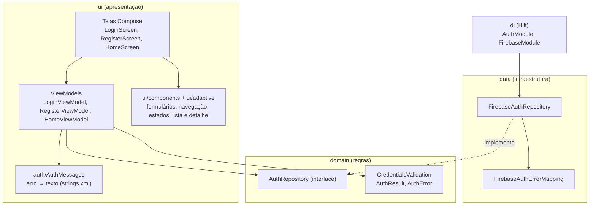
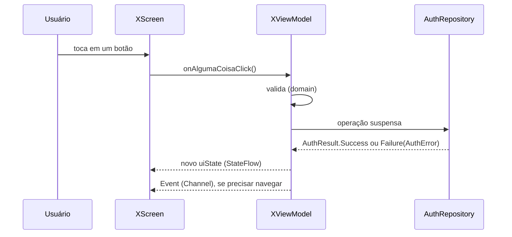
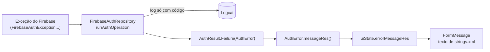
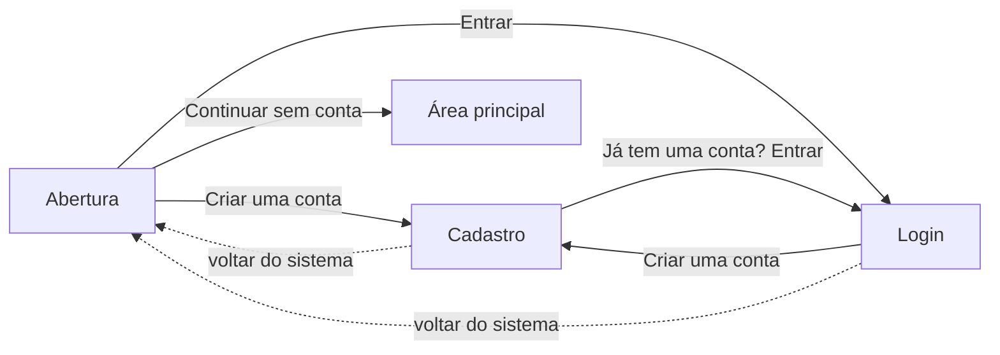

# Arquitetura do ORI

Este documento explica como o código do ORI está organizado e por quê.
Ele descreve **o que existe hoje**; o que ainda não foi feito aparece em
[Limitações conhecidas](#limitações-conhecidas).

## Visão geral do repositório

| Parte | Tecnologia | Situação |
|---|---|---|
| `android/` | Kotlin, Jetpack Compose, Hilt, Firebase Authentication | Abertura, cadastro, login e recuperação de senha |
| `functions/functions/` | Cloud Functions em TypeScript | Estrutura pronta, nenhuma função exportada |
| `web/` | Next.js | Template inicial, sem funcionalidades do ORI |

O app Android ainda **não grava dados** em nenhum banco (nem Firestore nem
Realtime Database). Apenas a conta de autenticação é criada no Firebase.

## Camadas do app Android

O app tem um único módulo Gradle (`:app`). As camadas são separadas por
**pacotes**, não por módulos, porque o projeto ainda é pequeno: mais módulos
aumentariam o tempo de configuração sem benefício real de isolamento.

**Direção das dependências:** `ui → domain ← data`. O pacote `domain` não
importa nada de `ui`, `data`, Android ou Firebase. Por isso suas regras são
testadas com JUnit puro, sem emulador.

### Pacotes

| Pacote | Responsabilidade |
|---|---|
| `domain/auth` | Contrato `AuthRepository` (inclui sessão e saída), `RegisterAccount`, `AuthResult`, `AuthError` e validação |
| `domain/session` | `SessionState` e `sessionStateFor()`: combina identidade e perfil |
| `domain/profile`, `domain/routine`, `domain/aac`, `domain/carelink`, `domain/preferences` | Modelos e contratos de perfil, rotina, comunicação (pranchas, mensagem, voz), vínculos e convites (com `CareLinkSide`, o lado do vínculo que cada tela mostra), e preferências de exibição e de comunicação |
| `domain/photos` | Fotos escolhidas pela pessoa, para símbolos e para o perfil: `PhotoStore`, `StoredPhoto`, erros de importação e `CloudPhotoRepository` (a cópia na conta) |
| `domain/common` | `DataResult` e `DataError`, usados por todos os repositórios de dados, e `AppLocale.kt`: o idioma padrão, os idiomas traduzidos e a escolha do idioma das datas e da voz (veja [idiomas.md](idiomas.md)) |
| `domain/model` | `TaskStatus` (deveria estar em `domain/routine`: ver G1 em [revisao-de-codigo.md](revisao-de-codigo.md)) |
| `domain/local` | `LocalDataStore` e `MoveLocalDataToAccount`: dados sem conta e a passagem deles para a conta |
| `domain/reports` | Cálculo dos relatórios ([funcionalidades/relatorios.md](funcionalidades/relatorios.md)) |
| `data/local` | Banco Room, repositórios locais e `Routed*Repository`, que escolhem entre aparelho e conta pelo dono dos dados |
| `data/auth` | `FirebaseAuthRepository`, a única classe que conhece o Firebase Auth |
| `data/firestore` | Nomes de coleções e campos (`FirestoreSchema`), conversão documento ↔ modelo e mapeamento de erros |
| `data/profile`, `data/routine`, `data/aac`, `data/carelink`, `data/preferences` | Repositórios Firestore, Cloud Functions (convites) e DataStore; na CAA, também a voz (TextToSpeech); na rotina, as leituras compartilhadas entre as telas |
| `data/photos` | `DevicePhotoStore` (reduz e guarda as fotos no aparelho) e `FirestoreCloudPhotoRepository` (a cópia na conta) |
| `di` | Módulos Hilt: `FirebaseModule` (Auth, Firestore, Functions), `AuthModule` e `DataModule` |
| `ui/app` | `OriApp` (raiz guiada pela sessão), `session/SessionViewModel`, `main/MainScaffold` (área principal) |
| `ui/app/screens/<feature>` | Uma pasta por tela: `XScreen.kt` (Route + Screen), `XViewModel.kt`, `XUiState.kt` |
| `ui/app/screens/auth` | Conversão de erros em textos (`@StringRes`) e `AuthFormScaffold` comum a login e cadastro |
| `ui/app/screens/routine`, `ui/app/screens/aac` | Telas e componentes da rotina e da comunicação (CAA); ver [funcionalidades/rotina.md](funcionalidades/rotina.md) e [funcionalidades/caa.md](funcionalidades/caa.md) |
| `ui/app/screens/account`, `carelinks`, `carerecipients`, `preferences` | Perfil, foto, vínculos, convites, pessoas acompanhadas e configurações; ver [funcionalidades/perfil-e-conta.md](funcionalidades/perfil-e-conta.md) |
| `ui/app/screens/today`, `reports` | Início e Relatórios; ver [funcionalidades/relatorios.md](funcionalidades/relatorios.md) |
| `ui/components/<categoria>` | Componentes visuais reutilizáveis, sem regra de negócio: `text`, `form`, `navigation`, `card`, `list`, `dialog`, `state`, `settings`, `brand`, `icon`, `photo` |
| `ui/adaptive` | `WindowLayout` (regras de layout por tamanho de janela), lista e detalhe e contêineres responsivos |
| `ui/theme` | Tokens: cores dos temas claro e escuro, tipografia, espaçamento, formas, `OriMotion`, `OriAppearance` e `OriTheme`, que aplica as preferências |
| `ui/preview` | Anotações `@OriPreview` e `@OriPreviewDark` |

## Padrão de cada tela

Cada tela segue o mesmo formato, para que quem conhece uma entenda todas:

1. **`XRoute`** (com estado): obtém o ViewModel pelo Hilt, observa o `uiState`
   com `collectAsStateWithLifecycle` e escuta os **eventos** de navegação.
2. **`XScreen`** (sem estado): recebe o estado e uma função para cada ação do
   usuário. Pode ser vista no preview sem Hilt e sem Firebase.
3. **`XViewModel`**: guarda o estado em um `StateFlow` imutável e expõe funções
   `onAlgumaCoisa()`. Navegação é enviada uma única vez por um `Channel`.
4. **`XUiState`**: `data class` com tudo que a tela precisa desenhar.

## Tratamento de erros

Os erros seguem um caminho único, do Firebase até o texto na tela:

- O repositório **nunca lança exceção** para falhas esperadas: devolve
  `AuthResult.Failure`. Assim o ViewModel é obrigado a tratar o erro (`when`).
- O log técnico registra **só o código ou o nome da exceção**. A mensagem da
  exceção pode conter o e-mail do usuário, por isso não é registrada.
- `CancellationException` é relançada para não quebrar o cancelamento de corrotinas.
- Senha errada e conta inexistente viram o mesmo erro (`INVALID_CREDENTIALS`),
  para que a tela não revele quais e-mails têm conta.
- Erros de validação (`CredentialsValidationError`) são detectados antes de
  qualquer chamada de rede e usam o mesmo caminho até a tela.

## Injeção de dependências

O Hilt é usado onde ele reduz acoplamento:

- `FirebaseModule` cria **um** `FirebaseAuth` para o app inteiro.
- `AuthModule` diz ao Hilt que quem pedir `AuthRepository` recebe
  `FirebaseAuthRepository`. Os ViewModels só conhecem a interface.
- Nos testes, os ViewModels são criados diretamente com `FakeAuthRepository`
  (sem Hilt), o que mantém os testes rápidos e simples.

## Navegação

A raiz do app é o `OriApp`, que mostra uma área diferente para cada `SessionState`. Em volta dele (e da tela
inicial do ORI Home) fica `OriDialogHost`, onde os diálogos são desenhados, na mesma janela: veja
[design-system.md](design-system.md) ("Diálogos").

- **Deslogado:** pager da Home, descrito abaixo.
- **Sem perfil:** "Complete seu perfil".
- **Ativo (com ou sem conta):** `MainScaffold` com navegação adaptativa e quatro áreas iguais para todos: Início, Rotina, Comunicar e Perfil. Tarefas e Relatórios abrem a partir do Início; Dados pessoais, Responsáveis, Acompanhados e Configurações, a partir do Perfil. Cada área abre suas subtelas com `rememberOpenSubscreen`: uma de cada vez, guardada se o app for fechado em segundo plano e fechada pelo "voltar" do sistema.

Detalhes em [funcionalidades/perfis-e-permissoes.md](funcionalidades/perfis-e-permissoes.md).
Leituras, escritas, comportamento offline e ambientes estão em [dados.md](dados.md).

Área deslogada: um único pager (`HomeScreen`) com três páginas. Cada tela existe
uma vez só, e não há outra navegação antes do login.

Depois do login ou do cadastro, nada é navegado aqui: a sessão muda e o `OriApp`
troca a área inteira.

## Verificações

| Onde | Comando | O que verifica |
|---|---|---|
| `android/` | `./gradlew detekt` | Análise estática e formatação Kotlin (regras ktlint) |
| `android/` | `./gradlew detekt -PdetektAutoCorrect` | Corrige a formatação automaticamente |
| `android/` | `./gradlew testDevDebugUnitTest` | Testes de domínio, ViewModels e testes de UI Compose na JVM (Robolectric) |
| `android/` | `./gradlew lintProdDebug` | Android Lint |
| `android/` | `./gradlew assembleDevDebug assembleProdDebug` | Build dos APKs (`dev` usa o emulador do Firebase; `prod`, o projeto real) |
| `android/` | `./gradlew assembleProdProfiling` | O release com R8 e perfis de baseline, assinado com a chave de depuração: o build para medir a fluidez num aparelho |
| `web/` | `npm run format:check`, `npm run lint`, `npm run build` | Prettier, ESLint, build |
| `functions/functions/` | `npm run lint`, `npm run build` | ESLint (estilo Google), TypeScript |
| `functions/security-tests/` | `npm run format:check`, `npm test` | Prettier; regras do Firestore e Cloud Functions no emulador (precisa de Java) |

O GitHub Actions (`.github/workflows/ci.yml`) executa todas essas verificações
em cada pull request e em cada push na `main`.

## Como adicionar uma nova feature sem quebrar as existentes

1. Regras e contratos novos vão em `domain/<feature>` (Kotlin puro, sem Android).
2. Acesso a Firebase vai em `data/<feature>`, implementando o contrato do domínio.
3. Ligue implementação e contrato em um módulo Hilt em `di/`.
4. Crie `ui/app/screens/<feature>/` com Route, Screen, ViewModel e UiState.
5. Reutilize os componentes de `ui/components` e `ui/adaptive` (ver [design-system.md](design-system.md)) e os textos de `strings.xml`.
6. Escreva testes em `src/test` espelhando o pacote, usando fakes.
7. Rode as verificações da tabela acima e atualize esta documentação.

## Limitações conhecidas

- As Cloud Functions de convite ainda **não foram publicadas**; as regras do Firestore já foram.
- Falhas e gambiarras conhecidas, com a correção sugerida: [revisao-de-codigo.md](revisao-de-codigo.md).
- O modo escuro não está implementado (ver [design-system.md](design-system.md)).
- A espera de 5 segundos na abertura não pode ser pulada.
