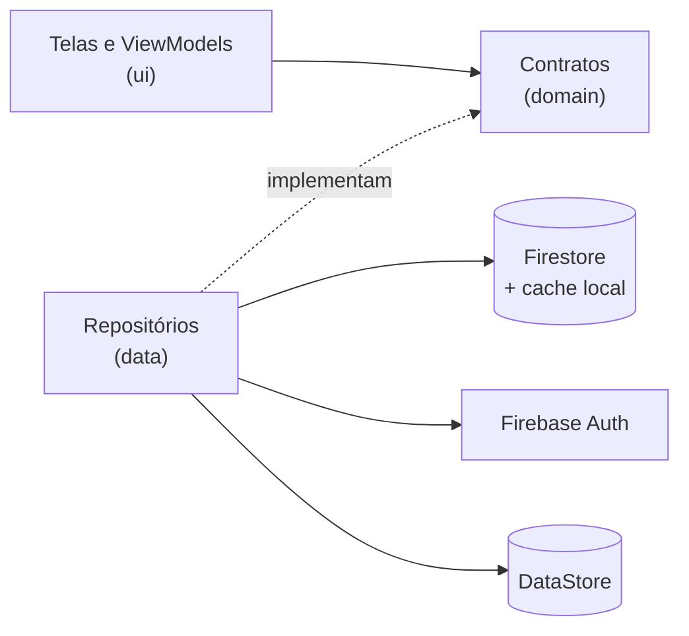
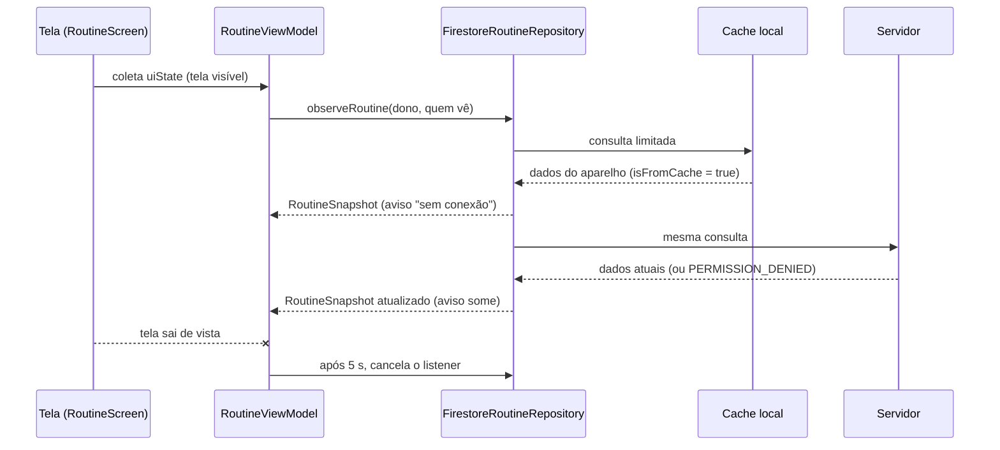
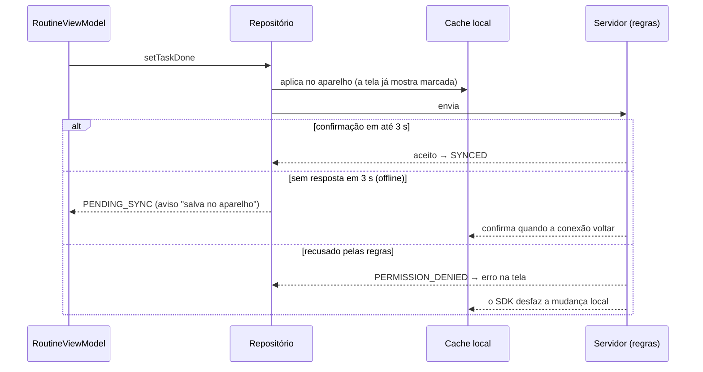

# Camada de dados

Este documento explica como o ORI lê e grava dados: os contratos entre telas e
infraestrutura, o modelo no Firestore, as regras de propriedade, o comportamento
sem internet, os custos, os ambientes e como o esquema pode evoluir.

> **Situação:** implementado e parcialmente testado.
> - Regras e funções: testadas no emulador (45 testes).
> - Políticas offline e ViewModels: testados na JVM com tempo virtual.
> - Repositórios Firebase do Android **não** têm teste automatizado contra o
>   emulador, e o comportamento offline não foi verificado em aparelho.
>   Veja [Limitações](#10-limitações).

## 1. Contratos: telas nunca falam com o Firebase



| Contrato (`domain`) | Implementação (`data`) | Fonte |
|---|---|---|
| `AuthRepository` | `FirebaseAuthRepository` | Firebase Auth |
| `ProfileRepository` | `FirestoreProfileRepository` | `users/{uid}` |
| `RoutineRepository` | `FirestoreRoutineRepository` | `users/{uid}/routineTasks` |
| `CareLinkRepository` | `FirestoreCareLinkRepository` | `careLinks` |
| `InvitationRepository` | `FirestoreInvitationRepository` | `invitations` e `invitationOwners` (só online) |
| `DisplayPreferencesRepository` | `DataStoreDisplayPreferencesRepository` | DataStore local |
| `DevicePreferencesRepository` | `DataStoreDevicePreferencesRepository` | DataStore local (inclui a cópia das preferências da conta) |
| `AccountPreferencesRepository` | `FirestoreAccountPreferencesRepository` | Firestore |

- **Nenhum arquivo fora de `data/` e `di/` importa SDKs do Firebase ou do DataStore.**
  Isso foi verificado por busca no código.
- Todo resultado é um valor: `DataResult.Success` ou `DataResult.Failure(DataError)`.
- Escritas devolvem `WriteStatus`: `SYNCED` quando o servidor confirmou, ou
  `PENDING_SYNC` quando a mudança está salva no aparelho e ainda vai ser enviada.
- Nos testes, cada contrato é substituído por um fake (`testing/FakeRepositories.kt`).

## 2. Modelo dos dados

```text
users/{uid}                                   dono: uid
  displayName, createdAt (perfis antigos também têm role, que nada lê)

users/{uid}/routineTasks/{taskId}             dono: uid (usuário principal)
  title, date ("AAAA-MM-DD"), scheduledTime ("HH:MM" | null), description,
  status, ownerCanComplete, isDone, completedBy, completedAt,
  createdBy, createdAt, updatedAt

careLinks/{caregiverUid}_{primaryUserUid}     dois participantes
  caregiverUid, primaryUserUid, caregiverName, primaryUserName,
  status, permissions { viewRoutines, manageRoutines, manageCommunication },
  createdAt, revokedAt, invitationCode (o código aceito; vínculos antigos não têm)

users/{uid}/aacBoards/{boardId}              dono: uid (usuário principal)
  name, position, language (opcional), createdBy, createdAt, updatedAt
users/{uid}/aacBoards/{boardId}/symbols/{id}
  label, phrase, image ("emoji:…" | "device:….jpg" | null), position,
  createdBy, createdAt, updatedAt
users/{uid}/settings/preferences             só o dono
  textScale, theme, simplified, motion, updatedAt
users/{uid}/aacSavedMessages/{id}            só o dono
  text, language (opcional), emoji (opcional), position (opcional), createdAt

invitations/{código}                          quem convida cria; quem aceita marca como usado
  caregiverUid, caregiverName, status, createdAt, expiresAt, acceptedBy, acceptedAt
invitationOwners/{uid}                       só o dono: o último código dele
  code, createdAt
```

Os campos e valores válidos estão em `FirestoreSchema.kt` (Android) e em
`functions/firestore.rules`. Os dois precisam mudar juntos.

**Por que a rotina é uma subcoleção do dono?** O caminho já diz de quem são os
dados. Assim, a regra de propriedade é uma comparação simples
(`request.auth.uid == uid`), e excluir uma pessoa remove os dados dela junto.

## 3. Regras de propriedade

| Dado | Quem lê | Quem grava |
|---|---|---|
| Perfil | O dono; quem tem vínculo ativo com ele | O dono cria uma vez; depois só altera o nome |
| Rotina | O dono (tudo); responsável com `viewRoutines` (só tarefas `active`) | O dono cria, edita e exclui as que **ele** criou; responsável com `manageRoutines` gerencia as visíveis; o dono só conclui as do responsável com `ownerCanComplete` (detalhes em [funcionalidades/rotina.md](funcionalidades/rotina.md)) |
| Pranchas e símbolos | O dono; responsável com `manageCommunication` | Os mesmos; fotos (`device:`) só o dono adiciona (detalhes em [funcionalidades/caa.md](funcionalidades/caa.md)) |
| Frases salvas | Só o dono | Só o dono cria e exclui; depois de salva, só o emoji e o lugar (`position`) mudam |
| Preferências da conta | Só o dono | Só o dono grava; nunca são apagadas (detalhes em [funcionalidades/preferencias.md](funcionalidades/preferencias.md)) |
| Vínculo | Os dois participantes | Só quem aceita um convite válido cria, junto com o convite; qualquer participante encerra; só o usuário principal muda permissões |
| Convite | Um por vez, pelo código (nunca uma lista), por quem tem perfil | Quem convida cria e apaga; quem aceita só marca como usado, no mesmo lote do vínculo |

O detalhamento, com os testes, está em
[funcionalidades/perfis-e-permissoes.md](funcionalidades/perfis-e-permissoes.md).

## 4. Consultas, índices e custo

| Consulta | Filtros e ordem | Limite | Índice |
|---|---|---|---|
| Perfil | `users/{uid}` (1 documento) | — | — |
| Dia da rotina (dono) | `date == dia` | 100 | Automático |
| Dia da rotina (responsável) | `date == dia` + `status == active` | 100 | Automático (só igualdades; o Firestore combina índices simples) |
| Conferência de duplicatas | mesma consulta do dia, uma leitura (`get`) ao salvar | 100 | idem |

A ordem do dia (horário, depois nome) é aplicada no domínio (`forDay()`), não na
consulta. Assim não é preciso índice composto, e um dia tem no máximo 100 itens.
| Vínculos | `caregiverUid` ou `primaryUserUid == eu` + `status == active` | 50 | Automático (igualdades) |

- **Toda lista tem limite, e o servidor exige isso.** As regras recusam uma lista
  sem `limit` ou com limite maior (`request.query.limit <= 100` para rotina e
  `<= 50` para vínculos). Há testes para isso no emulador.
- **Paginação:**
  - Hoje uma rotina diária cabe em uma página de 100. Quando o limite é atingido,
    a tela avisa "Mostrando as primeiras 100 atividades".
  - Quando surgirem coleções que crescem sem parar (por exemplo, histórico de
    conclusões), a paginação será por cursor: `orderBy(campo, id)` com
    `startAfter(último)`, uma página por vez e sem listener.
- **Listeners só com a tela visível:**
  - Cada ViewModel expõe o estado com `stateIn(WhileSubscribed(5 s))`. O listener
    do Firestore para 5 segundos depois de a tela sair de vista (ou de o app ir
    para segundo plano) e volta quando ela reaparece.
  - A rotina é lida uma vez por dia, mesmo com Início, Tarefas e Rotina abertas
    em sequência, e as repetições uma vez por pessoa. Essa leitura compartilhada
    para 1 s depois da última tela (veja "Uma leitura por dia" em
    [rotina.md](funcionalidades/rotina.md)).
  - A sessão observa um único documento (o perfil).
- **Custo de leitura:**
  - Um listener cobra a leitura inicial dos documentos e, depois, só os
    documentos que mudam.
  - Mudanças apenas de metadados (cache → servidor, pendente → confirmado) não
    geram leituras cobradas.
  - Reabrir a tela depois de mais de 30 minutos cobra a leitura de novo.

**Vários dias numa consulta (03/11/2026):** relatórios e as marcas do mês leem um intervalo de `date` numa consulta, página de 100. O dono usa o índice automático de `date`; quem acompanha filtra também `status`, que usa o índice composto `routineTasks (status, date)` de `functions/firestore.indexes.json`. Até o índice ficar pronto depois de publicado, só as marcas do mês de quem acompanha deixam de aparecer.

**Esquema do banco local:** o Room exporta o esquema para `android/app/schemas` a partir da versão 3. Uma migração nova pode ser conferida contra o esquema antigo com `MigrationTestHelper`. A versão 4 (08/11/2026, `MIGRATION_3_4`) acrescenta a coluna `language` às pranchas e às frases salvas; o teste é `OriDatabaseMigrationTest`.

**Idioma das pranchas e frases (08/11/2026):** o campo `language` foi acrescentado como manda a seção 7: opcional, aceito pelas regras publicadas antes da versão do app que o grava, e ausente nos documentos de antes, que são lidos como português (`OLD_CONTENT_LANGUAGE`), o único idioma do app até então. Veja [caa.md](funcionalidades/caa.md#idioma-de-cada-prancha-e-frase-08112026).

**Limite de fotos:** continua conferido só pelo app. Um contador nas regras exigiria transação, que não funciona offline; o lugar certo é uma Cloud Function, quando houver o plano Blaze.

## 5. Fluxos de leitura e escrita

### Leitura (exemplo: rotina)



### Escrita (exemplo: marcar atividade como concluída)



## 6. Comportamento offline

| Situação | O que acontece |
|---|---|
| Abrir o app sem internet, com perfil já lido antes | O perfil vem do cache e o app abre normalmente |
| Abrir sem internet e sem perfil no cache | Espera o servidor por até 8 s; depois mostra "Sem conexão" com "Tentar novamente". Quando a conexão volta, o listener atualiza sozinho. Antes, este caso carregava para sempre |
| Ver a rotina sem internet | Mostra a última versão salva, com o aviso "Mostrando a última versão salva no aparelho" |
| Mudar algo com internet | A mudança aparece na hora. Nenhum aviso aparece: por um instante ela está "esperando o servidor", e avisar isso só faria uma frase piscar |
| Marcar atividade sem internet | Fica marcada na hora, com o aviso "Alteração salva no aparelho"; é enviada depois |
| Encerrar vínculo ou mudar permissão sem internet | Mesmo comportamento: aplicado no aparelho e enviado depois. **O acesso do responsável só é cortado no servidor quando a mudança chegar lá** |
| Gerar ou aceitar convite sem internet | Falha em até 15 s com "Sem conexão". Não há fila: o vínculo só existe se o servidor confirmar |
| Criar perfil sem internet | A gravação fica pendente e o app segue com o perfil local. Se o servidor recusar ao sincronizar, a sessão volta para "Complete seu perfil" |

### Política adotada

- **Cache:** o cache persistente do próprio Firestore, limitado a **50 MB**. Acima
  disso, o SDK descarta os documentos menos usados.
- **Persistência local de preferências:** DataStore, que não depende de conta.
- **Sincronização:** feita pelo SDK. As escritas ficam em fila no aparelho e são
  enviadas em ordem quando a conexão volta, mesmo que o app tenha sido fechado.
- **Repetição:**
  - O app não cria laços de repetição próprios. O SDK já repete as escritas do
    Firestore.
  - Gerar e aceitar convite são repetidos pela pessoa ("Tentar novamente") e são
    **idempotentes**: aceitar de novo um convite que já deu certo devolve sucesso,
    sem duplicar o vínculo, e gerar de novo mostra o mesmo código enquanto ele
    tiver pelo menos uma hora de validade.
- **Conflitos:**
  - As escritas alteram **só os campos necessários** (`update`), então mudanças
    em campos diferentes não se sobrescrevem. Exemplo: o responsável edita o
    título enquanto o usuário marca a conclusão.
  - No mesmo campo, vence a última escrita que chegar ao servidor.
  - Transições que não podem voltar atrás são garantidas pelas regras, não pela
    ordem de chegada. Exemplo: um vínculo encerrado nunca é reativado por um
    cliente.
  - A criação de vínculo usa transação no servidor.

### Dois lugares, sem duplicar a sincronização

- **Com conta, o Firestore continua sendo a fonte:** o cache dele já oferece leitura offline, fila de escrita e desfazer quando o servidor recusa. Refazer isso em Room traria o risco de dois estados diferentes para o mesmo dado.
- **Sem conta, os dados ficam em Room** (`data/local`). Não há servidor a sincronizar, e o cache do Firestore não serve como armazenamento, pois pode descartar documentos.

Os dois nunca guardam o mesmo dado ao mesmo tempo: `MoveLocalDataToAccount` tira cada item do Room depois da confirmação do servidor. Fluxo completo em [uso-local.md](funcionalidades/uso-local.md).

Mídias e a contagem de uso da CAA ficam em Room também para quem tem conta, porque nunca saem do aparelho.

## 7. Estratégia de evolução do esquema

1. **Mudanças só aditivas.** Um campo novo é opcional para quem lê. O
   `FirestoreSchema` ignora campos que não conhece e trata ausência com um valor
   seguro (por exemplo, permissão ausente = "não pode").
2. **Regras antes do app.** Como as regras usam `hasOnly`, um campo novo precisa
   ser aceito pelas regras **publicadas antes** da versão do app que o grava. Do
   contrário, as escritas do app novo são recusadas.
3. **Nunca renomear nem mudar o tipo no lugar.** Crie o campo novo, grave os dois
   durante a transição, migre os documentos antigos com um script Admin SDK ou uma
   função, e só então pare de ler o antigo.
4. **Valores de enum** (`status`) também são aditivos. Um valor que o app
   não conhece vira `null` no mapeamento e o documento é ignorado com segurança.
5. **Versões antigas do app** continuam funcionando enquanto as regras aceitarem
   o formato delas. Exceção feita de propósito em 03/11/2026: perfis novos não aceitam
   mais `role`, então um app anterior a essa data não consegue criar perfil. O app
   ainda não foi distribuído, então só aparelhos de teste foram afetados. Remover um formato exige versão mínima do app (forçar
   atualização), o que ainda não existe. Isso vale também para **leituras**: regras
   publicadas valem na hora para todas as versões instaladas. Quando as regras
   passaram a exigir `limit`, um app anterior a essa mudança, com consultas sem
   limite, passou a mostrar "sem permissão" em todas as telas. Antes de investigar um
   erro assim, confira no Logcat (`Listen for Query`) qual consulta foi recusada e se o
   aparelho tem a versão atual.
6. **Toda mudança de esquema** vem com teste em `functions/security-tests` e com
   a atualização deste documento e do `FirestoreSchema.kt`.

## 8. Ambientes

| | `dev` | `staging` | `prod` |
|---|---|---|---|
| Android | Flavor `dev`, pacote `com.oriteam.ori.dev` | Flavor `staging`, `com.oriteam.ori.staging` | Flavor `prod`, `com.oriteam.ori` (padrão no Studio) |
| Firebase | Emulator Suite local, projeto `demo-ori` | Projeto de homologação (a criar) | `oriteam-ori` |
| Configuração | `app/src/dev/google-services.json` (fictício, só para emulador) | `app/src/staging/google-services.json` (ausente) | `app/src/prod/google-services.json` |
| CLI (`functions/.firebaserc`) | alias `dev` | — | alias `prod` / `default` |

- Os três apps podem ficar instalados juntos, porque os pacotes são diferentes.
- `dev` aceita HTTP sem criptografia **só** para `10.0.2.2`, `127.0.0.1` e
  `localhost` (`src/dev/res/xml/network_security_config.xml`).
- **Usar o ambiente dev:**
  1. Em `functions/`, rode `npm --prefix functions run build` e depois
     `firebase emulators:start --project demo-ori`. A interface do emulador fica
     em http://localhost:4000.
  2. No Android Studio, escolha a variante `devDebug`.
  3. Em celular físico, rode `adb reverse tcp:9099 tcp:9099`, repita para as
     portas `8080` e `5001`, e compile com `-PoriEmulatorHost=127.0.0.1`.
- **Staging:**
  - **Bloqueado por configuração externa.** É preciso criar um projeto Firebase
    de homologação, registrar o app `com.oriteam.ori.staging`, colocar o
    `google-services.json` em `app/src/staging/` e adicionar o alias em
    `.firebaserc`.
  - Até lá, as variantes `staging` ficam desativadas pelo Gradle.

## 9. Testes

| Onde | O que | Como |
|---|---|---|
| `functions/security-tests` (emulador) | Regras: propriedade, permissões, limite obrigatório de consultas. Convites feitos pelo app (`careInvitations.test.mjs`); as funções guardadas para o plano Blaze (`invitationFunctions.test.mjs`) | `npm test` |
| `FirestorePoliciesTest` (JVM, tempo virtual) | Escrita confirmada, pendente (sem travar) e recusada; perfil que espera o servidor, desiste em 8 s e se recupera | `./gradlew testDevDebugUnitTest` |
| `FirestoreSchemaTest` | Conversão documento ↔ modelo, valores iguais aos das regras, mapeamento de erros | idem |
| `SignedInViewModelsTest`, `SessionViewModelTest` | ViewModels com repositórios falsos: avisos offline, limite atingido, alteração pendente, erros de permissão | idem |

Para confirmar que os testes pegam falhas reais, removi temporariamente o
limite da regra da rotina. O teste "unbounded or oversized routine queries are
rejected" falhou, e a regra foi restaurada.

## 10. Limitações

- Os repositórios Android não têm testes automatizados contra o Emulator Suite.
  Eles foram cobertos por fakes, pelos testes das regras e pelos testes das
  políticas puras.
- O comportamento offline foi projetado e testado em partes, mas não verificado
  em aparelho (modo avião).
- Encerrar um vínculo offline só corta o acesso quando a escrita chega ao servidor.
- O cache não é apagado ao sair da conta. Ele não é compartilhado entre contas
  pelas consultas, porque cada uma lê só os próprios caminhos, mas os dados
  continuam no aparelho.
- Não há paginação por cursor: nenhuma coleção atual precisa dela.
- Convites expirados só são limpos automaticamente depois de ligar a política de
  TTL no campo `expiresAt` (console do Firebase). Até lá, cada pessoa deixa no
  máximo um código, porque um código novo apaga o anterior.
- As Cloud Functions não são usadas pelo app (exigiriam o plano Blaze), e o ambiente
  de staging não existe.

## Fotos

Fotos de perfil e de símbolos ficam no Firestore, em `users/{dono}/photos/{id}`, uma por documento, como bytes. Sem conta, ficam só no aparelho.

**Por que no Firestore:** o Cloud Storage exige o plano Blaze. **Por que documentos separados:** uma prancha é lida como lista, e 60 fotos dentro dela viriam junto em toda leitura.

| Limite | Valor | Onde é garantido |
|---|---|---|
| Tamanho de uma foto | 100 KB | No app, ao reduzir, e nas regras, que recusam acima de 102.400 bytes |
| Maior lado | 512 px | No app |
| Fotos por pessoa | 100, ou seja, no máximo 10 MB | Só no app: as regras não conseguem contar documentos |

**Como o tamanho é respeitado:** a foto é reduzida para 512 px em JPEG. Se passar de 100 KB, a qualidade cai (85, 70, 55, 40) e, se ainda não couber, a imagem diminui (`compressedWithinLimit`).

**Custo:** o plano gratuito tem 1 GiB de armazenamento, cerca de 10 mil fotos no limite máximo; a maioria fica perto de 50 KB. Cada foto baixada conta como uma leitura. O aparelho guarda uma cópia e só baixa o que não tem (`fetchMissing`).

**Limitações:**
- Sem internet, a contagem não acontece e a foto entra na fila; o limite de 100 pode ser ultrapassado até a próxima conexão.
- Quem usa outro app contra a API poderia passar de 100 fotos, mas nunca de 100 KB por foto.
- Apagar uma prancha remove as fotos dela, mas fotos de símbolos trocados por um responsável ficam na conta até a pessoa apagá-las.
- As cópias ficam no armazenamento privado do app, mesmo depois de sair da conta.

## Avisos de conexão

"Sem conexão. Mostrando a última versão salva" e "Alteração salva no aparelho. Ela será enviada quando houver conexão." só aparecem quando a situação dura mais de 3 segundos (`withLastingSyncNotice`, em `ui/app/screens/common/SyncNotices.kt`). É o mesmo tempo que uma gravação espera o servidor antes de contar como pendente.

**Por quê:** com internet, toda mudança fica "pendente" por uma fração de segundo, até o servidor confirmar, e um dia abre primeiro com a cópia do aparelho. Mostrar o aviso nesses casos fazia a frase piscar. Os dados não esperam: só o aviso.

**Onde vale:** rotina, Tarefas e Organizar pranchas. Os avisos de gravação da comunicação, das preferências e dos vínculos já esperavam a resposta do servidor por 3 segundos.

## Banco local versão 5 e campos novos (09/11/2026)

- **Room 5 (`MIGRATION_4_5`):** `saved_messages.emoji`, `aac_symbols.color` e `aac_symbols.wordClass`, todos opcionais
  (o que já existe fica sem valor e continua como antes). Esquema exportado em `app/schemas/.../5.json`. Teste:
  `OriDatabaseMigrationTest`.
- **Firestore:** `aacSavedMessages/{id}.emoji` (opcional; a única coisa que muda depois de salvar), `symbols/{id}.color`
  e `symbols/{id}.wordClass` (valores fixos, conferidos pelas regras) e `routineSeries/{id}.repeat` aceita
  `monthly_day`. Nada disso pede índice novo.

## Banco local versão 6 e ordem das frases (12/11/2026)

- **Room 6 (`MIGRATION_5_6`):** `saved_messages.position`, opcional. O que já existe fica sem posição e continua na
  mesma ordem (a mais nova em cima). Esquema em `app/schemas/.../6.json`. Teste: `OriDatabaseMigrationTest`.
- **Firestore:** `aacSavedMessages/{id}.position` (opcional, inteiro de 0 a 999). A consulta continua ordenada só por
  `createdAt`, sem índice novo; a ordem escolhida é aplicada depois de ler. Veja
  [caa.md](funcionalidades/caa.md#pedidos-de-12112026-soltar-no-lugar-e-ordem-das-frases).

## Consentimento, exportação e exclusão da conta (09/11/2026)

- **`users/{uid}/legal/consent`:** `version`, `isAdult`, `guardianConsent`, `acceptedAt`. Só a pessoa lê e grava;
  pode ser gravado antes do perfil (o consentimento vem antes de qualquer dado). Cópia no DataStore do aparelho
  (`legal_consent_<uid>`), para o app abrir offline.
- **`users/{uid}.deletingAt`:** marca do perfil enquanto a conta é apagada; com ela, as regras deixam a dona apagar
  as atividades reservadas por um responsável.
- **Regras novas:** a dona apaga o perfil e as preferências da conta; um vínculo encerrado pode ser apagado por
  qualquer uma das duas pessoas. Testes: `functions/security-tests/test/accountDeletion.test.mjs`.
- Veja [legal/README.md](legal/README.md) para o fluxo completo.
