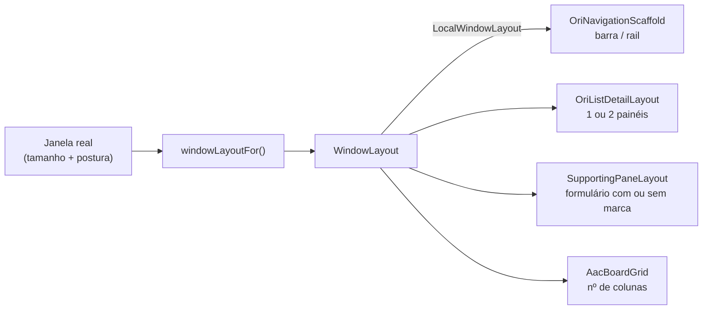
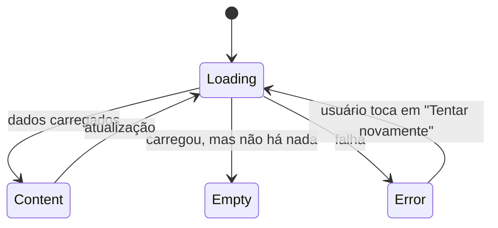

# Sistema visual e layouts adaptativos

Este documento explica a base visual compartilhada do app Android: tokens de
design (cores, tipografia, espaçamento), componentes reutilizáveis e as regras
que adaptam as telas ao espaço disponível da janela.

> **Situação:** implementado e parcialmente testado. Os componentes e as regras
> têm testes automatizados na JVM (Robolectric). **Não** foram verificados em
> aparelho físico, emulador, dobrável real nem com o teclado virtual aberto.
> Veja [Cenários testados](#cenários-testados).

## 1. Tokens de design

Os tokens ficam em `ui/theme` e são aplicados por `OriTheme`. Uma tela nunca
deveria escrever uma cor ou um tamanho de fonte "solto": ela pede um papel ao tema.

### Cores (`Color.kt`)

As cores originais do ORI foram mantidas e mapeadas para os papéis do Material 3.
Assim, componentes do Material (barra de navegação, rail, diálogos, switches)
já nascem com a identidade do ORI.

| Papel (`MaterialTheme.colorScheme`) | Cor do ORI | Uso |
|---|---|---|
| `primary` | `OriButtonCyan` #0082A3 nas telas de acesso; dentro do app, o teal #0F6E72 (#62C4BE no escuro) | Botões principais, foco, seleção |
| `background` | `OriBackground` #F2FAFE | Fundo das telas |
| `onBackground` / `onSurface` | `OriDarkBlue` #102A45 | Textos principais |
| `onSurfaceVariant` | #546E85, um tom abaixo de `OriSloganBlue` | Textos de apoio (veja "O que cada cor quer dizer") |
| `surface` | branco | Cartões, campos, diálogos |
| `secondaryContainer` | `OriDecorationArcThick` #E1EFF8 | Item selecionado, indicador da navegação |
| `outline` | `OriControlBorder` #7A8C9C (#5E7488 no escuro) | Borda do que se toca: campo de texto, escolha (chip), círculo de concluir, pontos de página. Tem pelo menos 3:1 sobre o fundo e o branco, o mínimo para um controle ser visto (WCAG 1.4.11) |
| `outlineVariant` | `OriCardBorder` #E5F0FA (#283A4B no escuro) | Só decoração: borda de cartão, linhas divisórias. Nunca a única borda de um controle |
| `error` / `tertiary` | #D32F2F / #2E7D32 | Erro / sucesso e "concluído" |

**Decisões:**
- As cores dinâmicas do Android 12+ (baseadas no papel de parede) foram
  desligadas, porque substituiriam a identidade visual do ORI.
- **Tema claro e escuro:** a pessoa escolhe em Preferências. As cores que o Material 3 não
  nomeia ficam em `LocalOriColors`, com uma versão para cada tema. Não use `Ori*` direto em
  telas: use os papéis do tema.
- **Modo escuro:** base no azul-marinho da marca (`#0C1824`, `#142230`), destaque teal profundo com texto claro (`strong`) e cores suaves escuras, mas saturadas o bastante para se ver no cartão. Para teal como texto ou linha sobre o fundo, use `strongOnSurface`, nunca `strong`. Os pares de contraste estão em `OriThemeRulesTest`, e os motivos em [revisao-de-design.md](revisao-de-design.md).
- **Aparência personalizável:** componentes leem `LocalOriAppearance` (animação, simplificação,
  espaçamento e listas). Veja [funcionalidades/preferencias.md](funcionalidades/preferencias.md).

### Tipografia (`Type.kt`)

As fontes são Nunito (marca) e Nunito Sans (interface). Os tamanhos dos papéis
são os mesmos das telas originais, então a aparência foi preservada. Todos os
tamanhos usam `sp` e acompanham o tamanho de fonte escolhido no sistema.

| Papel | Estilo | Onde aparece |
|---|---|---|
| `displayLarge` | Nunito ExtraBold 82 | Nome "ori" na abertura |
| `displaySmall` | Nunito Bold 28 | Nome "ori" no topo dos formulários |
| `headlineLarge` | Bold 32 | Título de tela (usuário principal) |
| `headlineMedium` | Bold 26 | Título de tela (responsável) |
| `headlineSmall` | Bold 21 | Frase da abertura, títulos de diálogo e de barra |
| `titleLarge` / `titleMedium` / `titleSmall` | Bold 19 / 17 / 15 | Estados vazios, cartões, itens de lista |
| `bodyLarge` / `bodyMedium` / `bodySmall` | 15 / 14 / 13 | Campos, subtítulos, textos de apoio |
| `labelLarge` | Bold 16 | Botões |
| `labelMedium` | Bold 14 | Rótulos de campo e links |
| `labelSmall` | SemiBold 13 | Mensagens de formulário, botão "Aa" |

A altura de linha é 1,4 × o tamanho da fonte, para que textos com várias linhas
continuem legíveis.

### Espaçamento e dimensões (`Dimensions.kt`)

- `OriSpacing`: 4, 8, 16, 24, 32, 48 dp. Use esses passos em vez de valores soltos.
- `OriDimensions.MinTouchTarget` = 48 dp: área mínima de toque.
- `OriDimensions.ControlMinHeight` = 52 dp: altura **mínima** de campos e botões.
  É mínima, não fixa: o controle cresce quando o texto ampliado precisa de mais espaço.
- `OriDimensions.FormMaxWidth` = 480 dp: largura máxima dos formulários.
- Formas: campos com cantos de 14 dp, cartões com 20 dp e botões totalmente arredondados.

## 2. Regras de responsividade

As decisões de layout dependem **do espaço da janela**, nunca do "tipo de aparelho".
Um celular deitado, um dobrável aberto e uma janela redimensionada no ChromeOS
seguem as mesmas regras.

### Como a janela é classificada

`currentWindowLayout()` lê o tamanho real da janela (`currentWindowSize()`) e a
postura do dobrável (`currentWindowAdaptiveInfo()`). Depois, `windowLayoutFor()`
classifica o tamanho com os limites do Material 3:

| Classe | Largura | Altura |
|---|---|---|
| Compacta | < 600 dp | < 480 dp |
| Média | 600–839 dp | 480–899 dp |
| Expandida | ≥ 840 dp | ≥ 900 dp |

O resultado é um `WindowLayout`, disponibilizado para todas as telas por
`LocalWindowLayout`. Quando a janela muda (rotação, divisão de tela, dobrável
aberto ou fechado, redimensionamento), o Compose recompõe tudo com o novo valor.

### Decisões tomadas a partir do `WindowLayout`

| Propriedade | Regra | Exemplos |
|---|---|---|
| `navigationLayout` | Barra inferior se a largura é compacta ou o dobrável está semiaberto (tabletop); rail em todos os outros casos. Até 07/11/2026 a largura expandida usava uma gaveta permanente, que ocupava cerca de um quarto do tablet para quatro destinos | Celular em pé: barra. Celular deitado: rail. Tablet em pé ou deitado: rail |
| `showsListAndDetailTogether` | Largura expandida | Tablet deitado e celular grande deitado mostram lista e detalhe lado a lado |
| `showsSupportingPane` | Largura expandida, ou largura média com altura compacta | Login e cadastro mostram a marca ao lado do formulário |
| `prefersHorizontalArrangement` | Altura compacta e largura não compacta | Abertura e prancha CAA lado a lado no celular deitado |
| `horizontalPadding` | 24 dp (compacta) ou 32 dp | Margens laterais |
| `aacSymbolMinWidth` | 96 (largura ou altura compacta) / 120 / 136 dp | Três colunas de símbolos num celular comum; mais colunas em telas largas |

Por que existe um `WindowLayout` próprio, em vez de usar a classe da biblioteca
diretamente? Porque assim as regras são funções puras, testadas sem tela
(`WindowLayoutTest`), e qualquer teste ou preview pode simular uma janela.



### Barras do sistema, recortes e teclado

- O app desenha de ponta a ponta (`enableEdgeToEdge`).
- As telas de formulário e a abertura usam `WindowInsets.safeDrawing`, que soma
  barra de status, barra de navegação, recorte da câmera e **teclado virtual**.
- O manifesto declara `adjustResize`. Com isso, o formulário encolhe quando o
  teclado abre e o campo em foco pode ser alcançado rolando.
- O `FillOrScrollColumn` ocupa a tela inteira quando o conteúdo cabe e passa a
  rolar quando não cabe (texto ampliado, janela baixa, teclado aberto).
- Na área principal (`MainScaffold`), a barra de baixo do celular já fica acima da barra do
  sistema. Com o trilho (tablets), nada fazia isso: o conteúdo agora se afasta também da
  barra de tarefas embaixo. Antes, o "Adicionar atividade" ficava metade embaixo dela (conferido
  no tablet SM-X610 em 07/11/2026).

## 3. Componentes

**Todo texto passa por `ui/components/text/Text.kt`.** É isso que faz o botão "Aa" valer em menus, listas, navegação e diálogos sem cada tela precisar lembrar. O detekt proíbe importar o `Text` do Material em outros arquivos (`ForbiddenImport`). Só o que é desenhado muda: valores salvos, senhas e o que é falado continuam como foram escritos.

Padrões vindos dos wireframes: `OriTopBar` (com "Aa"), `OriFilterTabs` (abas em pílula), `OriActionPill` (botão flutuante "+ Adicionar atividade"), `OriMenuRow` e `OriIconTile` (linhas de menu com ícone colorido). As cores suaves ficam em `LocalOriColors.accents` e somem na interface simplificada; `strong` é o teal das áreas internas, e o ciano segue nas telas de acesso.

**Uma cor para agir (09/11/2026).** Dentro do app, `OriAppColors` (em `MainScaffold`) troca o `primary` pelo teal:
botões, rádios, campos em foco e "Escolher" ficam da mesma cor que os dias da repetição, as abas e o "+ Adicionar
atividade" do wireframe. Antes, o ciano e o teal apareciam lado a lado com o mesmo papel, o que parecia falta de
acabamento. O ciano continua nas telas de acesso (entrada, cadastro), onde é a cor da marca. Teste:
`OriThemeRulesTest` ("inside the app the teal is the main color").

**Uma margem só.** Tudo começa na margem da janela (`WindowLayout.horizontalPadding`: 24 dp no celular, 32 dp em janelas maiores), que `CenteredContent` aplica:
- **Barra do topo:** o título, ou a seta de voltar, começa nessa margem, e o "Aa" termina nela.
- **Listas:** ficam dentro de `CenteredContent`, nunca com uma margem própria.
- **Títulos de seção e linhas de configuração:** não têm recuo extra. Começam na mesma borda dos campos e cartões.

**Um desenho para cada coisa:**

| O quê | Componente | Como é |
|---|---|---|
| Linha de lista ou de menu | `OriListItem`, `OriMenuRow` | O mesmo fundo, borda e cantos de `OriCard`, com a mesma altura pela densidade. O menu só acrescenta o quadrado colorido do ícone |
| Linha que abre outra tela | `OriOpenArrow` no fim | A seta → dos menus. Pranchas, acompanhados e menus a usam |
| Escolha de uma opção | `OriChoiceChip` | Escolhida na cor principal (`primary`), como os botões e os dias da repetição: um teal só nos dois temas (I11); as outras com contorno. Serve para abas (`OriFilterTabs`), pranchas (`BoardSelector`) e repetição |
| Título de seção | `SectionHeader` | `titleMedium`, cor do texto e alinhado à esquerda. Relatórios, Configurações, CAA e vínculos usam o mesmo |
| Atividade | `RoutineTimeline` | Horário à esquerda e cartão colorido, na Rotina e em Tarefas. A cor diz a parte do dia (`dayPartOf`), então é a mesma nas duas telas, com qualquer filtro e em todos os dias de uma repetição |

**Botões:** use sempre `OriPrimaryButton`, `LoadingButton`, `OriSecondaryButton` ou `OriTextButton` (`ui/components/form/OriButtons.kt`), nunca os do Material direto. Eles têm a mesma altura mínima (52 dp), o mesmo estilo de texto e largura total por padrão, e só mudam a ênfase. Lado a lado, ficam dentro de `EqualWidthRow`, que dá a mesma largura e altura a todos e passa para a linha de baixo se o texto não couber. As exceções são botões compactos com motivo: as ações da CAA, o "Hoje" do calendário, a linha "Ver o mês inteiro", os botões dos diálogos e o `OriActionPill`.

Os componentes genéricos ficam em `ui/components`. Os específicos de uma
funcionalidade (rotina, CAA) ficam no pacote da própria funcionalidade, para que
o sistema visual não vire um depósito de regras de negócio.

| Necessidade | Componente | Pacote | Comportamento adaptativo e de acessibilidade |
|---|---|---|---|
| Navegação principal | `OriNavigationScaffold`, `NavigationDestination` | `ui/components/navigation` | Barra ou rail conforme `navigationLayout`; rótulos sempre visíveis |
| Título de tela/painel | `OriTopBar` | `ui/components/navigation` | Título marcado como heading; botão voltar só quando há para onde voltar; título e "Aa" na margem do conteúdo |
| Indicador de páginas | `AnimatedPagerIndicator` | `ui/components/navigation` | — |
| Lista e detalhe | `OriListDetailLayout` | `ui/adaptive` | 1 ou 2 painéis; botão voltar do sistema volta à lista; evita a dobradiça de dobráveis; seleção sobrevive a rotação |
| Largura limitada | `CenteredContent` | `ui/adaptive` | Centraliza e limita a largura (padrão 480 dp) |
| Rolagem segura | `FillOrScrollColumn` | `ui/adaptive` | Preenche a tela ou rola |
| Painel de apoio | `SupportingPaneLayout` | `ui/adaptive` | Mostra um painel ao lado em telas largas ou baixas |
| Formulários | `LabeledTextField`, `PasswordTextField`, `FormMessage`, `LoadingButton`, `BrandHeader` | `ui/components/form` | Altura mínima (não fixa); mensagens anunciadas por leitores de tela; botão "Aa" com área de toque de 48 dp |
| Salvar e cancelar um formulário longo | `FormActionBar` | `ui/components/form` | Barra fixa embaixo, acima do teclado, com "Cancelar" e "Salvar" da mesma largura: quem preencheu só o primeiro campo não precisa rolar para terminar. Usada no formulário de atividade e no de símbolo |
| Datas no idioma do app | `rememberDateFormat`, `DateSkeletons`, `LocalAppLocale` | `ui/components/text/AppDates.kt` | O idioma escolhe a ordem e as palavras da data ("7 de novembro", "November 7"); veja [idiomas.md](idiomas.md) |
| Botão flutuante e o espaço dele | `ActionPillLayout`, `OriActionPill` | `ui/components/form` | Mede o botão e entrega a altura dele à tela, que a usa no fim da lista e embaixo do estado vazio: nada fica atrás do botão, também com texto ampliado |
| Hora no idioma do app | `rememberTimeFormat` | `ui/components/text/AppDates.kt` | "08:30" em português, "8:30 AM" em inglês dos EUA; a escolha de 12/24 horas do aparelho vale mais |
| Abertura de um formulário | `rememberFormOpening` | `ui/components/form/FormOpening.kt` | Um nome por abertura: o ViewModel do formulário só mantém o rascunho da mesma abertura (rotação, app fechado pelo sistema) e descarta o que foi deixado pelo voltar do sistema |
| Cartões | `OriCard` | `ui/components/card` | Sem sombra; versão clicável e versão destacada |
| Listas | `OriListItem`, `OriMenuRow`, `OriOpenArrow`, `SectionHeader` | `ui/components/list` | Texto quebra linha em vez de ser cortado; estado "selecionado" para lista e detalhe; seta para o que abre outra tela |
| Escolha de uma opção | `OriChoiceChip`, `OriFilterTabs` | `ui/components/form`, `ui/components/navigation` | Área de toque de 48 dp; anunciada como aba ou como opção de um grupo, com o estado "selecionado" |
| Diálogos | `OriConfirmationDialog`, `OriAlertDialog`, `OriDialog`, `OriDialogHost` | `ui/components/dialog` | Desenhados na janela da própria tela, sem o Android criar uma janela; anunciados pelo título, com a tela de trás escondida do leitor de tela; voltar e toque fora fecham; ação destrutiva em vermelho; cancelar sempre disponível |
| Estados | `ContentState`, `StatefulContent`, `LoadingState`, `EmptyState`, `ErrorState` | `ui/components/state` | Centralizados, com largura limitada e rolagem; erro anunciado |
| Partes mantidas | `outOfSightUnless`, `KeptUnder`, `rememberScreenRested` | `ui/components/state/KeptAhead.kt` | Uma parte cara (uma grade de 40 itens) fica montada fora de vista e só é mostrada quando pedida: não é desenhada, tocada nem lida enquanto escondida; `rememberScreenRested` diz quando montá-la antes, com a tela parada. Usadas em todos os apps do ORI Home e nas abas de Frases |
| Configurações | `SettingsSwitchItem`, `SettingsChoiceGroup`, `SettingsChoice` | `ui/components/settings` | A linha inteira é tocável; semântica de switch e de grupo de opções |
| Marca | `OriBrandBlock`, `OriDecorativeArcs` | `ui/components/brand` | Logo menor em janelas baixas |
| Rotina | `RoutineTimeline`, `DoneToggle`, `RoutineStepUiModel` | `ui/app/screens/routine` | O botão redondo marca como concluída, com estado anunciado ("Concluída"/"Pendente"); o resto do cartão abre os detalhes, quando há |
| Pranchas CAA | `AacBoardLayout`, `AacBoardGrid`, `AacSymbolTile`, `AacMessageBar`, `AacMessageActions`, `SymbolPicture`, `BoardSelector`, `MessageDisplayDialog` | `ui/app/screens/aac` | Colunas pela largura real, pelo tamanho escolhido e pelo texto do sistema (`aacGridSpec`); rótulo abaixo, acima, só texto ou só imagem; barra compacta (uma linha de mensagem, uma de ações, no máximo metade da altura); mensagem ao lado no celular deitado; mensagem em letras grandes sem voz |

**Onde são usados:** navegação, lista e detalhe, rotina, estados, diálogos e
configurações já são usados pela área logada ("Minha rotina", "Acompanhados" e
"Conta"). Os componentes de pranchas CAA continuam sem tela, porque a
funcionalidade de comunicação ainda não existe; eles foram testados isoladamente.

### Estados de interação

- **Foco:** campos trocam a borda (`outline`, 1 dp) para `primary` (1,5 dp). Botões e itens usam o
  indicador padrão do Material.
- **Pressionado:** efeito de toque (ripple) do Material em botões, cartões, itens e linhas de configuração.
- **Desabilitado:** botões ficam com 60% de opacidade, e o botão "Falar" da CAA fica desabilitado sem frase.
- **Carregando:** `LoadingButton` mostra progresso e bloqueia um novo envio.
- **Selecionado:** itens de lista e destinos de navegação usam `secondaryContainer`
  e expõem `selected` para leitores de tela.

## 4. Fluxo de estado

O padrão de cada tela continua o descrito em [arquitetura.md](arquitetura.md):
o ViewModel expõe um estado imutável, e a tela só desenha.

Para telas que carregam dados, use `ContentState`:



- O ViewModel expõe **um** `ContentState<T>` por vez, então não existe tela com
  carregamento e erro ao mesmo tempo.
- `StatefulContent` escolhe a visualização com um `when` exaustivo.
- `Empty` significa "carregou com sucesso e não há itens". Falha de permissão é
  `Error`, nunca uma lista vazia.

O **layout** (barra ou rail, um ou dois painéis) **não** faz parte do estado do
ViewModel: ele vem de `LocalWindowLayout` e muda sozinho com a janela. A
**seleção** da lista e detalhe é guardada pelo navegador do Material com
`rememberSaveable`, por isso sobrevive a rotação e redimensionamento.

## 5. Telas existentes adaptadas

| Tela | Celular em pé | Celular deitado | Tablet / janela larga |
|---|---|---|---|
| Abertura | Marca acima, opções abaixo | Marca à esquerda, opções à direita, logo menor | Opções com largura máxima de 480 dp |
| Login / Cadastro | Formulário em coluna | Marca à esquerda, formulário rolável à direita | Marca à esquerda, formulário com no máximo 480 dp |

Em todos os casos o conteúdo rola quando não cabe e respeita barras do sistema,
recortes e teclado.

## 6. Cenários testados

Os testes rodam na JVM com Robolectric (modo gráfico nativo, que mede o texto de
verdade). `OriTestWindow` simula o tamanho da janela e a escala de fonte com
`DeviceConfigurationOverride`.

```bash
cd android
./gradlew testDevDebugUnitTest
```

| Cenário | Teste | Situação |
|---|---|---|
| Limites de 600/840 dp e 480/900 dp | `WindowLayoutTest` | Testado |
| Celular em pé/deitado, dobrável aberto/semiaberto, tablet em pé/deitado | `WindowLayoutTest` | Testado (regras) |
| Barra → rail → barra ao redimensionar, mantendo o destino selecionado | `OriNavigationScaffoldTest` | Testado |
| Rail em janela larga; destino selecionado exposto | `OriNavigationScaffoldTest`, `WindowLayoutTest` | Testado |
| Lista/detalhe: um painel por vez + botão voltar do sistema | `OriListDetailLayoutTest` | Testado |
| Lista/detalhe: dois painéis; alargar a janela mantém o detalhe aberto | `OriListDetailLayoutTest` | Testado |
| Texto a 200%: campo mantém o texto inteiro; botão e item de lista crescem | `EnlargedTextTest` | Testado |
| Conteúdo extenso em item de lista (quebra de linha) | `EnlargedTextTest` | Testado |
| Login em celular deitado com texto a 200%: marca ao lado e último botão alcançável rolando | `LoginScreenLayoutTest` | Testado |
| Login em tablet: formulário com no máximo 480 dp | `LoginScreenLayoutTest` | Testado |
| Prancha CAA: mais colunas ao alargar a janela; frase ao lado no celular deitado | `FeatureComponentsTest` | Testado |
| CAA: remover símbolo, "Falar" desabilitado sem frase | `FeatureComponentsTest` | Testado |
| CAA: barra compacta, símbolos parados enquanto a mensagem cresce, três linhas de símbolos num celular comum | `AacBoardLayoutTest`, `AacMessageBarTest` | Testado |
| Rotina: alternar concluído e anunciar o estado | `FeatureComponentsTest` | Testado |
| Estados carregando, vazio, erro com e sem nova tentativa, conteúdo | `StatefulContentTest` | Testado |
| Switch e grupo de opções; diálogo de confirmação | `InteractiveComponentsTest` | Testado |
| Diálogo na janela da tela: lido como diálogo com título, tela de trás escondida do leitor e sem toque, voltar e toque fora fecham, conteúdo acompanha a tela | `OriDialogLayerTest` | Testado; aparência conferida a 360 dp e no tablet |
| Teclado virtual cobrindo o formulário | — | **Não foi possível verificar**: o Robolectric não simula o teclado. A proteção (`safeDrawing` + `adjustResize` + rolagem) está no código |
| Barras do sistema e recorte de câmera | — | **Não foi possível verificar**: o Robolectric não fornece insets reais |
| Dobradiça de dobrável separando painéis | — | **Não foi possível verificar**: fica a cargo do `ListDetailPaneScaffold`, sem teste com postura real |
| Aparência visual (cores, fontes Google) | — | **Não foi possível verificar** automaticamente: as fontes Nunito são baixadas pelo Google Play Services, ausente nos testes |

Para conferir manualmente, use o Android Studio com os dispositivos de
referência "Medium Phone", "Foldable", "Medium Tablet" e "Desktop", e o recurso
*Resizable (Experimental)*, que permite redimensionar a janela.

## 7. Como usar e estender

- **Nova tela com navegação principal:** envolva o conteúdo em
  `OriNavigationScaffold` com a lista de `NavigationDestination`. Não escolha
  barra ou rail na tela: o `WindowLayout` já decide.
- **Nova lista com detalhe:** use `OriListDetailLayout<String>`, com o **id** do
  item como chave (precisa caber em um `Bundle`).
- **Novo formulário:** coloque os campos em `CenteredContent` dentro de
  `FillOrScrollColumn`, e respeite `WindowInsets.safeDrawing`.
- **Nova regra de layout:** adicione uma propriedade em `WindowLayout`, com um teste
  em `WindowLayoutTest`, e leia-a por `LocalWindowLayout.current`.
- **Nova cor ou tamanho:** adicione o token em `ui/theme` e mapeie-o para um papel
  do Material antes de usá-lo em uma tela.

## Movimento (animações)

As animações deixam claro o que mudou, de onde algo veio e para onde foi. Todas passam por
`OriMotion` (`ui/theme`), que lê a escolha "Animações" em Configurações. Por isso, um único ajuste
vale para o app inteiro, e quem reduz ou desliga o movimento não perde nenhuma informação: o
conteúdo novo está completo desde o primeiro quadro.

| Nível | Movimento (deslizar, crescer, afundar) | Esmaecer | Balanço |
|---|---|---|---|
| Expressivas | Sim, duração completa | Sim | Sim |
| Sutis | Sim, 60% da duração | Sim | Não |
| Reduzidas | Não | Sim, 40% da duração | Não |
| Desligadas | Não | Não: tudo muda na hora | Não |

`OriMotion.movesThings` diz se algo pode se mover; `OriMotion.millis()` dá a duração em cada nível.
As curvas são as do Material: começam rápido e terminam devagar (`StandardEasing`), o que entra
desacelera (`EnteringEasing`), e o que sai acelera (`LeavingEasing`).

### Peças prontas

| Peça | Onde | Para quê |
|---|---|---|
| `paneTransition`, `fadeThrough`, `contentSwap`, `appear`, `disappear` | `ui/theme/OriTransitions.kt` | As transições do app, já ajustadas a cada nível |
| `OriPaneTransition` | `ui/components/motion` | Um passo para dentro (desliza do fim) ou para fora (volta) |
| `SubscreenHost` | `ui/components/navigation/OpenSubscreen.kt` | A área e a subtela aberta, com o passo para dentro e para fora |
| `Modifier.pressScale(interactionSource)` | `ui/components/motion/PressFeedback.kt` | O que é tocado afunda um pouco e volta (linhas, cartões, botões, símbolos). Anima no próprio nó (`Modifier.Node`), sem recompor nada |
| `Modifier.entrance(order, style, isEnabled)` | `ui/components/motion/Entrance.kt` | Um item chega quando aparece, subindo (`RISE`) ou crescendo (`POP`), com atraso escalonado (`order`). Também anima no próprio nó |
| `Modifier.itemAnimation(scope, motion)` | `ui/components/motion/ListMotion.kt` | Itens de listas e grades entram, saem e trocam de lugar suavemente (precisam de `key`). Quando a lista inteira muda (outro dia, outra prancha), a lista ganha um `key` próprio e aparece de uma vez |
| `rememberGridReorderState`, `Modifier.reorderable` | `ui/components/list/GridReorder.kt` | Segurar e arrastar um item de uma grade para mudar o lugar: ele cresce um pouco e segue o dedo, os outros abrem espaço (com `itemAnimation`), e a nova ordem chega ao soltar. Solto, o item desliza até o lugar dele, e a grade mostra a nova ordem até ela ser gravada (sem voltar ao lugar antigo por um instante). Usado em Montar e nas frases salvas (Prontas). A tela dá também "mover para antes/depois" ao leitor de tela |
| `loadingAfter` | `ui/app/screens/common/SyncNotices.kt` | Mantém o que está na tela enquanto o próximo dado chega; só mostra "Carregando" depois de 300 ms |
| `OriTransientNotice` | `ui/components/form/OriNotice.kt` | Um aviso que vem e vai (sem conexão, alterações pendentes) e abre o próprio espaço |

### Onde cada animação aparece

| Momento | Animação |
|---|---|
| Trocar entre Início, Rotina, Comunicar e Perfil | O conteúdo antigo esmaece rápido, e o novo aparece na hora, crescendo de 98% (`fadeThrough`). Cada área guarda o próprio estado (rolagem, o que estava aberto) enquanto outra é mostrada |
| Abrir e fechar uma subtela (Tarefas, Relatórios, Dados pessoais, Configurações, Organizar…) | Desliza um décimo da largura para o lado do passo (`SubscreenHost`) |
| Lista e detalhe no celular | Abrir o detalhe é um passo para dentro; o detalhe que sai mantém o que mostrava |
| Lista e detalhe lado a lado | Escolher outro item troca o detalhe com um esmaecer |
| Carregando → conteúdo, vazio ou erro | Esmaecer cruzado; dados novos na mesma lista não animam (`StatefulContent`) |
| Itens de listas (atividades, pranchas, símbolos, frases, pessoas) | Entram e saem esmaecendo; os outros deslizam para o novo lugar (mover uma prancha para cima) |
| Tocar numa linha, cartão, botão ou símbolo | Afunda para 97% (símbolos, 93%) e volta, com balanço no nível expressivo |
| Marcar uma atividade | O círculo se enche de cor, e o ✓ aparece crescendo, com balanço |
| Escolher um dia | O círculo do dia cresce, e o número troca de cor junto |
| Escolhas e abas | A cor muda suavemente |
| Início | Na primeira visita, os cartões chegam um depois do outro; voltando, eles já estão lá. A barra do dia se enche ao abrir e anda ao marcar |
| Trocar de dia ou de prancha | A lista anterior fica até a nova chegar, e a nova aparece de uma vez, sem piscar "Carregando" |
| Relatórios | Os números chegam um depois do outro; a linha do gráfico se desenha do primeiro ao último dia; os detalhes abrem suavemente |
| Montar (Frases) | Cada palavra entra crescendo; "Falar" respira devagar enquanto a voz fala |
| Fotos | Uma foto ainda sendo lida aparece esmaecendo sobre o ícone |

### Regras

- Use as peças acima, ou peça um *tipo* de movimento a `OriMotion` (`decorative`, `feedback`, `playful`, `movesThings`). Nunca use uma duração ou uma curva soltas numa tela.
- Anime só o desenho (`graphicsLayer`, `drawBehind`: escala, transparência, deslocamento, cor de fundo) e leia o valor animado **dentro** desses blocos, não na composição. Assim cada quadro só redesenha: nada é recomposto nem medido de novo.
- Para algo que muitos itens usam (uma grade de símbolos), prefira um `Modifier.Node`, como `pressScale` e `entrance`.
- Molas: `playful` usa a mola "rápida" do Material (amortecimento 0,6, rigidez 800), e os itens de lista, a "padrão" (0,9 e 700). Molas lentas parecem travadas em elementos pequenos.
- O que entra começa a aparecer no quadro seguinte ao toque, sem espera; só o que sai é rápido.
- Nada espera uma animação terminar para funcionar. Um toque durante uma transição já vale.
- Animação infinita só enquanto algo acontece (a voz falando) e só quando o movimento está liberado.
- Quem lê a tela ouve o valor final: um número que anima tem o valor certo na leitura do leitor de tela.

### Testes

`MotionLevelsTest` para o relógio no meio de uma transição e confere três coisas:

- desligadas, a subtela está completa e no lugar desde o primeiro quadro;
- reduzidas, ela aparece esmaecendo, sem deslizar;
- expressivas, ela desliza e termina no lugar.

O mesmo teste confere as regras de cada nível. Ele pega uma falha real: deixar "Reduzidas" deslizar o faz falhar.
`OriThemeRulesTest` confere as durações de cada nível.

`RoutineViewModelTest` confere que trocar de dia não passa por "Carregando" (com uma leitura de 40 ms, como a do
cache) e que um dia lento só mostra "Carregando" depois da espera.

**Desempenho:** a fluidez se mede no build `profiling` (`./gradlew assembleProdProfiling`), que é o release
com R8 e perfis de baseline, assinado com a chave de depuração. Um build de depuração é várias vezes mais
lento e não serve para julgar animações. Instalado pelo cabo, o app só é compilado quando o aparelho fica ocioso;
antes de medir, compile como a loja faz (`adb shell cmd package compile -f -m speed-profile com.oriteam.ori`). O
tempo para abrir cada tela e o jeito de medi-lo estão em [teste-geral.md](teste-geral.md) ("Terceiro teste").

**Diálogos:** um diálogo usa `OriAlertDialog` (a aparência do `AlertDialog` do Material: título, texto e botões no
fim), `OriConfirmationDialog` (pergunta com ação destrutiva) ou `OriDialog` (qualquer conteúdo, no meio ou na tela
inteira), nunca o `AlertDialog` ou o `Dialog` do Material, que o detekt proíbe. Eles são desenhados por
`OriDialogHost`, que fica em volta de cada janela do ORI (`MainActivity`, `LauncherActivity`): o diálogo do Material
é uma janela à parte, que o Android criava a cada abertura (50 a 90 ms a mais no tablet de teste). O fundo escurece
60%, como no Android, e a entrada segue o nível de "Animações". O que foi encontrado e corrigido está em
[revisao-de-codigo.md](revisao-de-codigo.md) (seção 8 e "Corrigidas").

## Limitações conhecidas

- As animações internas do Material 3 (toque, indicador da navegação, menus) seguem só o ajuste
  do sistema, não o nível escolhido em Preferências.
- A CAA usa a voz do aparelho; ela só foi testada com um substituto (fake), não com o
  TextToSpeech real. Veja [funcionalidades/caa.md](funcionalidades/caa.md).

## Regras acrescentadas em 03/11/2026

- **Avisos:** uma linha que explica algo usa `OriNotice` (`ui/components/form`). Com `isLive = true`, ela é anunciada pelo leitor de tela quando aparece ou muda; use isso para o que acontece enquanto a pessoa olha (sem conexão, limite atingido), não para ajuda fixa. O retorno de uma ação usa `FormMessage`.
- **Espaços:** só os degraus de `OriSpacing` (4, 8, 16, 24, 32, 48). Medidas que são tamanho de algo (a altura do gráfico, o ponto do dia) ficam como constantes com nome.
- **Cantos:** o que mostra conteúdo (cartões, linhas, blocos de resumo) usa `shapes.large`; controles (campos, abas, escolhas) usam `shapes.medium`; botões são pílulas.
- **Cores das áreas:** `OriAreaAccents` diz qual cor suave é de cada área (Rotina, Tarefas, Relatórios, Pessoas, Comunicação, Acompanhados). O que pertence a uma área usa a cor dela.
- **Abas:** quebram para a linha de baixo quando o texto ampliado não cabe; nenhuma fica fora da tela.
- **Botões compactos:** `isFullWidth = false`, em vez de passar um `Modifier` vazio.
- **Subtelas:** uma área abre uma subtela com `rememberOpenSubscreen` (`ui/components/navigation`): uma por vez, guardada se o app for fechado em segundo plano, fechada pelo "voltar" do sistema, a mais interna primeiro.
- **Lista e detalhe dentro de uma área:** `AreaListDetailLayout` (`ui/adaptive`), decidido pelo espaço da área. Para uma tela inteira, `OriListDetailLayout`, decidido pela janela e que evita a dobradiça.
- **Fotos guardadas:** `StoredPhotoImage` (`ui/components/photo`) desenha uma foto do `PhotoStore`, com um ícone enquanto ela não chega.

## Mudanças de 07/11/2026 (bugs e design, segunda rodada)

- **Um "Aa" só em duas colunas.** Com lista e detalhe lado a lado, a barra da lista não mostra "Aa"
  (`LocalTopBarShowsTextCase`); ele fica na barra do detalhe, no canto direito, como nas outras telas. O detalhe
  vazio tem uma barra só com "Aa" (`OriTopBarWithoutTitle`).
- **Título alinhado com o conteúdo.** `OriTopBar` usa a mesma largura máxima e o mesmo centro do conteúdo
  (`maxWidth`, `ContentMaxWidth` por padrão e `FormMaxWidth` nos formulários). Antes, num tablet, o título ficava
  bem à esquerda dos cartões.
- **Cor das linhas de menu.** `OriMenuRow` aceita `accentIndex = null`: uma linha que não é uma área (Acessibilidade,
  Tema, Privacidade, Configurações) fica com o fundo neutro, e a cor continua dizendo a área (`OriAreaAccents`).
  Substituído em 09/11/2026: o fundo neutro parecia cor perdida; agora é o ciano da marca (veja "O que cada cor quer
  dizer").
- **Rail em vez de gaveta.** Veja a tabela de `navigationLayout` acima.
- **Toque num dia do calendário.** O efeito de toque é um círculo do tamanho da seleção, não um quadrado atrás dela.
- **Trocar de área.** A área que sai some em 50 ms (antes, 90 ms): duas telas diferentes quase não aparecem juntas.
- **Botão flutuante.** `ActionPillLayout`, na tabela de componentes.

## O que cada cor quer dizer (09/11/2026)

As cores pareciam aleatórias: as linhas de Configurações e do Perfil tinham uma cor pela posição (sem significado),
depois só algumas ficaram coloridas e as outras cinzas; os cartões da Rotina tinham a cor sorteada pelo id da
atividade; os símbolos de Montar usavam as cores das áreas para outro significado; e no modo escuro as cores eram tão
apagadas que pareciam perdidas. Agora cada conjunto de cores tem um significado, e cada tela mostra só um conjunto:

| Onde | O que a cor diz | Cores | No código |
|---|---|---|---|
| Início, Perfil, Configurações | A área para onde a linha leva | Rotina verde-menta, Tarefas laranja, Relatórios amarelo, Responsáveis azul, Comunicação lilás, Acompanhados verde (`OriAreaAccents`) | `LocalOriColors.current.accents` |
| Páginas de Configurações | Cada página tem a sua, como no wireframe | Acessibilidade menta, Tema azul, Comunicação lilás (a área), Tela e início amarelo, Privacidade rosa, Sobre cinza; ícone escuro | `LocalOriColors.current.settings` (`OriSettingsColors`) |
| "Configurações" no Perfil | "É um ajuste do app" | Ícone na cor principal sobre azul-claro (`primary` sobre `primaryContainer`; o teal, dentro do app) | `OriMenuRow` com `accent = null` |
| Relatórios | A área de cada número | Concluídas verde-menta (Rotina), "Do planejado" amarelo (Relatórios), comunicação lilás (Comunicação): três cores, como no wireframe | `accents[OriAreaAccents.X]` em `ReportContent` |
| Montar | O tipo da palavra, como nas chaves de cor das pranchas de CAA | Pessoas amarelo, ações verde, sentimentos azul, respostas e cortesia rosa; o resto sem cor. A chave "Cores dos símbolos" foi tirada em 09/11/2026 | `LocalOriColors.current.words` (`OriWordColors`) |
| Rotina e Tarefas | A parte do dia | Manhã (5h–12h) amarelo, tarde (12h–18h) laranja, noite (18h–5h) lilás, sem horário verde-menta | `LocalOriColors.current.dayParts` (`OriDayPartColors`), `dayPartOf` |

- **Modo escuro:** as mesmas cores, escuras mas saturadas o bastante para se destacar do cartão. O
  `OriThemeRulesTest` confere que cada uma fica a pelo menos 40 de distância (por canal) da cor do cartão e que o
  texto sobre ela tem contraste AA.
- **Texto de apoio no tema claro:** `onSurfaceVariant` passou de #5C768D (o azul do slogan) para #546E85, um tom
  abaixo: o de antes dava 4,1 a 4,4 de contraste sobre as cores suaves, abaixo do AA (4,5). O slogan continua com
  `OriSloganBlue`.
- **Interface simplificada:** continua sem as cores dos símbolos e das atividades.
- **Cor de uma linha de menu:** `OriMenuRow` recebe a cor (`accent: OriAccent?`) que a tela escolhe: `areaAccent(OriAreaAccents.X)` para uma área, `LocalOriColors.current.settings.x` para uma página de ajuste, ou `null` para a cor principal (`primary`).
- **Testes:** `OriThemeRulesTest` (contraste de texto em todas as cores, nos dois temas; ícone do ajuste com 3:1;
  cores do modo escuro distintas do cartão), `DayPartTest` e `ConsistentLayoutTest` (a cor de uma atividade é a da
  parte do dia, igual em todos os dias de uma repetição), os testes de gramática (`SOCIAL`) e
  `StarterBoardLanguagesTest` (as cores da prancha sugerida nos três idiomas).
- **Conferido:** em imagem a 380 dp, nos dois temas (menus, atividades das três partes do dia e sem horário, a
  prancha sugerida e a chave); e no celular RQCX6026CSZ, em modo escuro: Início, Perfil, Configurações e a chave em
  Preferências da comunicação. As atividades e a prancha não foram vistas no celular, que estava sem atividades no
  dia e sem pranchas.

## Construção da interface (09/11/2026)

Uma revisão do que deixava a interface menos profissional sem estar errado (itens I1 a I10 em
[revisao-de-codigo.md](revisao-de-codigo.md)). Viraram regras:

- **Uma cor para agir:** o teal, dentro do app (veja "Uma cor para agir", acima).
- **Formulário longo termina sem rolar:** "Salvar" e "Cancelar" ficam na `FormActionBar`, fixa embaixo. Uma ação
  rara e destrutiva (excluir o símbolo) fica no conteúdo, em vermelho, longe do "Salvar".
- **Um controle explica o que faz antes de ser usado:** em "Repetir", as opções vêm primeiro; os dias da semana vêm
  depois, com o rótulo "Ou escolha os dias da semana".
- **Tela vazia mostra o assunto:** `EmptyState` recebe o ícone do caso (calendário na Rotina, ✓ em Tarefas sem
  pendências, balão nas pranchas, gráfico em Relatórios, pessoas nos acompanhados, cadeado num vínculo encerrado),
  nunca o "i" padrão, que lembra um aviso.
- **Título da barra cabe numa linha:** a barra e a linha do menu dizem "Acessibilidade" e "Comunicação", como no
  wireframe; a descrição embaixo da linha do menu diz o resto.
- **Um nome por área:** "Frases" na barra de navegação, no cartão do Início e na escolha da primeira tela; "Prontas"
  e "Montar" são as abas dentro dela.
- **Ação rara num menu:** renomear e excluir uma prancha ficam no "⋮" da barra de título de Organizar, e a lista de
  símbolos começa logo abaixo de "Adicionar símbolo". "Acrescentar as palavras que faltam" só aparece quando falta
  alguma.
- **Ícone com nome:** "Escrever", em Montar, é o ícone de teclado com a palavra embaixo, como as outras ações, e não
  um "+" que podia ser lido como "adicionar símbolo".
- **Saída em vermelho:** "Sair da conta" fica em vermelho, como no wireframe, separado das linhas de menu. Ele ainda
  pede confirmação, e o diálogo não é o de ação destrutiva, porque sair não apaga nada.
- **Um cartão tocável diz para onde leva:** o cartão "Nenhuma atividade para hoje" do Início abre a Rotina e diz isso
  na segunda linha.

**Testes:** `ActivityEditorScreenTest` (salvar e cancelar à vista num celular pequeno; os dias depois das opções),
`PreferencesScreenTest` (o título de cada página de ajuste cabe numa linha a 360 dp), `AacScreenTest` (renomear e
excluir no menu; sem menu para quem não pode mexer), `AacMessageBarTest` ("Escrever" é um botão de 48 dp),
`TodayScreenTest` (o cartão vazio leva à Rotina) e `OriThemeRulesTest` (o teal como cor principal dentro do app).
**Conferido:** em imagem a 360 dp, nos dois temas, e no celular RQCX6026CSZ, no modo escuro (veja a seção 11 de
[revisao-de-codigo.md](revisao-de-codigo.md); o I11, dois tons de teal no escuro, também foi corrigido).

## Abertura do logo (09/11/2026)

`OriIntroBrand` (`ui/components/brand/OriIntro.kt`), na primeira abertura do app no aparelho (`HomeViewModel`):

| Momento (expressivo) | O que acontece |
|---|---|
| 0–0,9 s | O logo aparece a partir do centro (um círculo que cresce), girando um pouco até o lugar, com um leve balanço |
| 0,45–1,5 s | Um halo sai do logo e some enquanto cresce |
| 0,8–1,4 s | As letras de "ori" sobem uma depois da outra |
| 1,35–2,5 s | O slogan entra palavra por palavra |
| 2,3–3,1 s | O logo "respira" uma vez; depois aparecem as opções de entrar |

- **"Animações":** Sutil encurta e tira o balanço; Reduzido só faz aparecer (nada se move); Desligado mostra tudo de
  uma vez. Os valores são lidos no desenho (`graphicsLayer`, `drawBehind`, `drawWithContent`).
- **Por que não desenha os traços:** o logo é um vetor rastreado de uma imagem (1.290 caminhos), sem traços
  separados para desenhar um a um.
- **Leitor de tela:** ouve "Logo Ori", "ori" e o slogan inteiros, nunca letra por letra.
- **Testes:** `OriIntroTest` (desligado: tudo de uma vez; expressivo: termina uma vez, em cerca de 3 s) e
  `HomeViewModelTest`.
