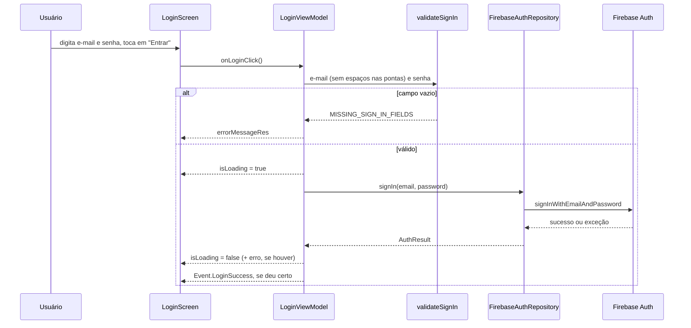

# Autenticação (cadastro, login e recuperação de senha)

**Situação:** implementado e parcialmente testado. As regras e os ViewModels
têm testes unitários; a integração real com o Firebase e as telas não têm
testes automatizados.

## 1. O que este módulo faz?

Permite criar uma conta com nome, e-mail e senha, entrar com e-mail e senha,
pedir um link para redefinir a senha e sair da conta. As contas ficam no
Firebase Authentication. Papéis e permissões (o que cada conta pode fazer) estão
em [perfis-e-permissoes.md](perfis-e-permissoes.md).

## 2. Por que ele existe?

O ORI precisa saber quem está usando o app antes de guardar rotinas e vínculos.
O Firebase cuida das senhas, então o ORI nunca armazena credenciais.

## 3. Como a execução começa?

O app abre na `Home`, um pager com três páginas: abertura, login e cadastro.
Na abertura aparecem os botões "Entrar", "Criar uma conta" e "Continuar sem conta".
Há um só tipo de conta, então o cadastro não pergunta papel.

## 4. Quais componentes participam?

| Componente | Papel |
|---|---|
| `LoginRoute` / `RegisterRoute` | Ligam ViewModel e tela; repassam eventos de navegação |
| `LoginScreen` / `RegisterScreen` | Desenham o formulário com componentes compartilhados |
| `LoginViewModel` / `RegisterViewModel` | Validam, chamam o repositório e atualizam o estado |
| `CredentialsValidation.kt` | Regras de validação (domínio) |
| `AuthRepository` | Contrato usado pelos ViewModels |
| `FirebaseAuthRepository` | Implementação com Firebase Authentication |
| `FirebaseAuthErrorMapping.kt` | Converte códigos do Firebase em `AuthError` |
| `AuthMessages.kt` | Converte erros em textos de `strings.xml` |

## 5. Como os dados percorrem esses componentes?



O cadastro segue o mesmo caminho com `validateRegistration` e o caso de uso
`RegisterAccount`. Ele faz três coisas, nesta ordem:

1. cria a conta no Authentication;
2. grava o nome de exibição (`displayName`);
3. cria o perfil `users/{uid}`, só com o nome.

Se o terceiro passo falhar, a conta já existe e está logada, e o app mostra
"Complete seu perfil" para terminar o cadastro sem criar uma segunda conta.

Depois do login ou do cadastro, **quem leva a pessoa para dentro do app é a
sessão** (`SessionViewModel` e `OriApp`), não a tela de login.

## 6. Quais regras são verificadas?

| Regra | Onde |
|---|---|
| Login exige e-mail e senha | `validateSignIn` |
| Recuperação exige e-mail | `validatePasswordReset` |
| Cadastro exige nome, e-mail e senha | `validateRegistration` |
| Senha e confirmação iguais | `validateRegistration` |
| Senha com pelo menos `MIN_PASSWORD_LENGTH` (6) caracteres | `validateRegistration` |
| Espaços nas pontas do nome e do e-mail são removidos; a senha nunca é alterada | ViewModels |
| O modo "Aa" muda só a exibição, nunca o valor digitado | `UppercaseVisualTransformation` |
| Um novo envio é ignorado enquanto outro está em andamento | ViewModels (`isLoading`) |

Não há verificação de **autorização** neste módulo: ele apenas autentica.

## 7. Onde os dados são lidos e gravados?

- A conta, a senha e o `displayName` ficam no Firebase Authentication.
- O perfil (`displayName`) fica no Firestore, em `users/{uid}`. Perfis antigos também têm `role`, que nada lê.
- A preferência "Aa" fica no aparelho (DataStore, arquivo `display_preferences`).
  Ela vale para login, cadastro e as próximas aberturas do app, e também pode
  ser alterada em **Conta → Letras maiúsculas**.

## 8. O que acontece em caso de erro?

| Situação | Mensagem ao usuário |
|---|---|
| Senha errada ou conta inexistente | "E-mail ou senha incorretos" (mesma mensagem, para não revelar contas) |
| E-mail já usado no cadastro | "Este e-mail já está em uso" |
| Sem internet | "Sem conexão. Verifique sua internet e tente novamente" |
| Muitas tentativas | "Muitas tentativas. Aguarde um pouco e tente novamente" |
| Conta criada, mas o nome do Firebase Auth não foi salvo | Nada: o cadastro segue, porque o app usa o nome do perfil (R13, 15/11/2026); a falha vai para o log, sem o nome |
| Qualquer outra falha | "Algo deu errado. Tente novamente" |

Na recuperação de senha, um e-mail sem conta recebe a mesma resposta de sucesso
("Se houver uma conta com este e-mail, enviaremos um link…"). Falhas reais, como
falta de internet, aparecem como erro.

O log técnico (Logcat) registra apenas o código do erro, nunca o e-mail ou a senha.

## 9. Como o estado da interface é atualizado?

`LoginUiState` e `RegisterUiState` são imutáveis. Cada ação gera uma cópia com
`update { it.copy(...) }`. A tela redesenha sozinha ao observar o `StateFlow`.
Mensagens são guardadas como `@StringRes` (`errorMessageRes`, `successMessageRes`),
e o texto só é resolvido na tela. Editar um campo apaga o erro anterior.

## 10. Como testar?

Testes automatizados (em `android/`):

```bash
./gradlew testDevDebugUnitTest
```

| Teste | O que garante |
|---|---|
| `CredentialsValidationTest` | Ordem das regras e limite de 6 caracteres |
| `FirebaseAuthErrorMappingTest` | Senha errada e conta inexistente geram o mesmo erro |
| `TextCaseTest` | O modo "Aa" não altera o texto digitado nem o tamanho dele |
| `LoginViewModelTest` | Validação, sucesso, falha, senha preservada e recuperação neutra |
| `RegisterViewModelTest` | Validação, sucesso com nome/e-mail sem espaços, perfil gravado, conta sem perfil segue para a sessão, falha |
| `LoginViewModelTest` / `RegisterViewModelTest` | A preferência "Aa" é gravada e restaurada por uma tela nova |
| `SessionViewModelTest` | Sessão restaurada, conta sem perfil, saída da conta |

Teste manual: instale o APK (`./gradlew assembleProdDebug`), crie uma conta com
o "Aa" ligado e entre com a mesma senha digitada em minúsculas.

**Não há** testes com o Firebase Auth Emulator nem testes de interface Compose.

## 11. Como adicionar um recurso sem quebrar os existentes?

- Novo tipo de erro: adicione o valor em `AuthError`; o `when` em `AuthMessages.kt`
  deixa de compilar até você escolher o texto, e então crie o texto em `strings.xml`.
- Nova regra de validação: adicione em `CredentialsValidation.kt` com um teste.
- Novo provedor (por exemplo, Google): adicione uma função ao `AuthRepository`,
  implemente em `FirebaseAuthRepository` e atualize `FakeAuthRepository`.

## Sair da conta

Em **Conta → Sair da conta**, o app chama `signOut()`. A sessão passa a
`SignedOut` e a raiz do app volta sozinha para a abertura.

## Pendências

- O cache offline do Firestore não é apagado ao sair (ver [perfis-e-permissoes.md](perfis-e-permissoes.md#7-limitações-e-riscos)).
- Não há testes com o Firebase Auth Emulator nem testes de ponta a ponta das telas.

## Entrar com o Google (09/11/2026)

- **O que a pessoa vê:** em Entrar e em Cadastrar, abaixo do formulário, "ou" e "Continuar com o Google". O Android
  mostra as contas Google do aparelho; a pessoa escolhe uma e entra. Na primeira vez a conta é criada com o nome do
  Google e segue para "Complete seu perfil", como uma conta de e-mail.
- **Como funciona:** `GoogleSignInSection` pede a conta ao Credential Manager do Android (`GetSignInWithGoogleOption`
  com o `default_web_client_id` que o plugin do Google gera do `google-services.json`) e entrega o token a
  `GoogleSignInViewModel`, que chama `AuthRepository.signInWithGoogle` (`GoogleAuthProvider` no Firebase). A sessão
  muda sozinha; o app nunca vê senha.
- **Erros:** fechar a lista de contas não é erro; sem conta Google no aparelho, a tela explica; falhas do Firebase usam
  as mesmas mensagens do login por e-mail. Só o tipo do erro vai para o log.
- **Configuração:** o provedor Google ligado no Firebase Authentication e a impressão SHA-1 do certificado cadastrada
  no app `com.oriteam.ori` (feito em 09/11/2026 para o certificado de depuração; para publicar, falta o certificado
  de publicação). O build `dev` usa o projeto de emulador `demo-ori`, sem Google: lá o botão não aparece.
- **Testes:** `GoogleSignInViewModelTest` (entra, fechar a lista não é erro, sem conta e falha explicadas). O pedido
  ao Android só roda no aparelho.
