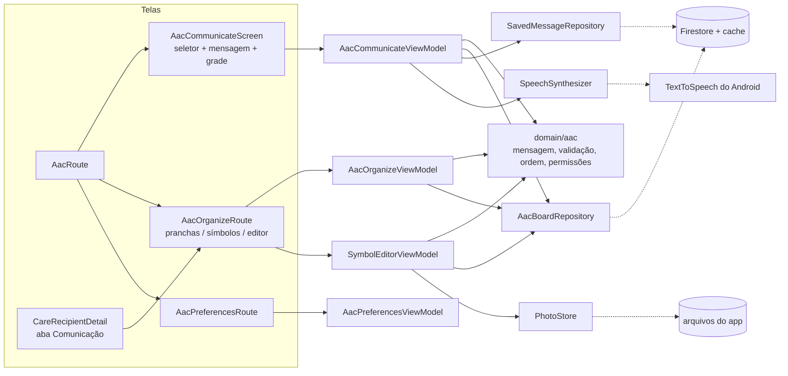
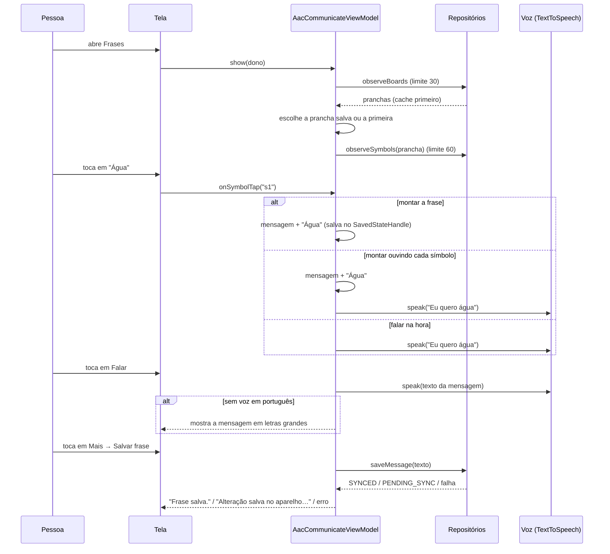

# Comunicação Aumentativa e Alternativa (CAA)

**Situação:**
- **Regras do Firestore:** implementadas, testadas no emulador (15 testes em
  `functions/security-tests/test/aac.test.mjs`) e publicadas no `oriteam-ori`.
- **Domínio, ViewModels, armazenamento de fotos e preferências:** implementados e
  testados na JVM (com Robolectric quando há Android no meio).
- **Telas:** implementadas e testadas na JVM com Robolectric: estados acessíveis,
  grade adaptável e permissões visíveis.
- **Não foi possível verificar:** a voz real (TextToSpeech) num aparelho, o seletor de
  fotos do sistema, leitores de tela reais, a grade com símbolos num aparelho real, o teclado
  com o celular deitado e o uso em tablet ou dobrável físicos.

## 1. O que o módulo faz e por que existe

A CAA ajuda quem não fala, ou fala com dificuldade, a se comunicar. A pessoa toca em
**símbolos** organizados em **pranchas**, monta uma **mensagem** e o aparelho a **fala**
em voz alta (ou a mostra em letras grandes).

O módulo existe para dar voz com **autonomia**. Por isso, nada é fixo:
- **Pranchas e símbolos** são criados pela própria pessoa. A prancha sugerida é só uma
  opção para quem não quer começar do zero.
- **Escrever** também é comunicar. Uma palavra que não está em nenhuma prancha pode
  ser digitada e entra na mensagem como qualquer símbolo.
- **Cada pessoa escolhe o próprio jeito de usar** (veja "Preferências"): montar frases,
  ouvir cada símbolo ou falar na hora.

## 2. Conceitos e modelo de dados

| Conceito | No código | Onde fica |
|---|---|---|
| Prancha: grupo de símbolos ("Comida") | `AacBoard` | `users/{dono}/aacBoards/{id}` |
| Símbolo: rótulo, frase associada, imagem | `AacSymbol` | `users/{dono}/aacBoards/{prancha}/symbols/{id}` |
| Mensagem em montagem | `AacMessage` (lista de `MessagePart`) | Só no aparelho (`SavedStateHandle`) |
| Frase salva | `SavedMessage` | `users/{dono}/aacSavedMessages/{id}` |
| Preferências | `AacPreferences` | DataStore local do aparelho |
| Foto de um símbolo | `SymbolImage.DevicePhoto` (aponta para um `StoredPhoto`) | Arquivo em `filesDir/aac_photos/` do aparelho e, com conta, `users/{dono}/photos/{id}` |

```text
users/{dono}/aacBoards/{boardId}
  name        texto, 1–40
  position    inteiro 0–999 (ordem das pranchas)
  createdBy, createdAt, updatedAt

users/{dono}/aacBoards/{boardId}/symbols/{symbolId}
  label       texto, 1–40 (o que aparece)
  phrase      texto 1–200 ou null (o que é falado; null fala o rótulo)
  image       "emoji:💧", "device:<nome>.jpg" ou null
  position    inteiro 0–999 (ordem dentro da prancha)
  createdBy, createdAt, updatedAt

users/{dono}/aacSavedMessages/{messageId}
  text        texto, 1–500
  createdAt
```

- **Rótulo e frase associada:** o símbolo "Água" pode falar "Eu quero água". Assim a
  pessoa encontra o símbolo por uma palavra curta e é entendida por uma frase completa.
- **Imagens:** o documento guarda **só uma referência curta**, nunca a imagem. Isso
  mantém cada documento pequeno (leituras baratas e rápidas) e respeita o limite de
  1 MiB por documento do Firestore. As regras recusam qualquer outro formato, como
  `data:image/png;base64,...`.
- **A mensagem guarda uma cópia** do rótulo, da frase e da imagem de cada pedaço. Se o
  símbolo for editado ou excluído depois, a mensagem em montagem não muda.

## 3. Imagens e licenças

| Fonte | Como é usada | Licença e cuidados |
|---|---|---|
| **Emoji** (sugeridos ou digitados) | Desenhados pela fonte do próprio aparelho | Os caracteres Unicode não têm restrição de uso. O app **não distribui** imagens de emoji: quem desenha é a fonte do sistema (no Android, normalmente Noto Color Emoji, licença SIL OFL 1.1). A aparência pode variar entre fabricantes |
| **Fotos do aparelho** | Escolhidas pelo seletor de fotos do sistema, reduzidas e guardadas no aparelho e, com conta, na conta | A pessoa escolhe a foto e é responsável por ter direito de usá-la; o app avisa isso na tela. Com conta, a foto vai para a conta da pessoa e aparece nos aparelhos dela e de quem organiza as pranchas |
| **Pictogramas de terceiros** | **Não incluídos** | ARASAAC usa CC BY-NC-SA, que proíbe uso comercial e exige atribuição e a mesma licença. PCS/Boardmaker é proprietário. Incluí-los exigiria uma decisão de produto e jurídica (veja "Como estender") |

A tela de preferências tem a seção **"De onde vêm as imagens"**, que explica isso para
quem usa o app.

Os ícones das ações da mensagem (apagar, teclado, olho) não são símbolos de comunicação: vêm
do Material Icons (Apache 2.0), a mesma origem dos outros ícones do app, e estão em
`res/drawable`.

**Onde as fotos ficam:** no pacote `photos`, compartilhado com a foto de perfil (`domain/photos/PhotoStore.kt`, `data/photos/DevicePhotoStore.kt`). Com conta, cada foto também vai para a conta (`users/{dono}/photos/{id}`, até 100 KB, veja [dados.md](../dados.md#fotos)). Enquanto um aparelho ainda não baixou uma foto, o símbolo mostra um ícone neutro com o rótulo e continua funcionando.

**Como a foto é guardada** (`DevicePhotoStore`):
1. Lê só as dimensões e escolhe uma redução (`inSampleSize`), para nunca carregar uma
   foto de 12 MP inteira na memória.
2. Reduz para no máximo 512 px no maior lado, endireita fotos tiradas de lado (EXIF) e
   grava um JPEG de cerca de 50 KB.
3. Grava primeiro num arquivo temporário e só depois o renomeia. Se faltar espaço,
   nenhuma foto quebrada fica para trás e a tela mostra "Não foi possível guardar a
   foto no aparelho".
4. Nomes vindos do Firestore só são aceitos no formato `<letras-e-números>.jpg`, o que
   impede caminhos como `../`.

## 4. Permissões

| Ação | Usuário principal | Responsável com `manageCommunication` | Responsável sem ela |
|---|---|---|---|
| Ver e usar as pranchas para falar | ✅ | — (a tela do responsável só organiza) | ❌ |
| Criar, editar, ordenar e excluir pranchas e símbolos | ✅ | ✅ | ❌ |
| Adicionar foto do aparelho | ✅ | ❌ (pode manter a que já existe) | ❌ |
| Ler, criar e excluir frases salvas | ✅ | ❌ **nunca** | ❌ |

- **`manageCommunication`** é uma permissão nova do vínculo, **desligada por padrão**. Só
  o usuário principal liga, em Conta → Pessoas vinculadas → "Permitir que … organize
  minhas pranchas de comunicação".
- **Vínculos antigos**, que não têm a chave, são tratados como "sem permissão" no app e
  nas regras.
- **Frases salvas são privadas:** são o que a pessoa disse ou quer dizer. Nenhuma
  permissão do responsável dá acesso a elas.
- **Mensagem em montagem:** nunca vai para o servidor, a menos que a pessoa toque em
  "Salvar frase".
- **Onde as regras moram:**
  - `domain/aac/AacAccess.kt` decide **o que a interface mostra**.
  - `functions/firestore.rules` decide **o que o servidor aceita**.
  - Testes: `AacDomainTest`, `AacOrganizeViewModelTest` e `aac.test.mjs`.
- **Autoria:** novos documentos exigem `createdBy == quem grava` e o horário do servidor.
  Edições não podem mudar a autoria.

## 5. Componentes



- **Entrada do usuário principal:** a aba **Frases** (`MainDestination.COMMUNICATE`) abre
  `AacRoute`, que alterna entre comunicar (padrão), organizar e preferências. O "voltar"
  sempre retorna a comunicar.
- **Entrada do responsável:** em Acompanhados, a pessoa escolhida mostra as abas **Rotina**
  e **Comunicação**. A aba de comunicação só aparece com `manageCommunication`.

## 6. Fluxo: seleção, montagem, reprodução e persistência



### Seleção

- **Seletor de pranchas:** uma fileira rolável de chips mostra todas as pranchas e
  "Frases salvas", sempre a um toque, sem menus escondidos.
- **Prancha escolhida:** fica no `SavedStateHandle`. Se ela for excluída (inclusive pelo
  responsável, em outro aparelho), a primeira prancha restante é escolhida.
- **Sem nenhuma prancha:** a pessoa já pode escrever e falar. A tela também oferece
  "Usar a prancha sugerida" (14 símbolos) e "Montar minha prancha".

### Montagem

- **Pedaços da mensagem:** cada toque em símbolo (ou palavra escrita) vira um pedaço
  (`MessagePart`).
- **Remover:** tocar num pedaço o remove. O botão "Apagar" remove o último. "Apagar tudo"
  fica no menu "Mais", longe de toques acidentais.
- **Limite de 30 pedaços:** com a mensagem cheia, novos toques são ignorados e um aviso
  explica o motivo. Pedaços antigos nunca são descartados em silêncio.
- **Reinício do app:** a mensagem fica no `SavedStateHandle` e sobrevive a rotação e ao
  fechamento do app pelo sistema.

**Por que a barra é compacta.** Os símbolos são a parte principal da tela, então a barra
(`AacMessageBar` e `AacMessageActions`) tem uma linha de mensagem e uma linha de ações:

- **A mensagem não empurra os símbolos.** Acima da grade, ela fica em uma única linha que
  rola para o lado e mostra sempre o pedaço mais novo. Se crescesse, os símbolos mudariam de
  lugar sob o dedo enquanto a pessoa monta a frase, e lembrar a posição de cada símbolo faz
  parte de como a CAA é usada. Para rever uma mensagem longa, basta arrastar a linha ou usar
  "Mostrar em letras grandes". No celular deitado a mensagem fica ao lado da grade, então
  ela quebra linha e aparece inteira.
- **Quatro ações sempre à vista:** "Falar", "Apagar", "Escrever" e "Mais", cada uma com
  ícone e rótulo, porque nem todo mundo lê e nem todo ícone é óbvio. O menu "Mais" guarda
  "Mostrar em letras grandes", "Salvar frase" e "Apagar tudo".
- **Texto ampliado não quebra palavra.** Todas as ações têm a mesma largura. Se o rótulo mais
  longo não couber, elas passam para duas por linha.
- **O campo de texto abre só quando pedido.** "Escrever" abre o campo já com o cursor, abaixo
  das ações, para o botão não sair do lugar. Fechar o campo não apaga o que foi digitado.
- **A barra nunca passa de metade da altura.** Com texto muito ampliado e o campo aberto, ela
  rola por dentro, e os símbolos continuam na tela.

### Reprodução

- **Voz:** `AndroidSpeechSynthesizer` usa o TextToSpeech do aparelho em pt-BR. Funciona
  sem internet quando a voz está instalada.
- **"Falar" vira "Parar"** enquanto fala.
- **Sem motor de voz ou sem voz em português:** o estado fica `UNAVAILABLE`, a tela avisa,
  e "Falar" abre a mensagem em letras grandes (`MessageDisplayDialog`). Uma voz em outro
  idioma seria enganosa, por isso não é usada.
- **"Mostrar em letras grandes"** (no menu "Mais") abre essa tela a qualquer momento, por
  exemplo em lugares barulhentos.
- **Ciclo de vida:** cada tela tem a própria conexão com a voz, fechada (`close()`)
  quando o ViewModel termina. Nada fica falando ou ocupando memória depois.
- **Privacidade:** nada do que é falado é registrado em log ou enviado pelo app.

### Persistência

- **Frases salvas:** gravadas com `saveMessage`, pelo menu "Mais" → "Salvar frase".
  - **Offline:** a gravação vai para a fila do Firestore, e a tela diz "Alteração salva no
    aparelho…".
  - **Falha (sem permissão, rede):** a tela mostra o erro e a mensagem continua montada,
    para tentar de novo.
- **Tocar numa frase salva** a fala (ou a mostra em letras grandes).
- **Excluir** pede confirmação.
- **Listener de frases salvas:** só existe enquanto "Frases salvas" está aberto, o que
  economiza leituras.

## 7. Fluxo: organizar pranchas e símbolos

- **Layout:** um ou dois painéis, pela largura que a área recebe (720 dp ou mais), e não
  pelo tipo de aparelho. À esquerda ficam as pranchas; à direita, os símbolos ou o editor.
- **Ordenar:**
  - Cada linha tem botões **"Mover X para antes/depois"** (48 dp), em vez de arrastar,
    que é difícil para muitas pessoas.
  - O domínio calcula a nova ordem (`moved`) e grava **só as posições que mudaram**
    (`positionChanges`), num único lote atômico.
  - Isso também corrige empates deixados por duas pessoas adicionando ao mesmo tempo.
- **Criar ou renomear prancha:** a caixa de diálogo valida o nome (obrigatório, até 40
  caracteres, sem repetir) antes de gravar. Uma falha mantém a caixa aberta com o motivo.
- **Excluir prancha:**
  - Pede confirmação.
  - Lê os símbolos e exclui tudo num lote: nenhum símbolo fica sem prancha.
  - Depois que a exclusão é aceita, apaga as fotos desses símbolos deste aparelho.
- **Editor de símbolo** (`SymbolEditorViewModel`):
  - **Campos:** rótulo, frase falada (opcional) e imagem (emoji sugerido ou digitado,
    foto ou nenhuma).
  - **Antes de gravar:** relê a prancha para recusar rótulo repetido e prancha cheia (60).
  - **Id reservado uma vez:** tocar duas vezes em "Salvar", ou salvar depois de reiniciar
    o app, grava o mesmo símbolo.
  - **Fotos sem uso:** fechar sem salvar apaga as fotos importadas pelo formulário.
    Trocar a foto apaga a antiga depois que a edição é aceita.

## 8. Preferências e grade adaptável

**O que a pessoa escolhe** (valem para este aparelho):

| Preferência | Opções |
|---|---|
| Ao tocar em um símbolo | Montar a frase · Montar ouvindo cada símbolo · Falar na hora |
| Tamanho dos símbolos | Pequeno · Médio · Grande |
| Rótulos | Abaixo da imagem · Acima · Só o texto (letras maiores) · Só a imagem |

**Como a grade decide** (`aacGridSpec`):
- **Largura mínima do símbolo:** o maior entre dois valores:
  - a base da janela (96 dp em celular ou janela baixa, 120 ou 136 dp nas maiores) × o
    tamanho escolhido (0,7 · 1 · 1,3);
  - 67 dp × a escala do texto do sistema, para os rótulos caberem.
- **Colunas:** quantas couberem na **largura real da área**, entre 1 e 8. Num celular de
  360 dp, a grade recebe 312 dp (a largura menos as margens), o que dá 4 colunas no tamanho
  Pequeno, 3 no Médio e 2 no Grande.
- **Imagem e rótulo:** a imagem ocupa cerca de 60% do símbolo (de 40 a 160 dp). Símbolos com
  menos de 80 dp de largura usam rótulos menores, para palavras comuns caberem.
- **Efeito:** um tablet mostra **mais símbolos**, não símbolos gigantes. Texto ampliado
  mostra **menos símbolos por linha**, com palavras inteiras: 3 colunas até 1,3× e 2 colunas
  com 2×, num celular de 360 dp.
- **Celular deitado:** a mensagem vai para uma coluna ao lado, para a grade manter a
  altura, e os símbolos continuam pequenos para caberem várias linhas.

**Configurações conferidas** com testes de layout e com imagens geradas no computador
(Robolectric):

| Janela (dp) | O que foi olhado |
|---|---|
| 360 × 616 (celular de 360 × 780, sem as barras) | Texto 1×, 1,3× e 2×; Pequeno, Médio e Grande; só o texto; campo de texto aberto |
| 891 × 411 (celular deitado) | Mensagem ao lado, 5 colunas |
| 800 × 1100 (tablet) | 5 colunas, ações sem esticar |

No celular real (360 × 780 dp, texto 1×) foram conferidos a barra, o menu "Mais", o teclado
aberto ao tocar em "Escrever" e as opções de quem ainda não tem pranchas. A grade com símbolos
não foi vista no aparelho, porque a conta usada não tem pranchas.

## 9. Estados acessíveis

| Situação | Como aparece e é anunciado |
|---|---|
| Símbolo | Um único botão, lido pelo rótulo, com a ação "adicionar à mensagem" ou "falar". No modo "só a imagem", o rótulo vira a descrição do botão |
| Mensagem | Região viva: o leitor de tela anuncia "Mensagem: …" a cada mudança |
| Pedaço da mensagem | Botão "Remover Água" |
| Ações da mensagem | Ícone e rótulo visíveis. "Apagar" é lido como "Apagar última", "Mais" como "Mais ações da mensagem", e "Escrever" anuncia se o campo está aberto ou fechado |
| Voz indisponível | Aviso em texto + mensagem em letras grandes |
| Carregando / vazio / erro | Componentes padrão (`StatefulContent`). Uma permissão negada é **erro**, nunca "vazio" |
| Offline | "Mostrando a última versão salva" / "Alteração salva no aparelho…" |
| Ordenar | Botões com nome ("Mover Água para antes"), desabilitados nas pontas |
| Excluir | Sempre com confirmação |

## 10. Limites e custo

| Limite | Valor | Onde é garantido |
|---|---|---|
| Pranchas por pessoa | 30 | App (validação) e regras (`limit <= 30` na lista) |
| Símbolos por prancha | 60 | App (validação) e regras (`limit <= 60`) |
| Frases salvas listadas | 50, as mais novas | App e regras (`limit <= 50`) |
| Pedaços por mensagem | 30 | Domínio |
| Frase salva | 500 caracteres | Domínio e regras |

- **Leituras:** abrir a comunicação lê no máximo 30 pranchas + 60 símbolos.
- **Índices:** nenhuma consulta usa filtros compostos. A ordem é aplicada no domínio e
  as frases salvas usam um único `orderBy`, coberto pelo índice automático. Por isso,
  `firestore.indexes.json` continua vazio.

## 11. Testes

```bash
cd android && ./gradlew testDevDebugUnitTest
cd functions/security-tests && npm test
```

| Pedido | Testes |
|---|---|
| **Operações** | `AacDomainTest` (mensagem, validação, duplicatas, limites, ordem); `AacOrganizeViewModelTest` (ordenar só o que muda, criar/renomear prancha, excluir com confirmação); `SymbolEditorViewModelTest` (criar no fim da prancha, duplicata, toque duplo, rascunho e id após reinício); `AacCommunicateViewModelTest` (três modos de toque, remover pedaços, salvar, prancha sugerida uma vez); `AacDocumentMappingTest`; `DataStoreAacPreferencesRepositoryTest` |
| **Estados acessíveis** | `AacScreenTest` (símbolo como um botão com rótulo e ação, rótulo oculto ainda lido, região viva da mensagem, botões de mover com nome, aviso de voz indisponível, sem pranchas ainda dá para escrever); `AacMessageBarTest` (ações em uma linha, "Falar" vira "Parar", menu "Mais", ações desabilitadas sem mensagem, campo abre com foco e anuncia o estado, texto digitado não se perde, texto ampliado não quebra palavra) |
| **Grade adaptável** | `AacGridSpecTest` (colunas pela largura real da grade em cada tamanho e escala de texto); `AacBoardLayoutTest` (três linhas inteiras de símbolos num celular comum, símbolos parados enquanto a mensagem cresce, pedaço mais novo visível, barra limitada com texto ampliado, opções sem pranchas visíveis, rótulo centralizado, celular deitado); `AacScreenTest` (mais colunas em área larga, menos com texto ampliado); `FeatureComponentsTest` (mensagem ao lado no celular deitado) |
| **Permissões** | `AacDomainTest`; `AacOrganizeViewModelTest` (responsável sem permissão não grava nada; com permissão não apaga fotos); `SymbolEditorViewModelTest` (responsável não adiciona foto); `AacScreenTest` (organizador sem permissão não oferece mudanças); emulador: 15 testes (dono, responsável com/sem permissão, vínculo antigo e revogado, frases privadas, formato da imagem, prancha inexistente, limites, autoria, concessão da permissão) |
| **Falhas de armazenamento** | `DevicePhotoStoreTest` (imagem ilegível, pasta bloqueada → nenhuma foto quebrada, redução real para 512 px, nomes inseguros); `SymbolEditorViewModelTest` (falha de rede mantém o formulário, foto ilegível/sem espaço explicada); `AacCommunicateViewModelTest` (falha ao salvar mantém a mensagem; gravação offline) ; `AacOrganizeViewModelTest` (exclusão que falha mantém as fotos) |

Para conferir que os testes pegam falhas reais, fiz mutações temporárias, desfeitas logo
depois:
- **No app:**
  - tirei a trava da prancha sugerida → falhou "the starter board is created once…";
  - tirei o plano B das letras grandes → falhou "without a voice the message is shown…";
  - desfiz de uma vez as correções de layout (mensagem em uma linha, largura igual das ações,
    limite de altura da barra, colunas no celular, rótulo centralizado) → 10 testes de
    `AacBoardLayoutTest`, `AacGridSpecTest` e `AacMessageBarTest` falharam.
- **Nas regras:**
  - abri as frases salvas ao responsável → falhou "stay private even from a caregiver…";
  - tirei a checagem de prancha existente → falhou "cannot create a symbol in a board
    that does not exist".

## 12. Como estender

- **Novo campo no símbolo** (por exemplo, cor de categoria):
  1. Acrescente-o em `hasAll`/`hasOnly` de `isValidSymbol` nas regras, com teste.
  2. **Publique as regras.**
  3. Atualize `AacDocumentMapping.kt`, `SymbolDraft` e o editor.
- **Pictogramas de terceiros:**
  1. Confirme se a licença permite o uso pretendido. Por exemplo, ARASAAC não pode ter uso
     comercial e exige atribuição e a mesma licença.
  2. Crie um novo tipo em `SymbolImage` (por exemplo, `"pictogram:<id>"`).
  3. Aceite-o em `isValidImage` nas regras.
  4. Mostre a atribuição na seção "De onde vêm as imagens".
- **Fotos no Cloud Storage** (se o plano Blaze for contratado): troque a implementação de
  `CloudPhotoRepository` (`data/photos`); `PhotoStore`, a CAA e o perfil não mudam. A
  referência `device:` dos símbolos continua valendo.
- **Nova preferência:** acrescente-a em `AacPreferences` e
  `DataStoreAacPreferencesRepository` (valor desconhecido volta ao padrão) e na tela de
  preferências.
- **Nova permissão:** mude `AacAccess.kt` **e** `firestore.rules` juntos, com testes nos
  dois lados.

## 13. Limitações

- **Fotos:**
  - Ficam só no aparelho que as adicionou.
  - Em outro aparelho, ou para o responsável, aparece um ícone neutro com o rótulo.
  - Entram no backup automático do Android, se a pessoa o tiver ativado.
- **Emoji** são desenhados pela fonte do aparelho e podem mudar de aparência entre
  fabricantes.
- **Preferências** valem por aparelho, não por conta. Num aparelho compartilhado, valem
  para todos.
- **Mensagem longa no celular em pé:** nem todos os pedaços ficam à vista ao mesmo tempo, em
  troca de os símbolos não mudarem de lugar. Para rever, é preciso arrastar a linha ou usar
  "Mostrar em letras grandes".
- **Palavras muito longas** ainda podem quebrar dentro do símbolo: a grade reserva espaço para
  palavras comuns, de até cerca de 8 letras.
- **Exclusão de prancha:** apaga até 60 símbolos num lote. Se duas pessoas passarem desse
  número ao mesmo tempo, sobras ficam invisíveis (sem prancha) até serem limpas.
- **A voz depende do motor instalado no aparelho.** Velocidade e escolha de voz não são
  configuráveis no app.
- **Não há:**
  - histórico de mensagens faladas (de propósito, por privacidade);
  - pranchas compartilhadas entre pessoas;
  - navegação de um símbolo para outra prancha.

## Tela "Formar frase" e uso sem conta

A tela abre em **Prontas** e tem duas abas no lugar do título:

- **Prontas:** um toque fala. Primeiro as frases salvas da pessoa, depois as que vêm com o app (`ReadyPhrase.kt`), cada uma com uma imagem. Enquanto fala, aparece "Parar". Falar uma frase pronta não mexe na mensagem que está sendo montada.
- **Montar:** a frase no topo, com um "+" para digitar o que não tem símbolo; a grade no meio, com uma cor suave por linha; e **Apagar, Salvar, Falar e Mais** embaixo, ao alcance do polegar. **Mais** guarda "Apagar tudo", "Mostrar em letras grandes", "Organizar pranchas" e "Preferências da comunicação". As abas de pranchas só aparecem quando há mais de uma.

**Adicionar palavras:** o último quadro da grade, **Nova palavra**, abre o formulário do símbolo, com imagem, emoji ou foto, e a palavra fica na prancha aberta. No campo do "+", "Guardar na prancha" leva o texto digitado para o mesmo formulário.

**Frases que vêm com o app:** ficam em `strings.xml`, não no banco. Assim funcionam na primeira abertura, sem rede e sem gastar o limite de frases salvas. **Limitação:** não dá para editar nem esconder essas frases.

### Como a frase montada fica coerente (`SentencePiece.kt`)

`composeSentence` recebe as palavras tocadas e devolve cada uma como será dita. É uma tabela pequena, não um corretor: só faz o que tem certeza, e nunca muda a ordem.

| Regra | Toques | Fala |
|---|---|---|
| Palavra que o verbo pede | eu, gosto, você | Eu gosto **de** você |
| "com" só para estados | estou, dor | Estou **com** dor |
| Nada onde não cabe | estou, feliz | Estou feliz |
| Sem repetir o que já foi tocado | estou, com, dor | Estou com dor |
| Concordância com quem vem antes | você, quero, água | Você **quer** água |
| Contrações | eu, gosto, ele | Eu gosto **dele** |

**Na barra:** a palavra acrescentada aparece sem caixa entre os trechos, porque não foi tocada e não há o que remover. A palavra concordada aparece já mudada. Quem lê a frase vê o que será dito, exceto as contrações, que só existem na fala.

**Para estender:** novos verbos entram em `verbs`, e novos estados em `states`, com um caso em `SentenceGrammarTest`. Palavras fora da tabela ficam como foram tocadas, então "adoro você" não ganha "de".

**Frase de um símbolo:** a frase associada só vale quando ele está sozinho. Numa mensagem com mais de um trecho, vale o rótulo, o que evita "estou estou com sono", inclusive em pranchas antigas. No modo "fala ao tocar", o primeiro símbolo fala a frase e os seguintes, a palavra.

**Prancha sugerida:** só palavras, em minúsculas e em quatro linhas (eu, você, estou, não / quero, preciso, gosto, com / água, comida, banheiro, ajuda / dor, sono, fome, frio). Vale só para pranchas novas. "com" não tem imagem. O vocabulário, a gramática e as frases prontas ainda precisam de revisão de alguém de fonoaudiologia.

- Sem conta, pranchas e frases salvas ficam no aparelho. Veja [uso-local.md](uso-local.md).
- Cada uso de "Falar" soma 1 na contagem do dia para os Relatórios. Essa contagem não guarda o que foi dito e não sai do aparelho.

**Fotos de símbolos:** com conta, ficam salvas nela e aparecem nos outros aparelhos, no aparelho do responsável que gerencia as pranchas inclusive. Só a pessoa pode adicioná-las. Limites em [dados.md](../dados.md#fotos).

## Mudanças de 03/11/2026 (fim da lista de revisão)

**Cores das pranchas.** A cor de um símbolo diz o tipo da palavra, como nas chaves de cor usadas em CAA: pessoas em amarelo, ações em verde, sentimentos em azul. Só as palavras que a gramática conhece têm cor (`wordClassOf` em `SentencePiece.kt`); as outras ficam sem cor, porque uma cor que não significa nada só acrescentaria estímulo. Antes, a cor vinha da linha da grade e mudava ao girar o celular.

**Contagem de comunicação.** Conta cada vez que a pessoa comunica uma mensagem: "Falar" (com voz, ou em letras grandes quando não há voz), "Mostrar", uma frase pronta ou um símbolo no modo que fala cada um. A voz que repete cada símbolo enquanto a frase é montada não conta, porque é retorno. A contagem continua só no aparelho, e o relatório diz isso.

**Frase longa.** A frase continua numa linha só acima dos símbolos, para eles não saírem de baixo do dedo. Quando há palavras roladas para a esquerda, aparece "…" no começo. A frase inteira está em "Mostrar" e no leitor de tela.

**Estrutura.** A leitura do que aparece embaixo (pranchas, símbolos, frases salvas) fica em `AacBoardContent`, e a mensagem sendo montada em `MessageDraft`. As fotos decodificadas recentes ficam num cache (`DecodedPhotos`), para a grade não piscar ao rolar.

**Testes:** `UsabilityTest` ("…" numa frase longa), `DecodedPhotosTest`.
