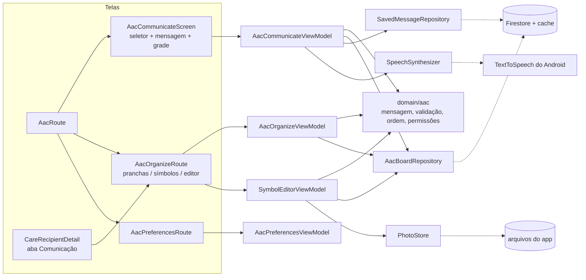
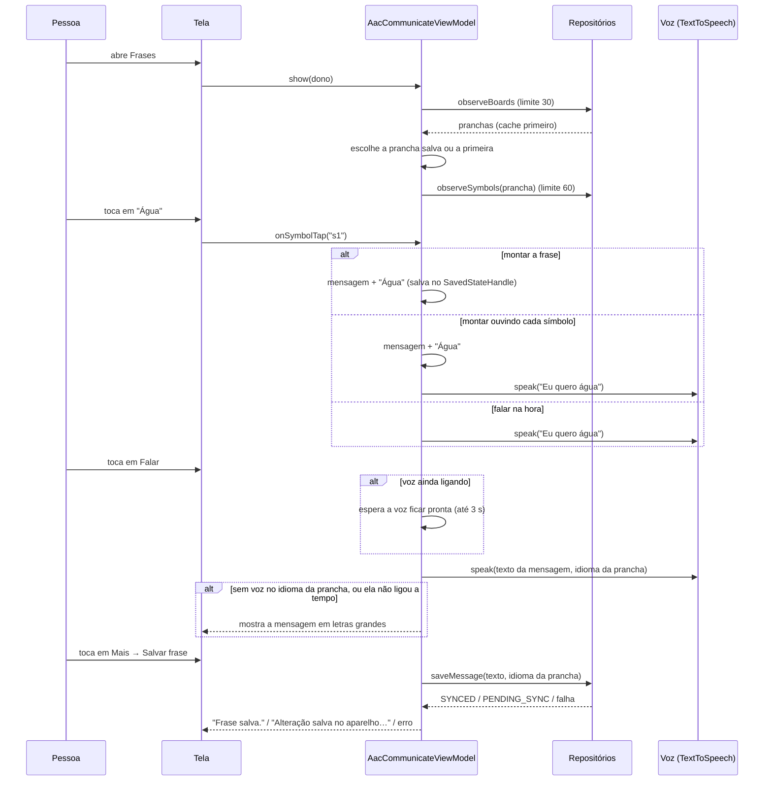
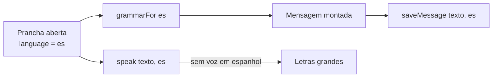
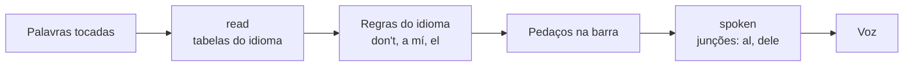
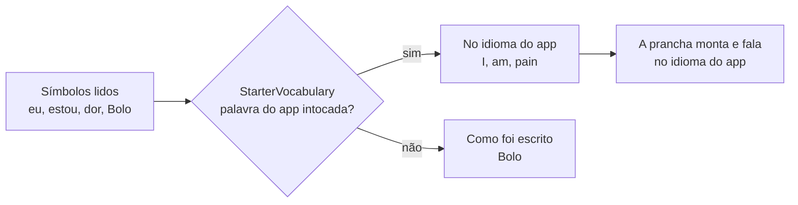

# Comunicação Aumentativa e Alternativa (CAA)

**Situação:**
- **Regras do Firestore:** implementadas, testadas no emulador (17 testes em
  `functions/security-tests/test/aac.test.mjs`) e publicadas no `oriteam-ori`.
- **Domínio, ViewModels, armazenamento de fotos e preferências:** implementados e
  testados na JVM (com Robolectric quando há Android no meio).
- **Telas:** implementadas e testadas na JVM com Robolectric: estados acessíveis,
  grade adaptável e permissões visíveis.
- **Não foi possível verificar:** a voz real (TextToSpeech) num aparelho, o seletor de
  fotos do sistema, leitores de tela reais, a grade com símbolos num aparelho real, o teclado
  com o celular deitado e o uso em tablet ou dobrável físicos.

## 1. O que o módulo faz e por que existe

A CAA ajuda quem não fala, ou fala com dificuldade, a se comunicar. A pessoa toca em
**símbolos** organizados em **pranchas**, monta uma **mensagem** e o aparelho a **fala**
em voz alta (ou a mostra em letras grandes).

O módulo existe para dar voz com **autonomia**. Por isso, nada é fixo:
- **Pranchas e símbolos** são criados pela própria pessoa. A prancha sugerida é só uma
  opção para quem não quer começar do zero.
- **Escrever** também é comunicar. Uma palavra que não está em nenhuma prancha pode
  ser digitada e entra na mensagem como qualquer símbolo.
- **Cada pessoa escolhe o próprio jeito de usar** (veja "Preferências"): montar frases,
  ouvir cada símbolo ou falar na hora.

## 2. Conceitos e modelo de dados

| Conceito | No código | Onde fica |
|---|---|---|
| Prancha: grupo de símbolos ("Comida") | `AacBoard` | `users/{dono}/aacBoards/{id}` |
| Símbolo: rótulo, frase associada, imagem | `AacSymbol` | `users/{dono}/aacBoards/{prancha}/symbols/{id}` |
| Mensagem em montagem | `AacMessage` (lista de `MessagePart`) | Só no aparelho (`SavedStateHandle`) |
| Frase salva | `SavedMessage` | `users/{dono}/aacSavedMessages/{id}` |
| Preferências | `AacPreferences` | DataStore local do aparelho |
| Foto de um símbolo | `SymbolImage.DevicePhoto` (aponta para um `StoredPhoto`) | Arquivo em `filesDir/aac_photos/` do aparelho e, com conta, `users/{dono}/photos/{id}` |

```text
users/{dono}/aacBoards/{boardId}
  name        texto, 1–40
  position    inteiro 0–999 (ordem das pranchas)
  language    código de idioma ("pt-BR", "es"…); ausente nas pranchas de antes, que são em português
  createdBy, createdAt, updatedAt

users/{dono}/aacBoards/{boardId}/symbols/{symbolId}
  label       texto, 1–40 (o que aparece)
  phrase      texto 1–200 ou null (o que é falado; null fala o rótulo)
  image       "emoji:💧", "device:<nome>.jpg" ou null
  position    inteiro 0–999 (ordem dentro da prancha)
  createdBy, createdAt, updatedAt

users/{dono}/aacSavedMessages/{messageId}
  text        texto, 1–500
  language    código de idioma da prancha em que foi montada; ausente nas de antes
  createdAt
```

- **Rótulo e frase associada:** o símbolo "Água" pode falar "Eu quero água". Assim a
  pessoa encontra o símbolo por uma palavra curta e é entendida por uma frase completa.
- **Imagens:** o documento guarda **só uma referência curta**, nunca a imagem. Isso
  mantém cada documento pequeno (leituras baratas e rápidas) e respeita o limite de
  1 MiB por documento do Firestore. As regras recusam qualquer outro formato, como
  `data:image/png;base64,...`.
- **A mensagem guarda uma cópia** do rótulo, da frase e da imagem de cada pedaço. Se o
  símbolo for editado ou excluído depois, a mensagem em montagem não muda.

## 3. Imagens e licenças

| Fonte | Como é usada | Licença e cuidados |
|---|---|---|
| **Emoji** (sugeridos ou digitados) | Desenhados pela fonte do próprio aparelho | Os caracteres Unicode não têm restrição de uso. O app **não distribui** imagens de emoji: quem desenha é a fonte do sistema (no Android, normalmente Noto Color Emoji, licença SIL OFL 1.1). A aparência pode variar entre fabricantes |
| **Fotos do aparelho** | Escolhidas pelo seletor de fotos do sistema, reduzidas e guardadas no aparelho e, com conta, na conta | A pessoa escolhe a foto e é responsável por ter direito de usá-la; o app avisa isso na tela. Com conta, a foto vai para a conta da pessoa e aparece nos aparelhos dela e de quem organiza as pranchas |
| **Pictogramas de terceiros** | **Não incluídos** | ARASAAC usa CC BY-NC-SA, que proíbe uso comercial e exige atribuição e a mesma licença. PCS/Boardmaker é proprietário. Incluí-los exigiria uma decisão de produto e jurídica (veja "Como estender") |

A tela de preferências tem a seção **"De onde vêm as imagens"**, que explica isso para
quem usa o app.

Os ícones das ações da mensagem (apagar, teclado, olho) não são símbolos de comunicação: vêm
do Material Icons (Apache 2.0), a mesma origem dos outros ícones do app, e estão em
`res/drawable`.

**Onde as fotos ficam:** no pacote `photos`, compartilhado com a foto de perfil (`domain/photos/PhotoStore.kt`, `data/photos/DevicePhotoStore.kt`). Com conta, cada foto também vai para a conta (`users/{dono}/photos/{id}`, até 100 KB, veja [dados.md](../dados.md#fotos)). Enquanto um aparelho ainda não baixou uma foto, o símbolo mostra um ícone neutro com o rótulo e continua funcionando.

**Como a foto é guardada** (`DevicePhotoStore`):
1. Lê só as dimensões e escolhe uma redução (`inSampleSize`), para nunca carregar uma
   foto de 12 MP inteira na memória.
2. Reduz para no máximo 512 px no maior lado, endireita fotos tiradas de lado (EXIF) e
   grava um JPEG de cerca de 50 KB.
3. Grava primeiro num arquivo temporário e só depois o renomeia. Se faltar espaço,
   nenhuma foto quebrada fica para trás e a tela mostra "Não foi possível guardar a
   foto no aparelho".
4. Nomes vindos do Firestore só são aceitos no formato `<letras-e-números>.jpg`, o que
   impede caminhos como `../`.

## 4. Permissões

| Ação | Usuário principal | Responsável com `manageCommunication` | Responsável sem ela |
|---|---|---|---|
| Ver e usar as pranchas para falar | ✅ | — (a tela do responsável só organiza) | ❌ |
| Criar, editar, ordenar e excluir pranchas e símbolos | ✅ | ✅ | ❌ |
| Adicionar foto do aparelho | ✅ | ❌ (pode manter a que já existe) | ❌ |
| Ler, criar e excluir frases salvas | ✅ | ❌ **nunca** | ❌ |

- **`manageCommunication`** é uma permissão nova do vínculo, **desligada por padrão**. Só
  o usuário principal liga, em Conta → Pessoas vinculadas → "Permitir que … organize
  minhas pranchas de comunicação".
- **Vínculos antigos**, que não têm a chave, são tratados como "sem permissão" no app e
  nas regras.
- **Frases salvas são privadas:** são o que a pessoa disse ou quer dizer. Nenhuma
  permissão do responsável dá acesso a elas.
- **Mensagem em montagem:** nunca vai para o servidor, a menos que a pessoa toque em
  "Salvar frase".
- **Onde as regras moram:**
  - `domain/aac/AacAccess.kt` decide **o que a interface mostra**.
  - `functions/firestore.rules` decide **o que o servidor aceita**.
  - Testes: `AacDomainTest`, `AacOrganizeViewModelTest` e `aac.test.mjs`.
- **Autoria:** novos documentos exigem `createdBy == quem grava` e o horário do servidor.
  Edições não podem mudar a autoria.

## 5. Componentes



- **Entrada do usuário principal:** a aba **Frases** (`MainDestination.COMMUNICATE`) abre
  `AacRoute`, que alterna entre comunicar (padrão), organizar e preferências. O "voltar"
  sempre retorna a comunicar.
- **Entrada do responsável:** em Acompanhados, a pessoa escolhida mostra as abas **Rotina**
  e **Comunicação**. A aba de comunicação só aparece com `manageCommunication`.

## 6. Fluxo: seleção, montagem, reprodução e persistência



### Seleção

- **Seletor de pranchas:** uma fileira rolável de chips mostra todas as pranchas e
  "Frases salvas", sempre a um toque, sem menus escondidos. "Mudar prancha", no menu "Mais", faz o mesmo perto das
  ações da mensagem (veja "Mudar prancha, cards do mesmo tamanho e mais palavras").
- **Prancha escolhida:** fica no `SavedStateHandle`. Se ela for excluída (inclusive pelo
  responsável, em outro aparelho), a primeira prancha restante é escolhida.
- **Sem nenhuma prancha:** a pessoa já pode escrever e falar. A tela também oferece
  "Usar a prancha sugerida" (14 símbolos) e "Montar minha prancha".

### Montagem

- **Pedaços da mensagem:** cada toque em símbolo (ou palavra escrita) vira um pedaço
  (`MessagePart`).
- **Remover:** tocar num pedaço o remove. O botão "Apagar" remove o último. "Apagar tudo"
  fica no menu "Mais", longe de toques acidentais.
- **Limite de 30 pedaços:** com a mensagem cheia, novos toques são ignorados e um aviso
  explica o motivo. Pedaços antigos nunca são descartados em silêncio.
- **Reinício do app:** a mensagem fica no `SavedStateHandle` e sobrevive a rotação e ao
  fechamento do app pelo sistema.

**Por que a barra é compacta.** Os símbolos são a parte principal da tela, então a barra
(`AacMessageBar` e `AacMessageActions`) tem uma linha de mensagem e uma linha de ações:

- **A mensagem não empurra os símbolos.** Acima da grade, ela fica em uma única linha que
  rola para o lado e mostra sempre o pedaço mais novo. Se crescesse, os símbolos mudariam de
  lugar sob o dedo enquanto a pessoa monta a frase, e lembrar a posição de cada símbolo faz
  parte de como a CAA é usada. Para rever uma mensagem longa, basta arrastar a linha ou usar
  "Mostrar em letras grandes". No celular deitado a mensagem fica ao lado da grade, então
  ela quebra linha e aparece inteira.
- **Quatro ações sempre à vista:** "Apagar", "Salvar", "Falar" e "Mais", cada uma com
  ícone e rótulo, porque nem todo mundo lê e nem todo ícone é óbvio. O menu "Mais" guarda
  as ações mais raras (veja "Montar", abaixo). "Escrever" fica no fim da linha da mensagem,
  também com ícone (um teclado) e rótulo.
- **Texto ampliado não quebra palavra.** Todas as ações têm a mesma largura. Se o rótulo mais
  longo não couber, elas passam para duas por linha.
- **O campo de texto abre só quando pedido.** "Escrever" abre o campo já com o cursor, abaixo
  da linha da mensagem, para o botão não sair do lugar. Fechar o campo não apaga o que foi digitado.
- **A barra nunca passa de metade da altura.** Com texto muito ampliado e o campo aberto, ela
  rola por dentro, e os símbolos continuam na tela.

### Reprodução

- **Voz:** `AndroidSpeechSynthesizer` usa o TextToSpeech do aparelho no idioma da prancha
  (uma prancha de antes é em português; veja "Idioma de cada prancha e frase").
  Funciona sem internet quando a voz está instalada. O motor é criado numa thread própria: na thread principal, ele
  atrasava em 24 ms a abertura de Frases.
- **"Falar" vira "Parar"** enquanto fala.
- **Sem motor de voz ou sem voz em português:** o estado fica `UNAVAILABLE`, a tela avisa,
  e "Falar" abre a mensagem em letras grandes (`MessageDisplayDialog`). Uma voz em outro
  idioma seria enganosa, por isso não é usada. Uma prancha num idioma sem voz instalada faz o
  mesmo só para ela.
- **Voz ainda ligando:** o motor de voz leva um momento para ligar quando a tela abre (estado
  `PREPARING`). Um toque nesse tempo espera por ele (`SpeechWhenReady`) e é falado assim que a voz
  fica pronta. Só o último toque espera, como na fala. Se a voz não ligar em 3 segundos
  (`VOICE_START_TIMEOUT_MILLIS`), o texto aparece em letras grandes, para a pessoa não ficar sem
  resposta. Antes, o primeiro toque numa frase pronta abria as letras grandes (falha B1, corrigida em
  07/11/2026).
- **Volume no zero:** como um app de mensagens avisa ao tocar um áudio com o celular sem som, depois de cada texto
  falado o ViewModel pergunta ao `SpeechVolume` (`AndroidSpeechVolume`) se a voz podia ser ouvida, no volume em que
  ela toca (veja "Volume da voz"). Em **Mídia**, o modo silencioso do celular não cala a voz: só o volume de mídia no
  zero, ou mudo. Em **Toque**, o silencioso cala também. Nesse caso aparece o aviso `VolumeOffWarning` acima da prancha ("O volume está no
  zero: ninguém ouviu a voz."), lido pelo leitor de tela assim que aparece, com **Aumentar o volume** (vai até pelo
  menos a metade e mostra o controle de volume do Android; se o Android não deixa, por causa do "Não perturbe", só
  abre o controle desse volume para a pessoa aumentar) e **Fechar**. O aviso some sozinho quando o próximo texto é
  falado com som. Sem voz nenhuma, o texto vai para as letras grandes e o aviso não aparece (não seria verdade). Ler o
  volume não precisa de permissão e não guarda nada.
- **Volume da voz** (em Voz, `VoiceSound`, guardado em `aac_voice_sound`): **Mídia** (o padrão, o volume de músicas e
  vídeos, como sempre foi) ou **Toque** (o volume do sino, que fica mudo no silencioso). O motor de voz recebe isso como
  `AudioAttributes` (`VoiceSoundOutput.kt`: `USAGE_MEDIA` ou `USAGE_NOTIFICATION_RINGTONE`). Enquanto a comunicação ou
  a tela Voz estão abertas, os botões de volume do aparelho mudam esse volume (`VoiceVolumeKeys`, que usa
  `volumeControlStream` da Activity): antes, sem nada tocando, o One UI mexia no volume do sino, e parecia que a voz
  usava o sino, mas ela tocava na mídia. "Voltar ao padrão" muda a voz, o tom e a velocidade, não o volume escolhido.
- **"Mostrar em letras grandes"** (no menu "Mais") abre essa tela a qualquer momento, por
  exemplo em lugares barulhentos.
- **Ciclo de vida:** cada tela tem a própria conexão com a voz, fechada (`close()`)
  quando o ViewModel termina. Nada fica falando ou ocupando memória depois.
- **Privacidade:** nada do que é falado é registrado em log ou enviado pelo app.

### Persistência

- **Frases salvas:** gravadas com `saveMessage`, pelo menu "Mais" → "Salvar frase".
  - **Offline:** a gravação vai para a fila do Firestore, e a tela diz "Alteração salva no
    aparelho…".
  - **Falha (sem permissão, rede):** a tela mostra o erro e a mensagem continua montada,
    para tentar de novo.
- **Tocar numa frase salva** a fala (ou a mostra em letras grandes).
- **Excluir** pede confirmação.
- **Listener de frases salvas:** só existe enquanto "Frases salvas" está aberto, o que
  economiza leituras.

## 7. Fluxo: organizar pranchas e símbolos

- **Layout:** um ou dois painéis, pela largura que a área recebe (720 dp ou mais), e não
  pelo tipo de aparelho. À esquerda ficam as pranchas; à direita, os símbolos ou o editor.
- **Ordenar:**
  - Cada linha tem botões **"Mover X para antes/depois"** (48 dp), em vez de arrastar,
    que é difícil para muitas pessoas.
  - O domínio calcula a nova ordem (`moved`) e grava **só as posições que mudaram**
    (`positionChanges`), num único lote atômico.
  - Isso também corrige empates deixados por duas pessoas adicionando ao mesmo tempo.
- **Criar ou renomear prancha:** a caixa de diálogo valida o nome (obrigatório, até 40
  caracteres, sem repetir) antes de gravar. Uma falha mantém a caixa aberta com o motivo.
- **Renomear e excluir** ficam no menu "⋮" da barra de título da prancha (desde 09/11/2026; antes eram dois botões
  largos que empurravam a lista de símbolos para o meio da tela do celular). Excluir aparece em vermelho.
- **Excluir prancha:**
  - Pede confirmação.
  - Lê os símbolos e exclui tudo num lote: nenhum símbolo fica sem prancha.
  - Depois que a exclusão é aceita, apaga as fotos desses símbolos deste aparelho.
- **Editor de símbolo** (`SymbolEditorViewModel`):
  - **Campos:** rótulo, frase falada (opcional) e imagem (emoji sugerido ou digitado,
    foto ou nenhuma).
  - **Antes de gravar:** relê a prancha para recusar rótulo repetido e prancha cheia (60).
  - **Id reservado uma vez:** tocar duas vezes em "Salvar", ou salvar depois de reiniciar
    o app, grava o mesmo símbolo.
  - **Fotos sem uso:** fechar sem salvar apaga as fotos importadas pelo formulário.
    Trocar a foto apaga a antiga depois que a edição é aceita.

## 8. Preferências e grade adaptável

**O que a pessoa escolhe** (valem para este aparelho):

| Preferência | Opções |
|---|---|
| Ao tocar em um símbolo | Montar a frase · Montar ouvindo cada símbolo · Falar na hora |
| Tamanho dos símbolos | Pequeno · Médio · Grande |
| Rótulos | Abaixo da imagem · Acima · Só o texto (letras maiores) · Só a imagem |

**Como a grade decide** (`aacGridSpec`):
- **Largura mínima do símbolo:** o maior entre dois valores:
  - a base da janela (96 dp em celular ou janela baixa, 120 ou 136 dp nas maiores) × o
    tamanho escolhido (0,7 · 1 · 1,3);
  - 67 dp × a escala do texto do sistema, para os rótulos caberem.
- **Colunas:** quantas couberem na **largura real da área**, entre 1 e 8. Num celular de
  360 dp, a grade recebe 312 dp (a largura menos as margens), o que dá 4 colunas no tamanho
  Pequeno, 3 no Médio e 2 no Grande.
- **Imagem e rótulo:** a imagem ocupa cerca de 60% do símbolo (de 40 a 160 dp). Símbolos com
  menos de 80 dp de largura usam rótulos menores, para palavras comuns caberem.
- **Efeito:** um tablet mostra **mais símbolos**, não símbolos gigantes. Texto ampliado
  mostra **menos símbolos por linha**, com palavras inteiras: 3 colunas até 1,3× e 2 colunas
  com 2×, num celular de 360 dp.
- **Celular deitado:** a mensagem vai para uma coluna ao lado, para a grade manter a
  altura, e os símbolos continuam pequenos para caberem várias linhas.

**Configurações conferidas** com testes de layout e com imagens geradas no computador
(Robolectric):

| Janela (dp) | O que foi olhado |
|---|---|
| 360 × 616 (celular de 360 × 780, sem as barras) | Texto 1×, 1,3× e 2×; Pequeno, Médio e Grande; só o texto; campo de texto aberto |
| 891 × 411 (celular deitado) | Mensagem ao lado, 5 colunas |
| 800 × 1100 (tablet) | 5 colunas, ações sem esticar |

No celular real (360 × 780 dp, texto 1×) foram conferidos a barra, o menu "Mais", o teclado
aberto ao tocar em "Escrever" e as opções de quem ainda não tem pranchas. A grade com símbolos
não foi vista no aparelho, porque a conta usada não tem pranchas.

## 9. Estados acessíveis

| Situação | Como aparece e é anunciado |
|---|---|
| Símbolo | Um único botão, lido pelo rótulo, com a ação "adicionar à mensagem" ou "falar". No modo "só a imagem", o rótulo vira a descrição do botão |
| Mensagem | Região viva: o leitor de tela anuncia "Mensagem: …" a cada mudança |
| Pedaço da mensagem | Botão "Remover Água" |
| Ações da mensagem | Ícone e rótulo visíveis. "Apagar" é lido como "Apagar última", "Mais" como "Mais ações da mensagem", e "Escrever" anuncia se o campo está aberto ou fechado |
| Voz indisponível | Aviso em texto + mensagem em letras grandes |
| Volume no zero | Aviso com ícone (escondido do leitor), texto e os botões "Aumentar o volume" e "Fechar", numa região viva |
| Carregando / vazio / erro | Componentes padrão (`StatefulContent`). Uma permissão negada é **erro**, nunca "vazio" |
| Offline | "Mostrando a última versão salva" / "Alteração salva no aparelho…" |
| Ordenar | Botões com nome ("Mover Água para antes"), desabilitados nas pontas |
| Excluir | Sempre com confirmação |

## 10. Limites e custo

| Limite | Valor | Onde é garantido |
|---|---|---|
| Pranchas por pessoa | 30 | App (validação) e regras (`limit <= 30` na lista) |
| Símbolos por prancha | 60 | App (validação) e regras (`limit <= 60`) |
| Frases salvas listadas | 50, as mais novas | App e regras (`limit <= 50`) |
| Pedaços por mensagem | 30 | Domínio |
| Frase salva | 500 caracteres | Domínio e regras |

- **Leituras:** abrir a comunicação lê no máximo 30 pranchas + 60 símbolos.
- **Índices:** nenhuma consulta usa filtros compostos. A ordem é aplicada no domínio e
  as frases salvas usam um único `orderBy`, coberto pelo índice automático. Por isso,
  `firestore.indexes.json` continua vazio.

## 11. Testes

```bash
cd android && ./gradlew testDevDebugUnitTest
cd functions/security-tests && npm test
```

| Pedido | Testes |
|---|---|
| **Operações** | `AacDomainTest` (mensagem, validação, duplicatas, limites, ordem); `AacOrganizeViewModelTest` (ordenar só o que muda, criar/renomear prancha, excluir com confirmação); `SymbolEditorViewModelTest` (criar no fim da prancha, duplicata, toque duplo, rascunho e id após reinício; um formulário fechado com o voltar do sistema abre de novo vazio e apaga a foto que tinha importado); `AacCommunicateViewModelTest` (três modos de toque, remover pedaços, salvar, prancha sugerida uma vez; um toque com a voz ainda ligando é falado quando ela fica pronta; a voz que não liga dá lugar às letras grandes; a prancha em outro idioma fala, monta e salva nele; uma frase falada com o volume no zero avisa, "Aumentar o volume" sobe e tira o aviso, ele some ao fechar ou quando um texto é ouvido, não aparece sem voz e é conferido também na frase que esperava a voz ligar); `AacDocumentMappingTest`; `DataStoreAacPreferencesRepositoryTest` |
| **Estados acessíveis** | `AacScreenTest` (símbolo como um botão com rótulo e ação, rótulo oculto ainda lido, região viva da mensagem, botões de mover com nome, aviso de voz indisponível, aviso de volume no zero com os dois botões, sem pranchas ainda dá para escrever); `AacMessageBarTest` (ações em uma linha, "Falar" vira "Parar", menu "Mais", ações desabilitadas sem mensagem, campo abre com foco e anuncia o estado, texto digitado não se perde, texto ampliado não quebra palavra) |
| **Grade adaptável** | `AacGridSpecTest` (colunas pela largura real da grade em cada tamanho e escala de texto); `AacBoardLayoutTest` (três linhas inteiras de símbolos num celular comum, símbolos parados enquanto a mensagem cresce, pedaço mais novo visível, barra limitada com texto ampliado, opções sem pranchas visíveis, rótulo centralizado, celular deitado); `AacScreenTest` (mais colunas em área larga, menos com texto ampliado); `FeatureComponentsTest` (mensagem ao lado no celular deitado) |
| **Permissões** | `AacDomainTest`; `AacOrganizeViewModelTest` (responsável sem permissão não grava nada; com permissão não apaga fotos); `SymbolEditorViewModelTest` (responsável não adiciona foto); `AacScreenTest` (organizador sem permissão não oferece mudanças); emulador: 15 testes (dono, responsável com/sem permissão, vínculo antigo e revogado, frases privadas, formato da imagem, prancha inexistente, limites, autoria, concessão da permissão) |
| **Falhas de armazenamento** | `DevicePhotoStoreTest` (imagem ilegível, pasta bloqueada → nenhuma foto quebrada, redução real para 512 px, nomes inseguros); `SymbolEditorViewModelTest` (falha de rede mantém o formulário, foto ilegível/sem espaço explicada); `AacCommunicateViewModelTest` (falha ao salvar mantém a mensagem; gravação offline) ; `AacOrganizeViewModelTest` (exclusão que falha mantém as fotos) |

Para conferir que os testes pegam falhas reais, fiz mutações temporárias, desfeitas logo
depois:
- **No app:**
  - tirei a trava da prancha sugerida → falhou "the starter board is created once…";
  - tirei o plano B das letras grandes → falhou "without a voice the message is shown…";
  - desfiz de uma vez as correções de layout (mensagem em uma linha, largura igual das ações,
    limite de altura da barra, colunas no celular, rótulo centralizado) → 10 testes de
    `AacBoardLayoutTest`, `AacGridSpecTest` e `AacMessageBarTest` falharam.
- **Nas regras:**
  - abri as frases salvas ao responsável → falhou "stay private even from a caregiver…";
  - tirei a checagem de prancha existente → falhou "cannot create a symbol in a board
    that does not exist".

## 12. Como estender

- **Novo campo no símbolo** (por exemplo, cor de categoria):
  1. Acrescente-o em `hasAll`/`hasOnly` de `isValidSymbol` nas regras, com teste.
  2. **Publique as regras.**
  3. Atualize `AacDocumentMapping.kt`, `SymbolDraft` e o editor.
- **Pictogramas de terceiros:**
  1. Confirme se a licença permite o uso pretendido. Por exemplo, ARASAAC não pode ter uso
     comercial e exige atribuição e a mesma licença.
  2. Crie um novo tipo em `SymbolImage` (por exemplo, `"pictogram:<id>"`).
  3. Aceite-o em `isValidImage` nas regras.
  4. Mostre a atribuição na seção "De onde vêm as imagens".
- **Fotos no Cloud Storage** (se o plano Blaze for contratado): troque a implementação de
  `CloudPhotoRepository` (`data/photos`); `PhotoStore`, a CAA e o perfil não mudam. A
  referência `device:` dos símbolos continua valendo.
- **Nova preferência:** acrescente-a em `AacPreferences` e
  `DataStoreAacPreferencesRepository` (valor desconhecido volta ao padrão) e na tela de
  preferências.
- **Nova permissão:** mude `AacAccess.kt` **e** `firestore.rules` juntos, com testes nos
  dois lados.

## 13. Limitações

- **Fotos:**
  - Ficam só no aparelho que as adicionou.
  - Em outro aparelho, ou para o responsável, aparece um ícone neutro com o rótulo.
  - Entram no backup automático do Android, se a pessoa o tiver ativado.
- **Emoji** são desenhados pela fonte do aparelho e podem mudar de aparência entre
  fabricantes.
- **Preferências** valem por aparelho, não por conta. Num aparelho compartilhado, valem
  para todos.
- **Mensagem longa no celular em pé:** nem todos os pedaços ficam à vista ao mesmo tempo, em
  troca de os símbolos não mudarem de lugar. Para rever, é preciso arrastar a linha ou usar
  "Mostrar em letras grandes".
- **Palavras muito longas** ainda podem quebrar dentro do símbolo: a grade reserva espaço para
  palavras comuns, de até cerca de 8 letras.
- **Exclusão de prancha:** apaga até 60 símbolos num lote. Se duas pessoas passarem desse
  número ao mesmo tempo, sobras ficam invisíveis (sem prancha) até serem limpas.
- **A voz depende do motor instalado no aparelho.** Velocidade e escolha de voz não são
  configuráveis no app.
- **Não há:**
  - histórico de mensagens faladas (de propósito, por privacidade);
  - pranchas compartilhadas entre pessoas;
  - navegação de um símbolo para outra prancha.

## Tela "Formar frase" e uso sem conta

A tela abre em **Prontas** e tem duas abas no lugar do título:

- **Prontas:** um toque fala. Primeiro as frases salvas da pessoa, depois as que vêm com o app (`ReadyPhrase.kt`), cada uma com uma imagem. Enquanto fala, aparece "Parar". Falar uma frase pronta não mexe na mensagem que está sendo montada.
- **Montar:** a frase no topo, com o botão **Escrever** (ícone de teclado e a palavra embaixo) para digitar o que não tem símbolo; a grade no meio, com uma cor suave por linha; e **Apagar, Salvar, Falar e Mais** embaixo, ao alcance do polegar. **Mais** guarda "Apagar tudo", "Mostrar em letras grandes", "Organizar pranchas" e "Preferências da comunicação". As abas de pranchas só aparecem quando há mais de uma.

**Trocar de aba só mostra o que já está pronto.** Os símbolos da prancha de Montar continuam lidos com Prontas aberta
(`AacBoardContent.buildBoard`: a prancha escolhida, ou a última usada), e as frases salvas, lidas só com Prontas
aberta, guardam a lista lida por último. Na tela (`AacTabs`), cada aba que já apareceu fica montada, fora de vista
enquanto a outra está aberta (`outOfSightUnless`: não é desenhada, tocada nem lida pelo leitor de tela), e Montar é
montada antes, escondida, quando a tela fica parada (`rememberScreenRested`). A comunicação também fica montada por
baixo de Organizar, Preferências e Nova palavra (`KeptUnder`), então voltar só a mostra de novo. Antes, cada troca
montava a prancha outra vez (66 a 144 ms no tablet de teste); agora leva de 26 a 55 ms. Um campo da aba que sai de
vista solta o teclado.

**Adicionar palavras:** o último quadro da grade, **Nova palavra**, abre o formulário do símbolo, com imagem, emoji ou foto, e a palavra fica na prancha aberta. No campo de "Escrever", "Guardar na prancha" leva o texto digitado para o mesmo formulário.

**Frases que vêm com o app:** ficam em `strings.xml`, não no banco. Assim funcionam na primeira abertura, sem rede e sem gastar o limite de frases salvas. **Limitação:** não dá para editar nem esconder essas frases.

### Como a frase montada fica coerente (`PortugueseGrammar.kt`)

`composeSentence` recebe as palavras tocadas e devolve cada uma como será dita. É uma tabela pequena, não um corretor: só faz o que tem certeza, e nunca muda a ordem.

| Regra | Toques | Fala |
|---|---|---|
| Palavra que o verbo pede | eu, gosto, você | Eu gosto **de** você |
| "com" só para estados | estou, dor | Estou **com** dor |
| Nada onde não cabe | estou, feliz | Estou feliz |
| Sem repetir o que já foi tocado | estou, com, dor | Estou com dor |
| Concordância com quem vem antes | você, quero, água | Você **quer** água |
| Contrações | eu, gosto, ele | Eu gosto **dele** |

**Na barra:** a palavra acrescentada aparece sem caixa entre os trechos, porque não foi tocada e não há o que remover. A palavra concordada aparece já mudada. Quem lê a frase vê o que será dito, exceto as contrações, que só existem na fala.

**Para estender:** novos verbos entram em `verbs`, e novos estados em `states` (em `PortugueseGrammar.kt`), com um caso em `SentenceGrammarTest`. Palavras fora da tabela ficam como foram tocadas, então "adoro você" não ganha "de".

**Frase de um símbolo:** a frase associada só vale quando ele está sozinho. Numa mensagem com mais de um trecho, vale o rótulo, o que evita "estou estou com sono", inclusive em pranchas antigas. No modo "fala ao tocar", o primeiro símbolo fala a frase e os seguintes, a palavra.

**Prancha sugerida:** só palavras, em minúsculas: as quatro linhas mais urgentes (eu, você, estou, não / quero, preciso, gosto, com / água, comida, banheiro, ajuda / dor, sono, fome, frio) e, desde 08/11/2026, mais quatro (sim, mais, ele/ela, nós / ir, comer, beber, dormir / brincar, mamãe, papai, remédio / calor, medo, feliz, triste). Vale só para pranchas novas. "com" não tem imagem. Em inglês e em espanhol, os mesmos lugares têm as palavras de cada idioma (veja "A frase montada em cada idioma"). O vocabulário, a gramática e as frases prontas ainda precisam de revisão de alguém de fonoaudiologia.

- Sem conta, pranchas e frases salvas ficam no aparelho. Veja [uso-local.md](uso-local.md).
- Cada uso de "Falar" soma 1 na contagem do dia para os Relatórios. Essa contagem não guarda o que foi dito e não sai do aparelho.

**Fotos de símbolos:** com conta, ficam salvas nela e aparecem nos outros aparelhos, no aparelho do responsável que gerencia as pranchas inclusive. Só a pessoa pode adicioná-las. Limites em [dados.md](../dados.md#fotos).

## Mudanças de 03/11/2026 (fim da lista de revisão)

**Cores das pranchas.** A cor de um símbolo diz o tipo da palavra, como nas chaves de cor usadas em CAA: pessoas em amarelo, ações em verde, sentimentos em azul e, desde 09/11/2026, respostas e cortesia (sim, não, por favor) em rosa. As cores são só dos símbolos (`OriWordColors`), não as das áreas do app. Só as palavras que a gramática conhece têm cor (`wordClassOf` em `SentencePiece.kt`); as outras ficam sem cor, porque uma cor que não significa nada só acrescentaria estímulo. Antes, a cor vinha da linha da grade e mudava ao girar o celular.

**Contagem de comunicação.** Conta cada vez que a pessoa comunica uma mensagem: "Falar" (com voz, ou em letras grandes quando não há voz), "Mostrar", uma frase pronta ou um símbolo no modo que fala cada um. A voz que repete cada símbolo enquanto a frase é montada não conta, porque é retorno. A contagem continua só no aparelho, e o relatório diz isso.

**Frase longa.** A frase continua numa linha só acima dos símbolos, para eles não saírem de baixo do dedo. Quando há palavras roladas para a esquerda, aparece "…" no começo. A frase inteira está em "Mostrar" e no leitor de tela.

**Estrutura.** A leitura do que aparece embaixo (pranchas, símbolos, frases salvas) fica em `AacBoardContent`, e a mensagem sendo montada em `MessageDraft`. As fotos decodificadas recentes ficam num cache (`DecodedPhotos`), para a grade não piscar ao rolar.

**Testes:** `UsabilityTest` ("…" numa frase longa), `DecodedPhotosTest`.

## Trocar de prancha sem piscar (07/11/2026)

- **Ao tocar em outra prancha:** os símbolos da anterior ficam até os novos chegarem, e a grade nova aparece de uma vez, sem esmaecer símbolo por símbolo.
- **Quando a leitura passa de 300 ms**, aparece "Carregando".
- **Onde está no código:** `loadingAfter` em `AacBoardContent` e `symbolsKey` no estado da tela.
- **Toque num símbolo:** ele afunda e volta sem refazer a grade (`Modifier.pressScale`, um `Modifier.Node`).
- **Fotos:** o caminho de uma foto já conhecida não consulta mais o disco a cada toque.

## Voz (07/11/2026)

### O que é e por que existe

A voz é a forma como a pessoa é ouvida, então ela precisa poder ajustá-la até soar como quer. Em
**Configurações → Comunicação**, e nas preferências de Formar frase, a seção **Voz** oferece:

- **Estilo:** Grave, Natural, Aguda e Criança. Cada um define tom e velocidade de uma vez.
- **Voz do aparelho:** as vozes instaladas no idioma do app (português, inglês ou espanhol), numeradas: primeiro as da região do aparelho, depois as que funcionam sem internet. Uma voz que precisa de internet diz isso.
- **Tom** e **Velocidade:** de 50% a 200%, em passos de 5%, para o ajuste fino.
- **Ouvir exemplo**, **Voltar ao padrão** e **Instalar mais vozes**. Este último abre a tela do motor de voz do Android.

Escolher uma voz ou um estilo toca o exemplo na hora; um controle deslizante toca quando o dedo solta. Com a voz
ainda ligando, o exemplo toca assim que ela fica pronta.

### Homem, mulher, criança

**Limitação:** os motores de voz do Android não informam se uma voz é de homem, de mulher ou de criança. Só dão um
nome técnico, como `pt-br-x-afs-local`. Por isso:

- as vozes aparecem numeradas, para ouvir e escolher;
- os estilos mudam o tom e a velocidade da voz escolhida: uma voz grave com o estilo Grave soa como um homem, e o estilo Criança é mais agudo e um pouco mais rápido.

Quais vozes existem depende do aparelho e do motor instalado (Google, Samsung…).

### Quem participa

| Peça | Onde | Papel |
|---|---|---|
| `VoiceSettings`, `VoicePreset` | `domain/preferences/AacPreferences.kt` | Voz escolhida, tom e velocidade, os limites (`MIN_`/`MAX_VOICE_*`) e os estilos |
| `SpeechSynthesizer` (`voices`, `configure`) | `domain/aac` | O contrato da voz: as vozes do aparelho e como falar |
| `AndroidSpeechSynthesizer` | `data/aac` | Lista as vozes instaladas no idioma do app (`TextToSpeech.voices`) e aplica `setVoice`, `setPitch` e `setSpeechRate`. Uma voz que saiu do aparelho volta para a padrão |
| `DataStoreAacPreferencesRepository` | `data/preferences` | Guarda `aac_voice_id`, `aac_voice_pitch` e `aac_voice_rate` no aparelho |
| `VoiceSettingsViewModel`, `VoiceSettingsSection` | `ui/app/screens/aac` | A tela. Tem um motor de voz próprio, para o exemplo soar como as pranchas |
| `OriLabeledSlider` | `ui/components/form` | Controle deslizante com nome, valor e o sentido de cada ponta, lido pelo leitor de tela |
| `AacCommunicateViewModel` | `ui/app/screens/aac` | Passa a voz escolhida ao motor das pranchas e segue cada mudança |

### Onde fica guardado

No aparelho, junto das outras preferências da CAA, com o volume em que a voz toca (`aac_voice_sound`). As vozes
instaladas mudam de um aparelho para outro, então a escolha não vai para a conta.

### O que acontece em erro

- **Sem voz no idioma do app:** a seção diz isso e oferece "Instalar mais vozes"; Falar continua mostrando a mensagem em letras grandes.
- **Voz escolhida removida do aparelho:** a voz padrão volta.
- **Valores fora dos limites:** voltam para dentro deles, ao salvar e ao ler.

### Testes

- **`VoiceSettingsTest`:** estilos, faixa de tom e de velocidade.
- **`DataStoreAacPreferencesRepositoryTest`:** a voz e o volume dela são guardados, dentro da faixa.
- **`VoiceSettingsViewModelTest`:**
  - escolher uma voz ou um estilo salva e toca;
  - o deslizante só salva ao soltar;
  - uma escolha feita com a voz ainda ligando é ouvida quando ela fica pronta;
  - voltar ao padrão mantém o volume escolhido;
  - escolher o volume salva e toca o exemplo nele;
  - o exemplo usa o que está na tela.
- **`AacCommunicateViewModelTest`:** as pranchas falam com a voz escolhida e seguem uma mudança; com a voz no
  toque, só o volume do toque decide o aviso, e é ele que sobe.
- **`VoiceSettingsSectionTest`:**
  - vozes numeradas;
  - tom e velocidade lidos por nome e valor;
  - Mídia escolhida no começo, Toque escolhido com um toque;
  - o estado sem voz.

O som real só se confere no aparelho, porque os testes usam um motor falso.

## Mudanças de 07/11/2026 (segunda rodada)

- **Voz que falha depois de aceitar.** O motor avisa os textos que aceitou e não conseguiu dizer
  (`SpeechSynthesizer.failures`), por exemplo uma voz que precisa de internet, sem internet. Uma mensagem dita com
  "Falar" ou uma frase pronta aparece então em letras grandes; a palavra de um símbolo, que é só retorno, não.
  Teste: `AacCommunicateViewModelTest`.
- **"Parar" flutua sobre a grade** de frases prontas, que tem sempre o espaço dele no fim: a grade não encolhe e
  cresce a cada frase falada. Tem a largura de um formulário, no centro.
- **Frases salvas.** Quando chegam, as frases prontas deslizam para baixo em vez de pular (`itemAnimation`).
- **Letras grandes** (`MessageDisplayDialog`): a mensagem fica no meio da tela, maior onde há espaço, e "Fechar"
  tem a largura de um formulário. É um `OriDialog` de tela inteira, desenhado na janela do app: abre em uns 30 ms
  (como janela própria do Android, eram 159 ms).
- **Montar sem pranchas:** as ações ficam no centro; sem mensagem, "Apagar", "Salvar" e "Falar" ficam no mesmo
  tom discreto e legível (55%), e "Falar" mantém o fundo; o estado vazio fica centralizado e na largura de um
  formulário.
- **Voz:** Estilo, Tom e Velocidade vêm primeiro; as vozes do aparelho ficam numa lista que abre ao tocar ("Ver as
  7 vozes do aparelho"), com a voz em uso escrita.
- **Gramática por idioma** (`SentenceGrammar.kt`): o português usa as tabelas de sempre (`PortugueseGrammar`); um
  idioma sem tabelas usa `PlainGrammar`, que diz as palavras como foram tocadas e não pinta nenhuma por classe.
  Desde 08/11/2026 a gramática é a do idioma da prancha (veja "Idioma de cada prancha e frase"). Teste:
  `SentenceGrammarTest`.

## Idioma de cada prancha e frase (08/11/2026)

### O que é e por que existe

Antes, nada dizia em que idioma uma prancha estava: a voz e a gramática usavam o idioma do app. Trocado o idioma
do aparelho, ou aberta a prancha por quem acompanha num aparelho em outro idioma, uma prancha em português seria
lida por uma voz em inglês. E uma pessoa bilíngue não conseguia ter uma prancha em cada idioma (falha L4).

Agora cada prancha e cada frase salva guardam o próprio idioma (`language`, um código como `pt-BR` ou `es`), e a
voz, a gramática e as cores dos símbolos seguem esse idioma, não o do aparelho.

### Como funciona

- **Prancha nova** (em "Organizar" ou a sugerida): recebe o idioma do app no momento em que é criada
  (`appLanguageTag`) e fica nele daí em diante.
- **Prancha e frase de antes:** não têm o campo e são em português (`OLD_CONTENT_LANGUAGE`, lido por
  `contentLanguage`), porque antes de 08/11/2026 o app só existia em português. Seguir o idioma do app faria uma
  voz em inglês ler "Eu quero água" quando o app fosse posto em inglês.
- **Símbolos:** não têm idioma próprio; seguem a prancha.
- **Mensagem em montagem:** usa a gramática do idioma da prancha aberta (`AacMessage.inLanguage`). "estou, dor"
  vira "Estou com dor" numa prancha em português; numa em espanhol, que ainda não tem tabelas, as palavras saem como
  foram tocadas. Uma palavra digitada segue a prancha aberta.
- **Frase salva:** guarda o idioma da prancha em que foi montada e é dita nele, mesmo aberta depois noutro idioma.
- **Frases prontas:** vêm do `strings.xml`, então estão no idioma do app e são ditas nele.
- **Voz:** `speak(texto, idioma)`. O motor troca de idioma só quando precisa. A voz escolhida em "Voz" é do idioma
  do app; noutro idioma fala a voz padrão daquele idioma, com o tom e a velocidade escolhidos.



### Quem participa

| Peça | Onde | Papel |
|---|---|---|
| `AacBoard.language`, `SavedMessage.language`, `contentLanguage` | `domain/aac` | O idioma; `null` quer dizer "de antes", em português |
| `appLanguageTag` | `domain/common/AppLocale.kt` | O idioma do app como código (`pt-BR`), gravado nas pranchas e frases novas |
| `grammarFor`, `AacMessage.inLanguage` | `domain/aac` | A gramática de um idioma (`pt`, `pt-BR` e `pt-PT` usam a mesma) |
| `AacBoardContent.language` | `ui/app/screens/aac` | O idioma da prancha escolhida |
| `AacCommunicateViewModel` | `ui/app/screens/aac` | Monta, fala e salva no idioma da prancha; diz cada frase salva no idioma dela |
| `AndroidSpeechSynthesizer.speak` | `data/aac` | Troca o idioma do motor; devolve `false` se não houver voz nele |
| `hasValidLanguage` | `functions/firestore.rules` | Aceita o campo só como código de idioma |

### Onde fica guardado e o que as regras conferem

- **Com conta:** o campo `language` em `users/{dono}/aacBoards/{id}` e em `users/{dono}/aacSavedMessages/{id}`.
  As regras aceitam o campo ausente (pranchas e apps de antes) ou um texto de até 35 caracteres no formato de
  código de idioma (`pt-BR`, `es`, `es-419`); recusam texto livre ("português"), número e texto vazio. Renomear uma
  prancha mantém o idioma. Regras publicadas em 08/11/2026.
- **Sem conta:** a coluna `language` em `aac_boards` e `saved_messages`, no Room versão 4 (`MIGRATION_3_4`, que só
  acrescenta as colunas, vazias para o que já existia).
- **Passagem para a conta:** cada prancha e frase leva o idioma dela; as de antes vão como `pt-BR`.

### O que acontece em erro

- **Sem voz no idioma da prancha:** `speak` devolve `false` e a mensagem aparece em letras grandes. Uma voz de outro
  idioma lendo a frase seria enganosa, por isso não é usada.
- **Sem voz no idioma do app:** o motor fica `UNAVAILABLE`, como antes, também para as pranchas em outro idioma.
- **Um código que o app não conhece** (gravado por uma versão futura): a gramática é a sem tabelas e a voz é a
  daquele idioma, se houver.

### Testes

- **`AacCommunicateViewModelTest`:**
  - uma prancha em espanhol, com o app em português, monta "A mí me gusta el agua" (a gramática do espanhol), fala
    em `es` e salva com `es`;
  - uma prancha de antes monta "Estou com dor", fala e salva em `pt-BR`, mesmo com o app em inglês;
  - sem voz em espanhol, a mensagem aparece em letras grandes;
  - uma frase salva é dita no idioma dela, uma pronta no do app;
  - a prancha sugerida é criada em `pt-BR`.
- **`AacOrganizeViewModelTest`:** uma prancha nova é criada no idioma do app.
- **`AacDocumentMappingTest`**, **`LocalRepositoriesTest`:** o idioma é gravado e lido, com conta e sem conta.
- **`MoveLocalDataToAccountTest`:** o que passa para a conta mantém o idioma; o de antes vai como `pt-BR`, mesmo
  com o app em inglês.
- **`AacPhrasesPaneTest`:** uma frase salva é dita no idioma dela, uma de antes em `pt-BR`, uma pronta no do app.
- **`OriDatabaseMigrationTest`:** depois da migração, o que já existia fica sem idioma e uma prancha nova guarda `es`.
- **No emulador** (`aac.test.mjs`): "a board may record its language, as a language tag" e "may record the
  language they are in". Os dois falham com as regras de antes.

### Limitações

- Não há como escolher nem trocar o idioma de uma prancha na tela: ela recebe o do app ao ser criada. Uma prancha
  em espanhol se cria com o app em espanhol (no Android 13+, em Configurações do Android → Apps → ori → Idioma).
  Uma escolha de idioma ao criar a prancha seria o próximo passo para quem é bilíngue.
- Português, inglês e espanhol têm gramática; um idioma sem tabelas diz as palavras como foram tocadas e não pinta
  símbolos.
- O aviso "Voz indisponível" e a lista de vozes em "Voz" olham só o idioma do app.

## A frase montada em cada idioma (08/11/2026)

### O que é e por que existe

O app passou a ter inglês e espanhol, e a CAA tinha gramática só em português. Uma prancha em inglês ou espanhol
diria as palavras como foram tocadas: "I want go", "yo me gusta agua". Agora cada idioma tem a sua gramática, com
as mesmas funções do português: concordância, a palavra que o verbo pede, junções na fala, cores e uma prancha
sugerida que a gramática conhece.

### Como funciona

As três gramáticas usam a mesma máquina, em `SentencePiece.kt`:

- **`GrammarTables`** guarda as tabelas de um idioma: os verbos (a forma de cada pessoa e a palavra que pedem antes
  de cada tipo de palavra), quem é sujeito, as palavras de ligação, a negação, os estados ("dor", "pain"), as
  qualidades ("hungry", "cansada") e as ações no infinitivo ("go", "comer").
- **`read`** percorre as palavras tocadas e faz o que vale para todos: o verbo concorda com quem vem antes, a
  negação mantém o verbo ligado ao que vem depois, e um pronome depois do verbo não é sujeito. Devolve, para cada
  palavra, o que ela é (`Reading`) e como fica (`SentencePiece`).
- **`spoken`** junta os pedaços e aplica as junções da fala de cada idioma.
- Cada idioma acrescenta as regras que só ele tem, depois de `read`.



| | Português | Inglês | Espanhol |
|---|---|---|---|
| Arquivo | `PortugueseGrammar.kt` | `EnglishGrammar.kt` | `SpanishGrammar.kt` |
| Concordância | eu quero, você quer, nós queremos, eles querem | I want, he wants, you are | yo quiero, tú quieres, ella quiere, ellos quieren |
| Palavra que o verbo pede | "de" (gosto, preciso), "com" (estou + estado) | "to" antes de ação (want, need, like, have), "in" antes de "pain" | "que" antes de ação (tengo), "con" antes de estado (estoy) |
| Junções na fala | dele, delas, de mim, comigo, conosco | — | al, del, conmigo, contigo, de mí, para ti… |
| Verbo que faltou | "eu fome" vira "eu **estou com** fome"; "eu cansada", "eu **estou** cansada" | "I hungry" vira "I **am** hungry"; "I pain", "I **am in** pain"; "I not hungry", "I **am** not hungry" | "yo hambre" vira "yo **tengo** hambre"; "yo cansada", "yo **estoy** cansada" |
| Artigo do que se conta | — ("preciso de banheiro" já soa natural) | "I need **the** bathroom" | "necesito **el** baño" |
| Regras só do idioma | — | "not" + verbo vira "don't"/"doesn't" e o verbo volta à forma simples; "I", "he", "she", "we", "they" depois do verbo ou de preposição viram "me", "him"…; "i" vira "I" | "yo" + "me gusta" vira "a mí me gusta"; o que se gosta ganha artigo ("el agua"), só para substantivos de gênero certo; "me gusta" concorda com quem é querido ("me gustas tú") |

**Na barra**, como no português, aparece o que será dito: "I **don't** want", "**a** mí me gusta **el** agua". Só as
junções ficam para a fala.

**Prancha sugerida.** Os mesmos lugares, com palavras de cada idioma que a gramática conhece (as 16 primeiras; as
outras 16 estão em "Mudar prancha, cards do mesmo tamanho e mais palavras"):

| Português | eu, você, estou, não | quero, preciso, gosto, com | água, comida, banheiro, ajuda | dor, sono, fome, frio |
|---|---|---|---|---|
| Inglês | I, you, am, not | want, need, like, with | water, food, bathroom, help | pain, sleepy, hungry, cold |
| Espanhol | yo, tú, tengo, no | quiero, necesito, me gusta, con | agua, comida, baño, ayuda | dolor, sueño, hambre, frío |

Em espanhol, "tengo" ocupa o lugar de "estou": "tengo hambre" é como se diz, e "estoy con hambre" soaria regional.

### Quem participa

| Peça | Onde | Papel |
|---|---|---|
| `GrammarTables`, `Verb`, `read`, `spoken` | `domain/aac/SentencePiece.kt` | A máquina comum |
| `PortugueseGrammar`, `EnglishGrammar`, `SpanishGrammar` | `domain/aac` | As tabelas e regras de cada idioma |
| `grammarFor` | `domain/aac/SentenceGrammar.kt` | A gramática de um código de idioma (`en-US` usa a do inglês) |
| `strings_aac.xml` de `values`, `values-en`, `values-es` | `res` | As palavras da prancha sugerida e as frases prontas |

### O que acontece em erro

- **Palavra fora das tabelas:** fica como foi tocada, sem conector e sem cor. Uma tabela só cresce com certeza: em
  inglês, "help" não é ação ("I need help" é mais comum que "I need to help"); em espanhol, um substantivo sem
  gênero certo não ganha artigo.
- **Idioma sem gramática** (uma prancha em francês): as palavras saem como foram tocadas (`PlainGrammar`).

### Testes

- **`SentenceGrammarTest`:** o português, com os mesmos casos de antes, mais "eles querem" e "delas"; todo idioma do
  app tem a sua gramática.
- **`EnglishGrammarTest`:** concordância, "to" e "in", "don't"/"doesn't", "me"/"him", "I" maiúsculo, o verbo que
  faltou (com e sem "not"), "the", cores.
- **`SpanishGrammarTest`:** concordância, "que" e "con", "a mí me gusta el agua", "me gustas tú", o verbo que
  faltou (com e sem "no"), "el baño", junções, cores.
- **Os três:** nada é inventado quando o verbo não é certo: "I water", "yo agua" e "eu água" ficam como foram
  tocados, porque pode ser querer, precisar ou gostar.
- **`StarterBoardLanguagesTest`:** lê a prancha sugerida de `values`, `values-en` e `values-es` e confere as cores,
  quatro frases e cada pessoa ("eu", "você") com cada sentimento (dor, sono, fome, frio), sem o verbo, com
  "não" e com "banheiro", em cada idioma. Uma tradução que troca uma palavra sem a gramática falha aqui.
- **`AacCommunicateViewModelTest`:** uma prancha em espanhol monta e fala "A mí me gusta el agua" com o app em
  português.

### Como estender

Um verbo novo entra em `verbs` do idioma, com as cinco pessoas e o que pede (`connectors`); um estado, em `states`;
uma ação, em `actions`. Sempre com um caso no teste do idioma. Um idioma novo segue os passos de
[idiomas.md](../idiomas.md#como-traduzir-para-um-idioma-novo).

### Limitações

- Dois sujeitos juntos ("I and he", "eu e ele") não viram plural.
- O verbo que faltou só entra entre uma pessoa e um sentimento. "I water" fica assim, porque o verbo poderia ser
  "want", "need" ou "like".
- O adjetivo não concorda com o sujeito: "eles cansado" vira "eles estão cansado".
- A ordem nunca muda: "I not am hungry" fica como foi tocado.
- Em espanhol, o gênero de um adjetivo ("cansado"/"cansada") é de quem toca, e só os substantivos da tabela ganham
  artigo depois de "me gusta".
- O vocabulário e as frases em inglês e espanhol não foram revisados por fonoaudiologia nem por falantes nativos.

## A prancha sugerida segue o idioma do app (08/11/2026)

### O que é e por que existe

Com o app em inglês, a prancha "Básico" criada em português continuava com "eu", "estou", "dor", e as palavras em
inglês digitadas ao lado montavam "I hungry" e "I pain". A prancha sugerida é vocabulário do próprio app, como as
frases prontas, então agora ela acompanha o idioma do app: em inglês aparece "Basics" com "I", "am", "pain", e monta
e fala em inglês; em espanhol, "Básico" com "yo", "tengo", "dolor".

### O que acompanha o idioma, e o que não

- **Uma palavra que o app pôs na prancha, intocada:** a mesma palavra, a mesma imagem e sem frase própria. Aparece,
  monta e é dita no idioma do app.
- **O nome "Básico"**, enquanto a prancha não for renomeada, vira "Basics" em inglês.
- **O que a pessoa escreveu ou mudou** (uma palavra nova, outra imagem, uma frase própria, outro nome) é dela e fica
  como foi escrito.
- **A prancha com alguma palavra do app** passa a montar e falar no idioma do app, para a gramática e a voz baterem
  com as palavras na tela. Uma prancha sem nenhuma palavra do app fica no idioma dela (L4).
- **Nada é regravado.** A tradução acontece só na tela: a prancha guardada não muda, e quem acompanha num aparelho em
  outro idioma vê as palavras no idioma do aparelho dele.
- **Editar** uma palavra traduzida abre o formulário com a palavra como ela aparece; salvar a torna da pessoa.



### Quem participa

| Peça | Onde | Papel |
|---|---|---|
| `StarterVocabulary` | `domain/aac` | O nome e as palavras da prancha sugerida em cada idioma; `boardIn` e `symbolsIn` mostram uma prancha no idioma do app |
| `starterVocabularyOf` | `ui/app/screens/aac/StarterBoard.kt` | Lê o vocabulário dos textos de cada idioma (`values-pt`, `values-en`, `values-es`); cada palavra tem uma chave ("i", "am"…) |
| `DataModule.provideStarterVocabulary` | `di` | Lê uma vez e entrega às telas |
| `AacBoardContent` | `ui/app/screens/aac` | Formar: mostra as pranchas e os símbolos no idioma do app e diz em que idioma a prancha monta e fala |
| `AacOrganizeViewModel` | `ui/app/screens/aac` | Organizar: o mesmo, também para o formulário de edição |

O idioma do app é lido de novo cada vez que a tela abre (`show`): trocado o idioma com o app aberto, a prancha
acompanha quando a tela é aberta de novo.

### Testes

- **`StarterVocabularyTest`:** a palavra do app intocada é traduzida e a prancha passa ao idioma do app; outra
  imagem, frase própria, outra grafia ou nome trocado ficam como estão; no mesmo idioma nada muda; uma prancha de antes
  (sem idioma) também acompanha; uma prancha feita em inglês volta ao português.
- **`StarterVocabularyResourcesTest`:** com os textos de verdade, a prancha criada em português aparece inteira em
  inglês e em espanhol.
- **`AacCommunicateViewModelTest`:** com o app em inglês, "Basics", "I am pain Bolo" na grade e "I" + "pain" falado
  "I am in pain" em `en-US`; em espanhol, "Yo tengo dolor" em `es-ES`.
- **`AacOrganizeViewModelTest`:** Organizar mostra o nome e as palavras no idioma do app, e entrega ao formulário a
  palavra como aparece.

### Limitações

- Numa prancha sugerida em que a pessoa acrescentou palavras, elas são ditas pela voz do idioma do app.
- Uma prancha criada pela pessoa com uma palavra igual à do app (mesma palavra e mesma imagem) também passa a seguir o
  idioma do app.

## Mudar prancha, cards do mesmo tamanho e mais palavras (08/11/2026)

- **Mudar prancha, no "Mais".** O menu "Mais", embaixo, junto das ações da mensagem, tem "Mudar prancha": abre a
  lista das pranchas (`BoardChoiceDialog`), com a aberta marcada, e um toque abre outra. "Organizar pranchas" está ali
  também, para criar outra. Os chips acima da grade continuam, mas só aparecem com duas pranchas ou mais e ficam na
  outra ponta da tela. Sem nenhuma prancha, o item não aparece. Teste: `AacScreenTest`.
- **Cards sem imagem do mesmo tamanho.** "com" (sem imagem) e "Nova palavra" ficavam mais baixos que os vizinhos,
  porque a altura vinha só do texto. Agora todo card tem a altura de um card com imagem e uma linha de rótulo
  (`tileMinHeight`, em `AacSymbolTile.kt`); com "Só o texto", nenhum tem imagem e todos ficam com o mínimo de antes.
  Um rótulo que quebra em duas linhas ainda cresce. Teste: `AacScreenTest`; conferido em imagem a 360 dp e a 1280 dp.
- **Mais palavras na prancha sugerida:** de 16 para 32. As quatro primeiras linhas não mudaram; as novas vêm depois.

| | Respostas e pessoas | Ações | Outras | Sentimentos |
|---|---|---|---|---|
| Português | sim, mais, ele/ela, nós | ir, comer, beber, dormir | brincar, mamãe, papai, remédio | calor, medo, feliz, triste |
| Inglês | yes, more, he/she, we | go, eat, drink, sleep | play, mom, dad, medicine | hot, scared, happy, sad |
| Espanhol | sí, más, él/ella, nosotros | ir, comer, beber, dormir | jugar, mamá, papá, medicina | calor, miedo, feliz, triste |

  As gramáticas conhecem todas: "mamãe", "mom" e "mamá" são pessoas ("mamãe quer água", "a mamá le gusta el agua"),
  os verbos no infinitivo são ações ("quero ir", "I want to go", "me gusta jugar") e os sentimentos completam o verbo
  que falta ("mamãe calor" diz "mamãe está com calor"). Em português, as ações passaram a ser pintadas de verde.
  Testes: `StarterBoardLanguagesTest` (cores e sete frases novas em cada idioma) e `StarterVocabularyResourcesTest`
  (as 32 palavras em inglês e espanhol).
- **Conferido no tablet SM-X610** (sem conta, em português): "Mudar prancha" aparece no "Mais" e abre a lista
  com "Básico" marcada; "com" e "Nova palavra" têm a altura dos outros cards.
- **Completar uma prancha sugerida antiga.** Uma "Básico" criada quando a prancha sugerida tinha 16 palavras não
  muda sozinha: o app não regrava dados da pessoa. Em **Organizar pranchas**, aberta a prancha, aparece
  "Acrescentar as 16 palavras sugeridas que faltam". As palavras vão para o fim, no idioma da própria prancha e como
  o app as cria (palavra, imagem, sem frase), então também acompanham o idioma do app. O botão só aparece para quem
  pode organizar e numa prancha que já tem palavras do app; uma palavra que já está lá, mesmo mudada, não é repetida.
  Cada palavra é uma gravação, então funciona sem internet; um segundo toque enquanto grava não faz nada, e a
  prancha não passa de 60 símbolos. Testes: `StarterVocabularyTest` (`missingFrom`), `AacOrganizeViewModelTest`
  (ordem, posição, toque duplo, sem permissão) e `AacScreenTest` (o botão).
  Conferido no celular RQCX6026CSZ (sem tocar no botão, para não gravar na prancha de quem usa): na "Básico" dele
  apareceu "Acrescentar as 17 palavras sugeridas que faltam", e "com" e "de", sem imagem, ficaram do tamanho
  dos outros cards. O tablet não estava conectado.

## Pedidos de 09/11/2026: emoji das frases, arrastar, cor e tipo de palavra

- **Emoji das frases salvas:** em Prontas, o lápis ao lado de uma frase salva abre "Emoji da frase": as mesmas
  sugestões do formulário do símbolo, um campo para digitar qualquer emoji e "Usar o padrão". Fica no campo `emoji`
  da frase (até 32 caracteres); depois de salva, só o emoji pode mudar (as regras recusam mudar o texto). Testes:
  `AacCommunicateViewModelTest` ("the emoji of a saved message…"), `aac.test.mjs` ("may have their own emoji…") e
  `OriDatabaseMigrationTest`.
- **Arrastar em Montar:** segurar um símbolo e arrastar muda o lugar dele; os outros abrem espaço enquanto ele passa,
  e a nova ordem é gravada ao soltar (`AacBoardGrid`, `onMoveSymbol` em `AacCommunicateViewModel`, uma gravação só com
  as posições que mudaram). Vem ligado; "Arrastar para mudar a ordem" (antes "Arrastar símbolos em Montar"), em Comunicação, desliga para quem move sem
  querer. Quem usa leitor de tela tem as ações "Mover … para antes/depois" em cada símbolo. Testes:
  `AacCommunicateViewModelTest` ("a symbol dragged…") e `AacScreenTest` ("screen readers move a symbol…").
- **Cor do cartão:** no formulário do símbolo, "Cor do cartão": "Pelo tipo de palavra" (o padrão, a chave de cores),
  sete cores suaves do app ou "Sem cor". Campo `color` do símbolo (`SymbolColor`). Testes: `AacDocumentMappingTest`,
  `SymbolEditorViewModelTest` ("the chosen tile color…") e `aac.test.mjs`.
- **Tipo de palavra:** no formulário do símbolo, "Tipo de palavra": Automático, Pessoa, Ação, Como se sente, Resposta
  ou cortesia, Coisa ou lugar. Para palavras que a gramática não conhece: um nome marcado como Pessoa concorda como
  "ele/ela" ("Ana quer água", "Ana wants water", "a Ana le gusta el agua"); uma ação nova recebe o que uma ação recebe
  ("I want to skate"); um sentimento novo ganha o verbo que falta ("Eu estou animado"). O tipo também dá a cor, quando
  nenhuma cor foi escolhida. Campo `wordClass` do símbolo; a mensagem leva o tipo de cada peça
  (`SentenceGrammar.compose(words, classes)`). Testes: `ChosenWordClassTest` e `aac.test.mjs`.
- **Gramática mais ampla em inglês e espanhol:** novos verbos (love, hate, prefer, feel; puedo, voy, prefiero), pessoas
  (grandma, brother…; abuela, hermano…), sentimentos, ações, artigos e respostas. "voy" + "baño" diz "voy al baño".
  Testes: `ChosenWordClassTest` ("the wider English/Spanish tables").

## Pedidos de 12/11/2026: soltar no lugar e ordem das frases

### Soltar onde o dedo está

Em Montar, ao soltar um símbolo arrastado, ele aparecia de novo no lugar antigo (às vezes lá embaixo) e depois
viajava até onde a pessoa o tinha posto. A causa: gravar a nova ordem leva um instante, e nesse instante a grade
voltava a mostrar a ordem antiga. Agora o componente (`GridReorderState`, em `ui/components/list/GridReorder.kt`) faz
como o ORI Home:

- a grade continua com a ordem montada pelo arraste até a ordem gravada ser a mesma (no máximo
  `STORE_WAIT_MILLIS`, 2 segundos; se a gravação falhar, a ordem gravada volta e o aviso de erro aparece);
- o item solto desliza de onde o dedo estava até o lugar dele e volta ao tamanho normal (`OriMotion.feedback`), por
  cima dos outros. Com "Animações" em Reduzido ou Desligado, ele vai direto para o lugar.

### Mudar a ordem das frases salvas

Em Prontas, segurar uma frase sua e arrastar muda o lugar dela entre as frases salvas, do mesmo jeito que um símbolo
em Montar. As frases que vêm com o app também se movem, entre elas (veja abaixo). Quem usa leitor de tela tem "Mover
… para antes/depois" em cada frase. A mesma opção, agora chamada **"Arrastar para mudar a ordem"** (em Comunicação), liga e desliga o arraste
nas duas abas.

- **Como a ordem é guardada:** cada frase pode ter um `position`. A lista é lida como antes (as 50 mais novas) e
  ordenada depois (`inChosenOrder`): primeiro as frases que nunca foram movidas, da mais nova para a mais velha, depois
  as movidas, pela posição. Assim uma frase salva depois de uma mudança aparece em cima, onde a pessoa a procura.
  Ordenar pela posição na consulta deixaria de fora as frases sem posição.
- **Ao mover:** `positionsAfterMoving` dá um lugar a todas as frases da lista, inclusive às que nunca foram movidas
  (senão elas pulariam para cima), e só grava as posições que mudaram, numa gravação só
  (`reorderSavedMessages`: um lote no Firestore, uma transação no Room).
- **Onde fica:** no aparelho, a coluna `position` de `saved_messages` (banco versão 6, `MIGRATION_5_6`); na conta,
  o campo `position` de `users/{uid}/aacSavedMessages/{id}`. As regras deixam mudar só o emoji e a posição (um número
  inteiro de 0 a 999), e só a dona. Ao passar os dados do aparelho para a conta, a frase leva a posição dela.
- **Exportação e exclusão:** a posição sai no arquivo exportado (conta e aparelho) e some com a frase.

### Testes

- `ReorderDropTest`: em Montar e em Prontas, o item solto fica onde foi solto enquanto a ordem é gravada (os dois
  testes falham sem a correção); uma ordem que nunca é gravada dá lugar à gravada; as ações do leitor de tela; sem a
  opção ligada, nada se move.
- `SavedMessageOrderTest`: a ordem mostrada e as posições gravadas a cada movimento.
- `AacCommunicateViewModelTest` ("a saved phrase dragged…"), `LocalRepositoriesTest` (a ordem no aparelho),
  `OriDatabaseMigrationTest` (versão 6), `MoveLocalDataToAccountTest` (a posição vai para a conta),
  `AccountExportTest` (a posição sai na exportação), `RoutedRepositoriesTest` (o encaminhamento do membro novo) e
  `aac.test.mjs` ("may be moved…", no emulador).

### Limitações

- Se a pessoa começar a arrastar de novo antes de a ordem anterior ser gravada (menos de um instante, na prática), a
  grade parte da ordem gravada.
- A regra nova do Firestore precisa ser publicada para a ordem das frases funcionar na conta; sem isso, mover uma frase
  na conta mostra o erro de permissão e a frase volta ao lugar. No aparelho (sem conta) já funciona.

### Mudar a ordem das frases que vêm com o app (frases prontas)

Também em Prontas, segurar uma das frases que vêm com o app ("Sim", "Não", "Ajuda"…) e arrastar muda o lugar dela
entre essas frases, do mesmo jeito que as salvas; o leitor de tela tem "Mover … para antes/depois". As salvas
continuam em cima, numa lista à parte: uma frase pronta não vai para o meio delas, nem o contrário (cada lista tem o
seu `GridReorderState`, e a chave de uma frase pronta na grade é `ready:<id>`, que nunca é igual à de uma salva). A
mesma opção "Arrastar para mudar a ordem" liga e desliga.

- **Onde fica:** só no aparelho, com as outras preferências da comunicação (`AacPreferences.readyPhraseOrder`, chave
  `aac_ready_phrase_order` no DataStore, com os ids separados por vírgula). As frases vêm com o app, então a ordem
  delas é uma escolha da tela, como o tamanho dos símbolos: não vai para a conta nem para a exportação, e some ao
  desinstalar ou ao limpar os dados do app.
- **Ids:** cada frase pronta tem um `id` fixo (`ReadyPhrase.id`: `yes`, `help`…), porque o número do texto
  (`R.string`) muda de uma versão para outra. `readyPhrasesIn` monta a lista na ordem escolhida; um id que o app não
  tem mais é pulado, e uma frase nova do app (que não estava na ordem) vai para o fim. `readyOrderAfterMoving` dá a
  ordem de todas depois de um movimento (nada, se nada muda).
- **Testes:** `ReadyPhraseOrderTest` (ids únicos, a ordem escolhida, ids sumidos, frases novas, movimentos);
  `ReorderDropTest` (a frase pronta solta fica onde foi solta, as ações do leitor de tela e nada com a opção
  desligada); `AacCommunicateViewModelTest` ("a ready-made phrase dragged…"); `DataStoreAacPreferencesRepositoryTest`
  (a ordem guardada e nada guardado sem ordem).
- **Limitação:** com conta em dois aparelhos, cada um tem a sua ordem das frases prontas (as salvas seguem a conta).
