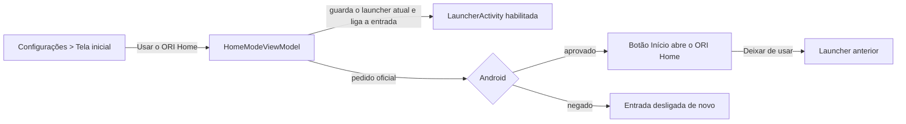
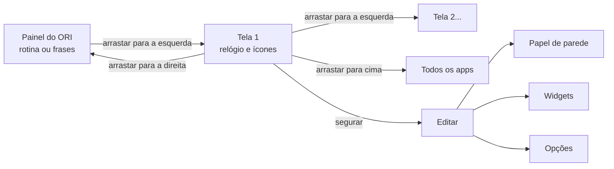
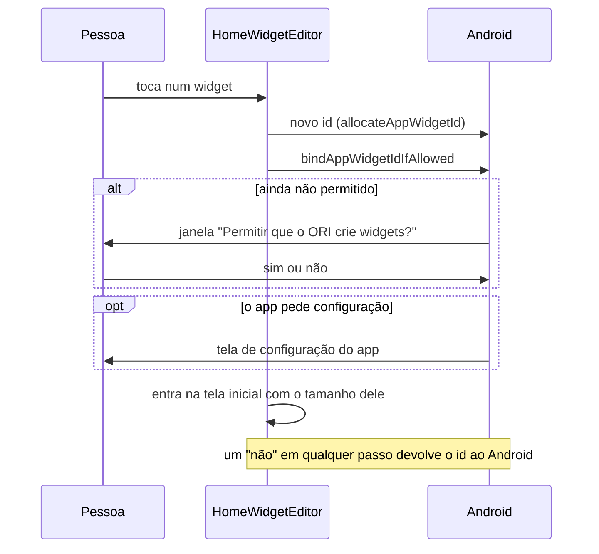
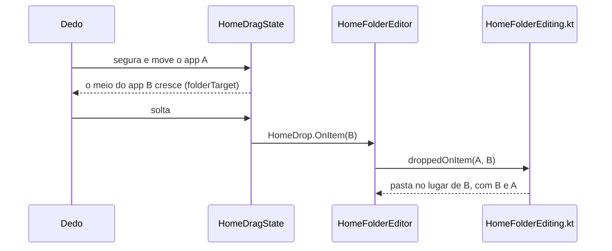

# ORI Home (tela inicial opcional)

## O que faz e por que existe

O ORI Home é uma tela inicial (launcher) calma e completa, como a do Android e a do iPhone: telas com ícones grandes e
widgets, o papel de parede, a lista de todos os apps com busca e, à esquerda, um painel com a rotina ou as frases do
ORI. É **opcional**: o ORI
continua funcionando igual sem ele, e nada acontece até a pessoa pedir em Configurações > Tela inicial.

## Como a execução começa

1. **Registro no Manifest:** `ui/launcher/LauncherActivity` com o filtro `MAIN` + `HOME` + `DEFAULT`, `singleTask`,
   `stateNotNeeded`, `excludeFromRecents` e **`android:enabled="false"`**. Desligada, ela não aparece como opção de
   tela inicial para ninguém.
2. **Ativação** (`HomeModeViewModel`): guarda o pacote do launcher em uso (`previousLauncher`), liga a entrada
   (`HomeActivation.setLauncherEnabled(true)`) e mostra o pedido do Android: o papel `ROLE_HOME` (`RoleManager`,
   Android 10+) ou, onde ele não existe, a tela de apps padrão (`Settings.ACTION_HOME_SETTINGS`). A pessoa decide
   na tela do sistema.
3. **Aprovado:** o botão Início abre o ORI Home. **Negado:** a entrada é desligada de novo e a tela diz que nada
   mudou; dá para tentar de novo.
4. **Voltar ao launcher anterior** (nas Configurações ou nas opções do ORI Home): desliga a entrada e abre o
   launcher guardado; se ele não existe mais, abre a tela de apps padrão do Android.

## Quem participa

| Peça | Onde | O que faz |
|---|---|---|
| `LauncherApp`, `LauncherSettings` e as funções puras | `domain/launcher/LauncherModel.kt` | Ordem da tela inicial, gaveta em ordem alfabética do idioma, busca sem acento, ocultar, limite de 60 itens |
| `arrangeHome`, `freeMove`, `packedIndexFor`, `HomeGrid`, `HomeCell`, `HomeSpan` | `domain/launcher/HomeLayout.kt` | O "motor" das posições: onde cada ícone e widget fica, encaixado ou livre, em telas ou numa lista |
| `dropped`, `stepped` | `domain/launcher/HomeEditing.kt` | Soltar um item numa casa e "mover para antes/depois" do leitor de tela |
| `LauncherIconSize`, `LauncherWallpaper`, `LauncherPanel`, `WallpaperStore`, `photosInUse` | `domain/launcher/LauncherAppearance.kt` | Tamanho, papel de parede, painel, o contrato da foto do fundo e as fotos que nunca são apagadas (as que uma tela mostra) |
| `LockScreenWallpaper`, `LockScreenChoice`, `lockScreenShown`, `withLockScreen`, `WallpaperTarget` | `domain/launcher/LockScreen.kt` | O que o ORI pôs na tela de bloqueio e como saber se ainda está lá |
| `HomeWidgetHost`, `WidgetProvider` | `domain/launcher/HomeWidgets.kt` | O contrato dos widgets |
| `AndroidInstalledApps` | `data/launcher` | Lista os apps com `LauncherApps` (todos os perfis), segue instalações e remoções, abre um app e lê os ícones fora da thread principal |
| `AndroidWidgetHost` | `data/launcher` | Os widgets pelo `AppWidgetHost` do Android: lista, ids, permissão, configuração, prévias |
| `DataStoreLauncherSettingsRepository`, `LauncherSettingsCodec` | `data/launcher` | As escolhas no DataStore do aparelho, em texto simples (um valor desconhecido é ignorado, nunca impede a tela de abrir) |
| `DeviceWallpaperStore`, `readReducedPicture` | `data/launcher`, `data/photos` | Cópia reduzida (até 1920 px) da foto do fundo, na pasta privada do app |
| `AndroidHomeActivation` | `data/launcher` | Quem é a tela inicial, e liga/desliga a entrada |
| `LauncherViewModel` e os editores `LauncherAppearanceEditor`, `WallpaperEditor`, `HomeWidgetEditor` | `ui/launcher` | O estado da tela e as ações, separados por assunto |
| `LauncherActivity`, `LauncherScreen`, `LauncherHome`, `HomePage`, `HomeClock`, `HomeBars`, `HomeOverlays`, `HomeDragState`, `HomeCarry`, `DropPreview`, `HomeItemMenu` | `ui/launcher` | A tela inicial: telas, casas, relógio, dock, "Remover", mensagens, menu, segurar e carregar |
| `HomeScreenPlaces` | `ui/launcher` | Onde cada coisa está na tela (itens, grade de cada tela, dock, "Remover"): a parte visível, onde o dedo acha o item, e a inteira, de onde as linhas são contadas numa lista rolada |
| `HomeMetrics` (`homeMetricsFor`) | `ui/launcher` | A grade de casas para a janela: colunas, linhas, tamanho da casa, do ícone e do dock. Calculada uma vez, em `LauncherScreen`, para todo o ORI Home |
| `AppMenuActions` | `ui/launcher` | O fim de todo menu de app: "Informações do app" e "Desinstalar" |
| `MenuLayer` (`MenuRequest`, `MenuLayerHost`) | `ui/launcher` | Onde os menus são desenhados: por cima de tudo, na própria janela da tela inicial. Um menu numa janela própria (`Popup`) fazia o Android criar essa janela a cada segurar, uns 90 ms com a thread principal parada no tablet de teste |
| `DrawerSheet`, `AppDrawer` | `ui/launcher` | Todos os apps, que sobem e descem com o dedo. A lista é montada antes, escondida, quando a tela fica parada pela primeira vez (`rememberScreenRested`, sem nada a compor, nenhuma animação e a thread principal livre), e continua montada: o deslize só a move (abrir levava de 83 a 157 ms montando uns 43 apps; agora, de 31 a 51 ms). Fechada, não é desenhada nem lida pelo leitor de tela, e só acompanha os apps e as opções (`rememberStateWhileShown`) |
| `HomeLayoutEditor` | `ui/launcher` | Soltar numa casa ou no dock, remover, mover pelo leitor de tela, pôr o relógio de volta |
| `OriPanel` | `ui/launcher` | O painel à esquerda, com a rotina (`RoutineRoute`) ou as frases (`AacRoute`) do ORI |
| `WallpaperPicker`, `WallpaperNow`, `WallpaperThumbnails`, `WallpaperPreview`, `LockScreenPicture`, `WidgetPicker`, `LauncherOptions`, `LauncherLayoutOptions`, `AppDrawer` | `ui/launcher` | Papel de parede ("Como está agora", grade de miniaturas, prévia da tela de bloqueio e da inicial), widgets, opções e todos os apps |
| `AndroidWallpaperWindow` | `ui/launcher/LauncherWallpaper.kt` | O papel de parede do Android de verdade nas prévias, visto pela janela |
| `ShownWidgetViews` | `ui/launcher` | As views dos widgets na tela, para levantar um quando é segurado (o toque dele acaba e ele é desenhado como está) |
| `SystemWallpaperLook` (`readSystemWallpaperLook`) | `ui/launcher` | O que o Android diz dos papéis de parede dele, sem as imagens: se o da tela inicial é claro e as cores principais dos dois |
| `homeOrientationFor` | `ui/launcher` | Celular sempre em pé; tablet gira, como o padrão do One UI |
| `HomeModeScreen`, `HomeModeViewModel`, `homeRequestIntent`, `openPreviousLauncher` | `ui/launcher` | A ativação nas Configurações do ORI |
| `HomeFolder`, `droppedOnItem`, `withFolderAround`, `withFolderChoice`, `tidied` | `domain/launcher/HomeFolders.kt`, `HomeFolderEditing.kt` | As pastas: fazer, pôr e tirar apps, renomear, arrumar ao fechar |
| `HomeFolderEditor`, `FolderCell`, `FolderLayer`, `FolderNameField`, `AppChecklist` | `ui/launcher` | A pasta na tela inicial, aberta por cima, o nome e a lista de apps com caixas |
| `AppShortcuts.kt`, `AndroidShortcuts`, `MenuShortcuts` | `domain`, `data`, `ui/launcher` | Atalhos dos apps no menu e na tela inicial, mantidos fixados no Android |
| `PinRequestActivity`, `PinRequestDialog`, `PinRefusal` | `ui/launcher`, `domain` | "Adicionar à tela inicial" pedido por outro app |
| `BadgeStyle`, `BadgeNotificationListener`, `NotificationBadges`, `HomeBadges` | `domain`, `data`, `ui/launcher` | Os selos dos ícones (ponto ou número) |
| `WidgetResize`, `WidgetResizeFrame`, `WidgetResizeControls` | `domain`, `ui/launcher` | Redimensionar um widget |
| `WidgetStepActivity`, `WidgetStepResults` | `ui/launcher` | Abre a janela "Permitir" e a configuração de um widget fora da tarefa da tela inicial, para a resposta voltar |
| `HomeUpkeep` | `ui/launcher` | O que o ORI Home arruma sozinho: relógio, app novo, pasta fechada, atalhos fixados |
| `RecentApps.kt`, `RecentDockApps` | `domain`, `ui/launcher` | Apps recentes na barra do tablet |
| `HiddenAppsOption`, `withHiddenApps` | `ui/launcher`, `domain` | "Ocultar apps" |

## A tela inicial

Feita para ficar o mais parecida possível com a do Android, e calma. De cima para baixo: uma faixa vazia (onde
aparecem "Remover" ao carregar um item e "Pronto" ao editar), a grade de casas com o **widget do relógio** no alto da
primeira tela, os pontos das telas e o **dock**, a fileira de apps sem nome que fica igual em todas as telas.

| Gesto | O que faz |
|---|---|
| Arrastar para o lado | Muda de tela (com "Telas lado a lado"). Na primeira tela, arrastar para a direita abre o painel |
| Arrastar para cima | **Todos os apps sobem junto com o dedo**; ao soltar, abrem ou voltam conforme a distância e a velocidade (como no Android). As telas não rolam para cima nem para baixo |
| Voltar | Na tela inicial, nada (ela nunca fecha, então nunca é montada de novo); no painel, volta para a primeira tela; numa aba (opções, papel de parede, widgets), fecha a aba e mostra a tela que estava, como foi deixada |
| Arrastar a lista de apps para baixo (no alto dela, ou pela alça) | Todos os apps descem junto com o dedo e fecham |
| Segurar um item (sem precisar soltar) | Vibra e abre o menu dele **na hora, ainda com o dedo na tela**, como no One UI, num balão **acima do item**, como no One UI 8 (embaixo, quando não há espaço acima), sem escurecer nada: o nome no alto (do app, "Relógio do ORI" ou o nome do widget), depois **Informações do app**, **Editar a tela inicial**, **Remover** e **Desinstalar**, cada um com o seu ícone; o que tira algo vem por último. As escolhas são escritas por extenso (o One UI põe "informações" só como um ⓘ), para cada uma dizer o que faz |
| Segurar um item e mover | O menu, aberto no segurar, fecha, e o item vai com o dedo: para outra casa, outra tela (parado na borda, a tela vira), para o **dock** (só apps) ou para **Remover**, no alto. Solto numa tela nova, a tela inicial fica nela |
| Segurar um item e mover, com a tela inicial **travada** | Nada sai do lugar, e um aviso neutro (não em vermelho, porque não é uma falha) diz que a tela inicial está travada. Segurar sem mover ainda abre o menu (sem "Remover"); mover o fecha |
| Segurar a tela vazia | Edita: ferramentas do Android embaixo (**Papel de parede**, **Widgets**, **Apps**, **Opções**) e "Pronto" no alto |

- **A animação de arrastar para cima** (`DrawerSheet`): a posição da lista é a do dedo, aplicada só no desenho (nada
  é recomposto a cada pixel). Ao soltar, uma mola sem quique leva até aberto ou fechado, com a velocidade do dedo;
  com animações reduzidas é um esmaecer curto, e desligadas vai direto. Enquanto a lista sobe, a tela inicial sobe um
  pouco e some, como no Android.
- **Relógio como widget:** a hora e a data são o **widget do relógio do ORI**, um item como os outros: dá para mover,
  remover e pôr de volta (Widgets > Relógio). Ele ocupa **só as casas de que precisa** (`rememberClockSize`): a
  largura da hora mais larga ("23:58") e da data mais comprida do ano no idioma (todo dia da semana de todo mês),
  escritas como o relógio escreve: no tamanho de letra da pessoa e, com o botão "Aa", em maiúsculas. É medida uma vez
  (não muda de um minuto ou de um dia para o outro), e a hora e a data ficam numa linha só cada, sem quebrar: o que se
  vê fica dentro das casas que ele ocupa, e o espaço que bloqueia os outros ícones é o mesmo do desenho. Carregado, o
  relógio vai sobre um cartão translúcido, para se ver o tamanho dele. Num tablet com ícones grandes ele cabe numa coluna
  e os ícones ficam ao lado; num celular estreito ainda precisa da linha toda. Entra no começo da tela uma vez só (`isClockSetUp`); removido, não volta
  sozinho. Na lista de widgets, a seção **Relógio** mostra primeiro os widgets do app de relógio do aparelho (o que
  abre os alarmes: o da Samsung, o do Google...), para quem preferir o relógio padrão.
- **Dock:** cabe uma fileira de apps (até o número de colunas de em pé, no máximo 7, nas duas posições do tablet).
  Um dock feito num tablet, com mais apps, divide a largura no celular.
- **"Mostrar o dock"** (desde 12/11/2026, ligado por padrão; `LauncherSettings.showsDock`): desligado, o dock some e
  as casas da tela inicial ganham o espaço dele (`HomeRoom.hasDock`). A grade é contada como se o dock estivesse lá:
  as mesmas casas ficam mais altas, e nenhum ícone muda de casa ou de tela (contar de novo daria mais uma linha em pé,
  ou mais uma coluna deitado, e levaria ícones da segunda tela para a primeira). Nada pode ser solto onde ele estava, e os apps recentes da barra
  também somem (a opção deles fica desligada). Os apps do dock continuam guardados (`launcher_dock`) e voltam quando
  ele é ligado de novo; eles continuam em todos os apps. Com "Mostrar botões", o botão de todos os apps fica sozinho no
  meio da faixa de baixo, para quem não desliza para cima (`hasDockRow`). Editando, a barra de ferramentas sobe sobre a
  tela reduzida, porque a faixa de baixo passa a ter só os pontos.
- **"Mostrar botões":** o botão de todos os apps fica bem no meio do dock (a primeira metade dos apps à esquerda, o
  resto à direita, com espaços vazios do lado mais curto; um app só fica à direita) e um botão **Editar a tela inicial** (lápis)
  fica no alto, à direita, no lugar do "Pronto" (que o substitui durante a edição). Assim quem não faz gestos chega à
  edição, ao papel de parede, aos widgets e às opções. Sem a opção, a tela inicial não tem botões, como no One UI.
- **Editando, telas como no One UI 8:** o papel de parede escurece, e cada tela aparece menor (70 %), como um cartão
  (um preenchimento suave e um contorno), com a **casinha** no canto de cima à esquerda (faz dela a tela principal,
  para onde o botão Início volta e onde o ORI Home abre; cheia na principal) e a **lixeira** no canto à direita
  (apaga a tela; não aparece se for a única). Depois da última tela há um cartão **"+"** que adiciona uma tela vazia
  (até 12), do mesmo tamanho e no mesmo lugar das telas menores. As bordas das telas vizinhas aparecem dos lados
  (`besideTheCurrentPage`: cada tela vizinha chega mais perto pela parte do espaço que a tela menor deixa; só no
  desenho, e só editando, quando o pager monta também as vizinhas). Apagar uma tela com itens pede confirmação: os
  itens saem da tela inicial (os apps continuam em todos os apps, os widgets devolvem o número ao Android) e as telas
  seguintes voltam uma posição. Uma tela vazia sai na hora. Apagada a última tela, a edição mostra a tela anterior,
  não o "+" que ficou no lugar dela. Os itens continuam podendo ser carregados entre as telas menores: a casa de
  destino é medida na tela como está desenhada. Ao carregar um item fora da edição, uma tela vazia espera no fim para
  criar uma tela nova; um item solto nela fica à vista (`landingPage`: a tela a mais espera a gravação chegar, por no
  máximo 2 segundos).
- **Pontos das telas,** como no One UI: um traço para o painel à esquerda, uma **casinha** para a tela principal, um
  ponto para cada outra tela e, editando, um **"+"** para o cartão que adiciona uma; a tela à vista fica cheia. A troca é só de transparência, lida no desenho.
- **Travar a tela inicial** (Opções), como no One UI: os ícones e os widgets não mudam de lugar nem saem da tela
  inicial, nem com um toque longo sem querer (pensado para quem tem dificuldade motora). Nada é carregado (nem da
  gaveta), "Remover" e a lixeira das telas somem, o leitor de tela não oferece "Mover" nem "Remover", e mover um item
  segurado mostra "A tela inicial está travada". A regra fica no domínio (`isLayoutLocked`: soltar, dock, mover,
  remover e apagar tela não mudam nada), e um widget nunca devolve o número ao Android enquanto fica na tela.
  Adicionar um app ou um widget continua possível. Não é um bloqueio do aparelho: sair do ORI Home continua igual.
- **Área de destino, como no One UI** (`DropPreview`): enquanto um item é carregado, um retângulo suave mostra as
  casas que ele vai ocupar onde o dedo está, do tamanho do item (um widget ou o relógio ocupam várias). Fica
  **vermelho** quando o item não vai ficar ali (`canDrop`, a mesma regra de soltar): em "Livres", casas ocupadas por um
  item de outro tamanho (o item volta; um app vindo de todos os apps vai para a primeira casa livre), ou a tela
  inicial cheia. Some sobre "Remover" e sobre o dock. É só desenho: o leitor de tela move os itens com as ações dele.
- **Dica de tela vazia:** só aparece quando a tela inicial tem apenas o relógio (nunca por cima de widgets ou
  ícones), logo abaixo das linhas que os itens da tela ocupam (o relógio pode ter sido movido).
- **Mensagens** (um app que não abriu, o Android recusou a tela de bloqueio): num cartão acima dos pontos, legível em qualquer
  papel de parede, sem tirar espaço do dock. Somem sozinhas depois de 6 segundos, como uma mensagem do Android, para
  não ficarem por cima dos nomes; o leitor de tela as lê quando aparecem.
- **Dois jeitos de posicionar** (Opções > Opções avançadas > Posição dos ícones):
  - **Encaixados** (como o iPhone antigo): um depois do outro, sem buracos. Soltar um ícone sobre outro toma o lugar
    dele, e os outros se ajeitam. Um widget largo pode deixar um espaço antes dele, mas a ordem nunca muda.
  - **Livres** (como o Android e o iPhone atual): cada ícone fica na casa onde foi solto, com espaços vazios onde a
    pessoa quiser. Soltar sobre um item do mesmo tamanho troca os dois; onde não cabe, volta ao lugar. As casas de
    todos ficam gravadas, então nada anda sozinho. Trocar de um jeito para o outro não perde as casas. Ao passar para
    "Encaixados", o relógio vai para o começo (`withArrangement`): na ordem, ele podia cair no meio de uma fileira.
- **Só telas lado a lado,** como no One UI: a opção de uma lista que rola saiu (11/11/2026), e quem a usava volta às
  telas (a escolha guardada, `launcher_paging`, é apagada na próxima mudança). Assim nenhuma tela inicial rola, e
  toda a altura recebe ícones até o dock.
- **A tela inicial fica sempre por baixo** das abas (`LauncherScreen`): opções, papel de parede e widgets abrem por
  cima dela, e ela não é desmontada. Ao voltar, a mesma tela aparece, sem os ícones subirem de novo; enquanto uma aba
  está aberta, o leitor de tela não passa pela tela inicial.
- **Tamanho dos ícones:** Pequeno (48 dp), **Médio (58 dp, o do One UI**: medido no tablet de teste, 113 px a 312
  dpi), Grande (84) e **Enorme (120 dp, mais que o dobro do médio)**, para quem tem muita dificuldade com os movimentos
  das mãos: no celular, 2 × 3 ícones; no tablet, 4 × 5 em pé e 5 × 3 deitado, sempre do tamanho escolhido. Antes, o
  médio era 72 dp (maior que o do One UI) e o enorme 104 dp (só 1,4 vez o médio). O nome embaixo tem até duas linhas;
  uma palavra comprida ("Configurações") é dividida com hífen onde o idioma permite, não em qualquer letra.
- **Máximo: blocos, como os do Windows Phone, feitos para hoje** (`HomeTiles.kt`, `TileLook`): cada app vira um bloco
  arredondado que ocupa a casa inteira, da cor do próprio app num tom calmo e escuro (o tom médio das partes do ícone
  que aparecem, com no máximo 55 % de saturação e 36 % de luminosidade, para o nome em branco ser lido;
  `tileColorOf`), com o ícone no alto e o nome dentro, embaixo à esquerda, em até duas linhas. Com os ícones sem cores
  (nível de estímulo "Nenhum", ou escolhido à mão) os blocos ficam cinza; uma pasta é um bloco transparente da cor da escrita da tela inicial, e aberta mostra os apps como blocos também (`drawerTileOf`, o mesmo de todos os apps). Um
  bloco carregado sobre um app ou pasta onde vai entrar fica pequeno (`INTO_FOLDER_SCALE`): do mesmo tamanho, ele
  cobria o bloco de baixo e a pasta desenhada em volta dele, e a pessoa não via onde ia soltar.
- **Pastas sem piscar.** A causa principal estava na entrada dos itens (`HomePageGrid`): a página guardava, uma vez,
  que os itens "chegam" (sobem aparecendo), e todo item que entrava nela depois também subia, começando invisível e
  esperando a vez dos que vinham antes dele. Um app tirado da pasta, uma pasta nova e a pasta desfeita (que vira o app
  que sobrou) são itens novos na página, então sumiam e voltavam. Agora só sobem os itens que estão na página quando
  ela aparece com a tela inicial já lida (`risesIn`, lembrado por item); quem chega depois já está lá.
- **Soltar numa pasta** (`IntoFolderLanding`, `Landing.into`): gravar a mudança leva um instante no aparelho.
  Antes, ao soltar um app sobre outro (ou sobre uma pasta), a cópia que seguia o dedo sumia na hora, e nesse instante a
  tela mostrava o estado antigo: o app de volta no lugar dele e o alvo sem a pasta desenhada em volta; depois tudo
  mudava. As duas coisas piscavam. Agora a cópia fica sobre o alvo, com a pasta em volta, até a tela mostrar o app
  dentro da pasta (ou 2 segundos, no máximo); se a pasta não aceita o app, ele volta para o lugar dele. Do mesmo modo,
  um app tirado da pasta aberta e solto na tela deixa a pasta escondida até ela fechar (antes ela reaparecia por um
  instante). A grade conta o bloco como
  um ícone de 120 dp sem nome embaixo e fica quase quadrada (uma casa tem pelo menos 80 % da largura de altura):
  2 colunas no celular (3 linhas com as barras do sistema), 3 no tablet em pé (4 linhas) e 4 × 3 deitado. Os blocos
  são carregados inteiros (com o nome), e o dock continua com os ícones.
- **Formato dos ícones** (`IconShape`, `IconShaping.kt`): **Redondo**, **Arredondado** (cantos arredondados de 28 %,
  como o do One UI; o padrão) ou **Quadrado** (cantos retos; no Máximo, os blocos também ficam com cantos retos, como
  os do Windows Phone), o mesmo para todos os ícones. Até 12/11/2026 eram só dois, e o "Quadrado" era o arredondado:
  a escolha passou a ser guardada em `launcher_icon_outline`, e quem tinha `launcher_icon_shape` fica com o mesmo
  formato de antes (o "SQUARE" antigo vira Arredondado), com a chave antiga apagada na primeira mudança. Antes cada app vinha com o seu: os ícones adaptativos saíam com o
  formato do aparelho e os antigos como imagem solta (quadrada ou de contorno próprio), e a tela misturava formatos.
  Agora o ORI desenha cada ícone: um adaptativo mostra o meio das suas camadas, como o Android (`inShape`); um antigo
  vai numa placa branca, como o próprio Android faz com eles; depois vem o selo do perfil de trabalho, quando é o caso
  (`badgedFor`). As pastas e o círculo de "fazer pasta" seguem o mesmo formato (`LocalIconShape`). Mudar o formato lê
  os ícones de novo (o cache guarda cada formato à parte).
- **A grade em qualquer tela** (`homeMetricsFor`, uma função pura testada sem tela):
  - **Deitado, a grade transposta, como no One UI** (`HomeOrientation`, `positionsTurned`): as colunas deitado são
    as linhas de em pé e as linhas, as colunas de em pé, **mas só quantas couberem com o ícone do tamanho escolhido e o
    nome em uma linha** (no tablet de teste, 6 × 8 em pé e 8 × 5 deitado; o One UI tem 8 × 6, mas o ORI guarda a faixa
    do alto para "Remover" e "Pronto"). Assim um ícone enorme continua enorme deitado (antes encolhia para caber a
    grade transposta inteira). Com uma grade escolhida, ela é transposta inteira. Cada posição
    guarda o seu arranjo: mover um ícone deitado não muda onde ele fica em pé, e o contrário. Na primeira vez deitado,
    um item sem casa deitado vai para a mesma tela que tem em pé, na ordem de leitura de em pé (a grade transposta tem
    as mesmas casas, então uma tela cheia continua uma tela). Deitado, o nome fica em uma linha, para caber; o relógio
    ocupa uma linha e é desenhado até 15 % menor (`scaledToFit`) em vez de tomar duas.
    Todos os apps também transpõem (as colunas da tela inicial em cada posição).
  - **Celular sempre em pé** (`homeOrientationFor`): como o One UI faz por padrão, a tela inicial do celular não
    deita (menor lado abaixo de 600 dp); o tablet gira.
  - **Colunas:** pela largura em pé e pelo tamanho do ícone, com um teto por tamanho, como no Android (7, 6, 5 e 4):
    no tablet as casas ficam mais largas em vez de virarem colunas miúdas (6 no tamanho médio).
  - **Grade escolhida** (Opções > Opções avançadas > Grade da tela inicial), como a "Grade da tela inicial" do One UI:
    "Automática" (as colunas e as linhas seguem o tamanho dos ícones, como acima) ou uma das grades que esta tela
    oferece, as que cada tamanho de ícone daria aqui (`gridChoicesFor`). Com uma grade escolhida, o tamanho do ícone
    não muda mais as casas: o ícone fica do tamanho escolhido quando cabe na casa e menor quando não cabe, e nada sai
    do lugar. Numa janela menor que a da escolha, a grade fica no que a tela comporta (casas de pelo menos 56 dp).
    Deitado, a grade escolhida é transposta.
  - **Linhas:** de 1 a 8, quantas couberem em pé (o One UI usa 6 × 8 no tablet). Uma linha **nunca é espremida**
    abaixo do ícone com o nome. O nome tem sempre o mesmo número de linhas em toda a fileira, para os ícones ficarem
    alinhados.
  - **Tela baixa demais para as linhas:** primeiro o nome passa para uma linha, para o ícone ficar do tamanho
    escolhido; se nem assim couber, o ícone fica menor (no mínimo 40 dp) com o nome em duas linhas, uma ou nenhuma (o
    leitor de tela continua dizendo cada um); e, por último, cabem menos linhas. O dock acompanha o tamanho do ícone.
  - **Barras do sistema:** a grade fica dentro delas dos quatro lados. No celular deitado a barra de navegação e o
    recorte da câmera ficam ao lado, e os ícones não passam por baixo deles. A borda que vira a tela ao carregar um
    item também fica dentro delas.
  - **Faixa do alto:** tem 64 dp e cresce com a letra grande, para "Remover" (e "Pronto") nunca cobrir a primeira
    linha.
  - **Casas guardadas** (em "Livres"): com ícones maiores cabem menos colunas e linhas, e um ícone das últimas
    aparece noutra casa enquanto isso, na ordem de leitura das casas guardadas (a ordem na tela não se embaralha). A
    casa dele continua guardada, mesmo que outro ícone seja movido: com os ícones menores de novo, ele volta para lá.
  - **Um lugar só:** `LauncherScreen` calcula a grade e a entrega às telas, ao soltar, à prévia do papel de parede e
    à lista de widgets. Assim todos concordam sobre as casas.
  - Conferido em imagem em 11 tamanhos (veja "Como testar").
- **Os gestos leem a tela como ela está agora.** O gesto de segurar começa no primeiro toque e continua vivo depois
  (é o jeito do Compose: `pointerInput` não recomeça a cada mudança). Por isso o que ele chama
  (`rememberHoldActions`, `rememberDrawerCarry`) é feito uma vez e lê o estado atual com `rememberUpdatedState`: a
  grade, a edição e o dock do momento do gesto, nunca os do primeiro toque. Antes, a tela montava com os ajustes
  padrão (ícones médios, 6 colunas no tablet) enquanto os da pessoa carregavam, e o soltar calculava a casa com essa
  grade velha.
- **Ao virar de tela,** os ícones não "sobem" de novo (a entrada animada é só quando a tela inicial aparece), e um
  ícone já lido aparece no primeiro quadro (`LocalCachedAppIcon`), sem piscar vazio.
- **Leitor de tela:** a hora tem as ações "Todos os apps", "Personalizar a tela inicial", "Organizar os favoritos" e
  "Abrir o painel do ORI"; cada item tem "Abrir o menu" (segurar), "Mover para antes/depois" (nos livres, troca de
  casa com o vizinho do mesmo tamanho; no dock, dentro do dock) e "Remover" (os dois últimos não, com a tela
  travada). Nada depende só de gesto.
- **Abrir um app "saindo do ícone",** como no One UI: o toque diz onde o ícone está na tela, e o Android faz o app
  crescer a partir dele (`ActivityOptions.makeScaleUpAnimation`). Só quando o nível de animação deixa as coisas se
  moverem (`OriMotion.movesThings`); com animações reduzidas ou desligadas, o app abre sem crescer. A procura da
  atividade do app (uma chamada ao sistema) é feita fora da thread principal.

## Todos os apps

Como no Android: uma alça e uma busca no alto, e todos os apps numa grade, em ordem alfabética, com as colunas e o
tamanho de ícone da tela inicial (deitado, as da grade transposta). Em Opções > Todos os apps, a pessoa escolhe
**Lista** (a grade que rola para baixo, como sempre foi) ou **Telas** (`AppPages`, `DrawerStyle.PAGES`): telas lado a
lado, como a tela inicial, com as colunas dela e quantas linhas couberem, e os pontos embaixo; passar o dedo para o
lado vira a tela, e uma busca nova volta à primeira. Todos os apps seguem o tamanho dos ícones da tela inicial (as
colunas e o ícone de cada tamanho); no **Máximo**, nas duas formas, cada app é um bloco igual ao da tela inicial, da
altura de uma casa, com o nome sempre dentro (`DrawerTile.tileHeight`).

**Só todos os apps** (Opções avançadas > O que o ORI Home mostra; `HomeScreenMode.APPS_ONLY`, `AppsOnlyPane`): sem
telas, dock nem widgets, o ORI Home abre direto em todos os apps, sobre o papel de parede (numa camada 90 % opaca, para
ler em qualquer fundo), com a hora e a data no alto e o botão das opções (a única entrada para elas aqui). Nada é
carregado para uma tela inicial que não existe e o menu não oferece "Adicionar à tela inicial"; a edição não abre.
Nas opções somem o que é da tela inicial (travar, painel, widgets). O que estava na tela inicial fica guardado e volta
ao escolher "Tela inicial e todos os apps". A busca tem largura máxima, um botão para apagar
o que foi escrito, e a tecla de busca do teclado abre o primeiro app encontrado. A cada busca nova (e ao apagar a
busca) a lista volta ao começo: antes, ela ficava no primeiro app achado e escondia os de antes dele. Tocar abre o app; segurar abre o
menu dele, no mesmo balão da tela inicial, com o nome do app (**Informações do app**, **Adicionar à tela inicial** ou
**Remover da tela inicial**, e **Desinstalar** por último; com a tela travada, sem "Remover da tela inicial"). "Informações do app" abre a página do Android (`LauncherApps.startAppDetailsActivity`).
"Desinstalar" abre a confirmação do próprio Android (`ACTION_DELETE`, com a permissão comum
`REQUEST_DELETE_PACKAGES`): nada é apagado sem a pessoa confirmar ali. Apps que vieram com o aparelho não mostram
"Desinstalar" (o Android não deixa). Ocultar apps saiu do menu; os que já estavam ocultos aparecem nas opções para
voltar.

**Arrastar da gaveta para a tela inicial**, como no Android: segurar um app (vibra) e mover. A gaveta desce, a tela
inicial aparece e o app segue o dedo; ao soltar, ele fica na casa onde foi solto (em qualquer tela, virando nas
bordas) ou no dock. Em "Encaixados", entra naquela posição da ordem; em "Livres", naquela casa (ou na primeira livre,
se ela estiver ocupada). Soltar em "Remover" ou fora das telas desiste. O ORI tem **um ícone por app**: um app que
já está na tela inicial, arrastado da gaveta, muda de lugar (o One UI cria outro atalho; aqui, dois ícones do mesmo
app só confundiriam). Com a tela inicial cheia (60 itens), não
entra. Segurar abre o menu na hora, com o dedo ainda na tela; mover o fecha e carrega o app. Com a tela inicial
travada, nada é carregado da gaveta: segurar abre o menu, que ainda tem "Adicionar à tela inicial".

## Painel à esquerda

No lugar das notícias de outros celulares, a **rotina de hoje** ou as **frases**, funcionando ali mesmo (marcar uma
atividade, tocar numa frase para falar), com "Abrir no ORI" no alto. Escolha em Opções > Painel à esquerda (Minha
rotina, Frases ou Nenhum). Os atalhos "Minha rotina" e "Frases" saíram da grade: o painel ficou no lugar deles.
"Abrir no ORI" traz de volta o app que já está aberto, como estava, e só troca a área (`MainActivity.onNewIntent`,
`AreaRequest`); antes, o app era fechado e aberto de novo a cada toque (169 ms até o primeiro quadro, contra 28 ms
agora com ele aberto).

- É a mesma tela do ORI (`RoutineRoute`, `AacRoute`), da mesma pessoa e com as mesmas regras: só aparece com uma
  sessão ativa que já aceitou os termos (J2). Sem isso, mostra "Comece pelo ORI" e um botão para abrir o ORI, onde se
  entra, se continua sem conta e se aceita. Nada disso acontece no ORI Home.
- O pager só monta a tela que está à vista (`beyondViewportPageCount = 0`): a rotina só é seguida enquanto o painel
  está aberto, o que poupa bateria e leituras do Firestore. Só durante a edição o pager monta também as telas
  vizinhas (para as bordas delas aparecerem), e aí o painel, se for vizinho.
- **Uma barra só no alto:** na rotina, "Abrir no ORI" fica na barra do título (`topBarActions` de `RoutineRoute`);
  antes eram duas barras, uma só com "Abrir no ORI". As frases não têm barra de título, então "Abrir no ORI" fica numa
  linha própria sobre elas.
- **Uma coluna só, também no tablet** (`LocalAllowsTwoPanes`): no painel, uma atividade abre por cima da lista, como
  no celular. Antes, no tablet em pé, a rotina abria em duas colunas e a da direita ficava vazia ("Escolha uma
  atividade"), ocupando metade do painel.

## Papel de parede

Como no One UI: Editar > **Papel de parede** mostra, no alto, como estão a tela de bloqueio e a tela inicial e,
embaixo, uma **grade** de telinhas no formato da tela de agora (em pé ou deitada), cada uma com o papel de parede
dela. A grade põe quantas cabem (cada uma com pelo menos 96 dp em pé, 150 dp deitada) e as alarga para encher a linha;
os títulos ocupam a linha inteira.

- **O papel de parede do Android de verdade** (`AndroidWallpaperWindow`): o Android não deixa um app ler a imagem
  (desde o Android 14, só com o "acesso a todos os arquivos", que o ORI não pede: seria acesso a todos os arquivos do
  aparelho para mostrar uma prévia, e a Google Play não aceita esse acesso para uma tela inicial). Mas a janela do ORI
  Home já mostra o papel de parede por trás (`windowShowWallpaper`): a prévia abre um buraco transparente até ele,
  como faz um `SurfaceView` (`BlendMode.Clear`). Então é a imagem de verdade, no tamanho real: a parte dela que está
  atrás da prévia, não a imagem inteira em miniatura. Funciona onde nada entre a prévia e a janela é desenhado à
  parte; durante a animação de abrir a aba (que esmaece), o buraco mostra a tela inicial por um instante.
- **Como está agora** (`WallpaperNow`), no alto, como no One UI: a tela de bloqueio e a tela inicial lado a lado, no
  formato da tela (até 300 dp de altura). A da **tela inicial** é a da pessoa (`MiniHome`): a grade desta tela, cada
  item da tela principal na sua casa, com os ícones de verdade, e os apps do dock, sobre o papel de parede dela. A da
  **tela de bloqueio** (`LockScreenPicture`) tem a hora e a data por cima e mostra o que a tela de bloqueio mostra
  (`lockScreenShown`): o papel de parede do Android, quando ela não tem imagem própria; o fundo que o ORI pôs lá,
  enquanto ainda está lá; ou, quando outra coisa pôs uma imagem (as configurações do Android), as cores que o Android
  informa dela, ou um tom liso: o ORI não consegue ver essa imagem.
- **Como o ORI sabe o que está na tela de bloqueio:** o Android dá um número a cada imagem que recebe
  (`setBitmap` devolve o número; `getWallpaperId(FLAG_LOCK)` diz o número de agora, sem permissão e sem mostrar nada
  da imagem; negativo quando a tela de bloqueio não tem imagem própria e mostra a da tela inicial). Ao aplicar, o ORI
  guarda o fundo e o número (`LockScreenChoice`); ao abrir o papel de parede e ao voltar para o ORI, pergunta o número
  de novo. Número igual: é o fundo do ORI; diferente: alguém trocou, e a prévia não finge que sabe.
- **Do aparelho:** o **papel de parede do Android** (o padrão: a janela do ORI Home usa `windowShowWallpaper`, então
  quem desenha é o Android; a miniatura é ele mesmo, visto pela janela), **Minhas fotos** (seletor
  de fotos do sistema, sem permissão)
  e o **histórico**: as últimas 8 fotos usadas, da mais nova para a mais velha, para escolher de novo, numeradas
  ("Foto 1 usada antes", "Foto 2 usada antes"...), para o leitor de tela distinguir uma da outra. Segurar uma foto
  do histórico abre "Remover do histórico", que apaga a cópia. Uma foto que uma tela mostra (a inicial ou a de
  bloqueio: `photosInUse`) não sai do histórico e o arquivo dela nunca é apagado, nem quando passa da oitava. As
  miniaturas usam uma cópia pequena (1/8 de cada lado), não a foto inteira.
- **Degradês:** Amanhecer, Mar, Campo, Entardecer e Pétala, feitos com as cores calmas do ORI, no claro e no escuro.
- **Cores:** o fundo do tema e as cinco cores calmas.
- Tocar numa escolha abre a **prévia de verdade** com ela, sem nada tocável, e só **Aplicar** troca. Como no One UI,
  **Tela de bloqueio** e **Tela inicial** (abas) trocam entre as duas telas com o papel de parede: a tela inicial é a
  de verdade; a de bloqueio é desenhada por cima dela, com a hora e a data (`LockScreenPicture`; com o papel de parede
  do Android, ele mesmo, pela janela). As abas, Cancelar e Aplicar ficam num cartão acima dos pontos e do dock, nunca
  sobre eles (numa linha no tablet, em duas no celular). Sem a tela de bloqueio permitida pelo Android, não há abas e
  Aplicar vale para a tela inicial. Como no Android, **Aplicar pergunta onde usar**: Tela inicial, Tela de bloqueio
  ou as duas (`AndroidLockScreenWallpaper`, `WallpaperManager.FLAG_LOCK`, permissão comum `SET_WALLPAPER`). A tela de
  bloqueio é do Android: o ORI entrega a foto (a cópia reduzida) ou, para as cores e degradês, uma imagem desenhada
  com elas, sem marcar para cópia de segurança. Uma foto nova usada só na tela de bloqueio entra no histórico. Se o
  Android recusar (política do aparelho), aparece um aviso; dando certo, **nenhuma mensagem**: a prévia "Como está
  agora" da tela de bloqueio já mostra o novo fundo (antes aparecia um aviso verde, "A tela de bloqueio foi
  atualizada", que a pessoa achou feio e não dizia nada que a prévia não mostre). O **papel de parede do Android
  também pergunta**: na tela inicial, o ORI passa a mostrar o do Android; na tela de bloqueio, o ORI tira a imagem
  própria dela (`WallpaperManager.clear(FLAG_LOCK)`) e o Android volta a mostrar ali o mesmo papel de parede da tela
  inicial dele.
  Cancelar (ou voltar) descarta; uma foto nova não aplicada é apagada. A foto trocada fica no histórico; a que passa
  da oitava é apagada.
- **Cor do que está escrito** (`HomeInk`): como no Android, tudo o que está na tela inicial (hora, data, nomes,
  pontos) tem a mesma cor, escolhida pelo fundo: escura sobre papel de parede claro, branca com uma sombra leve sobre
  papel escuro. Para o papel de parede do Android, o próprio Android diz se ele é claro (`WallpaperColors`, sem
  permissão); para uma foto, o ORI mede o brilho médio de uma cópia de 8 × 8 pontos. Nas cores e degradês do ORI,
  vale a cor do tema. A gaveta e as abas usam sempre a cor do tema (antes, numa superfície transparente, alguns
  textos ficavam pretos e outros brancos).
- Sem o papel de parede (nível de estímulo "Nenhum", ou "Mostrar o papel de parede" desligado), a tela inicial e a de
  só todos os apps têm o fundo liso do tema, **também por cima do papel de parede do Android** (`wallpaperShown` devolve
  `Theme`). O papel de parede escolhido continua guardado e volta quando a pessoa liga de novo. A prévia de um papel de
  parede o mostra mesmo assim, para a pessoa ver o que está escolhendo. Antes, a baixa estimulação punha um véu sobre a
  foto e a deixava cinza; o véu saiu, porque quem quer menos estímulo agora tira o papel de parede.

## Widgets

Editar > **Widgets** lista os widgets dos apps instalados, agrupados por app, com a imagem que o app oferece e o
tamanho em casas ("2 × 2"). A lista é lida quando a edição começa (a um toque de "Widgets"), e uma leitura nova mantém
a lista já mostrada no lugar de "Carregando" (na primeira vez, abrir levava 244 ms; agora, 79 ms).

- O ORI guarda só o **id** do widget e o **tamanho** em casas; o conteúdo é desenhado pelo app do widget e não passa
  pelo ORI.
- **O tamanho é informado como o Android 12 pede** (`updateAppWidgetSize` com a lista de tamanhos). Antes ia pela
  forma antiga, que deixa a lista vazia: widgets feitos com Glance (como o relógio da Samsung) quebravam
  (`NoSuchElementException`) e o Android mostrava "can't show content". Achado no registro do tablet. Os widgets só se atualizam com a tela inicial à vista (`setListening` no `onStart`/`onStop`).
- Editando, uma camada sobre o widget recebe os toques, para segurar mover o widget em vez de apertar o que tem nele.
- **A lista nunca fecha o ORI Home.** No tablet de teste, com 77 tipos de widget, o Android não conseguia entregar
  a lista inteira de uma vez (`BadParcelableException`, falta de espaço na comunicação com o sistema) e o ORI Home
  fechava; depois de duas vezes, o Android voltava a perguntar qual tela inicial usar. Agora, se a lista inteira
  falha, ela é lida app por app (`getInstalledProvidersForPackage`, para os apps de `LauncherApps`), o app que falhar
  fica de fora e a lista avisa "Alguns widgets não puderam ser lidos". Se nada puder ser lido, aparece uma mensagem
  de erro, não uma lista vazia. A imagem de cada widget, o "adicionar" e a configuração procuram o widget na lista
  lida por último (`KnownWidgets`), nunca pedem a lista inteira de novo (antes era um pedido por linha, e um deles
  fechou o ORI Home em pé); um widget que falte nela é pedido só ao app dele.
- O menu de um widget tem o nome que o app dá a ele ("Clima"), lido fora da thread principal.
- **Imagens da lista:** a imagem que o app dá do widget vem primeiro (lida fora da thread principal e guardada em
  memória, até 8 MB). Sem ela, no Android 12+, o desenho de prévia do app (`previewLayout`), feito como o Android faz
  um widget, sem ligar nenhum (sem id), como uma view de verdade na lista (como o One UI faz), por cima do ícone do
  app: um desenho que não funciona fora da tela inicial de quem o fez fica em branco ou falha (os relógios da Samsung
  usam `ConstraintLayout`, que só a tela inicial da Samsung tem), e então se vê o ícone, nunca uma caixa vazia. Widgets do mesmo app com o mesmo nome e tamanho (cinco "Current weather and
  forecast", 2 × 2, no tablet) mostram a descrição de cada um, ou "Opção 1", "Opção 2"... quando não há descrições
  diferentes (`variantsOf`); o leitor de tela diz o mesmo.
- "−" tira o widget e devolve o id ao Android. Um widget cujo app foi removido mostra "Este widget não está mais
  disponível" e pode ser tirado.
- Nenhuma permissão nova: só `<queries>` com `APPWIDGET_UPDATE`, para ver os widgets oferecidos.

## Recursos do One UI (pastas, atalhos, selos e outros)

Acrescentados em 11/11/2026 para o ORI Home fazer o que a tela inicial da Samsung faz. Cada um segue a mesma
divisão do resto: a regra no domínio (testada sem Android), o Android na camada `data` e a tela em `ui/launcher`.

**Pastas.** Segurar um app e soltá-lo **no meio** de outro faz uma pasta no lugar do de baixo (perto da borda da casa,
ele só muda de lugar, como no One UI). Enquanto o dedo está no meio, o ícone de baixo cresce com a pasta desenhada em
volta. Soltar um app numa pasta põe o app nela. "Criar pasta" no menu de um app faz uma pasta só com ele e já a abre,
para quem não arrasta. Tocar na pasta abre um cartão por cima da tela (que escurece um pouco): no alto, o nome (tocar
mostra o teclado; uma pasta nova não tem nome e aparece como "Pasta" no idioma do app); "+" abre a lista de todos os
apps com caixas, os da pasta já marcados ("Pronto" aplica: os marcados entram, os desmarcados vão para a tela
inicial). Segurar um app da pasta abre o menu dele ("Tirar da pasta") ou, movendo, carrega-o para fora: a pasta some
da vista e fecha quando o app é solto. Uma pasta que fica com um app só volta a ser esse app **ao fechar**, qualquer
que seja o jeito de fechar (voltar, toque fora, Início, abrir um app): o `HomeUpkeep` observa a pasta aberta.
Pastas ficam nas telas, não no dock. Com a tela travada, nada muda.

**Atalhos dos apps.** Segurar um app mostra, no alto do menu, os atalhos dele (os declarados e os recentes, até 4, como
o Android). Tocar abre; "+" ao lado põe o atalho na tela inicial, onde ele é um ícone como o de um app (chave
`shortcut:<perfil>/<pacote>/<id>`). O Android só deixa a tela inicial em uso ler atalhos; os que estão na tela inicial
são mantidos **fixados** no Android e soltos quando saem dela. Um app pode pedir "Adicionar à tela inicial" (um atalho
ou um widget): o Android abre a `PinRequestActivity`, que mostra o que é e de qual app, e só adiciona com o "sim" da
pessoa. Como qualquer app pode abrir essa tela, um pedido só vale quando o próprio Android o cumpre (o atalho fica
fixado, o widget fica ligado); senão, nada é adicionado.

**Selos dos ícones.** Como no One UI, a bolha vermelha com o número de notificações no canto do ícone (na tela
inicial, no dock, nas pastas e em todos os apps), a mesma no tema claro e no escuro: vermelho do ORI (`OriBadge`) com o
número em branco e em negrito, do tamanho de um terço do ícone e crescendo com ele (antes usava a cor de erro do tema,
que no escuro é um rosa-claro com número escuro). Nas opções, "Selos dos ícones": **número (o padrão, como no One
UI)**, ponto ou desligados (até "99+"); a pasta mostra a soma dos apps dela. Para contar, o Android exige que a pessoa
permita o "Acesso a notificações" ao ORI Home: até lá nada aparece e nada é contado; o botão nas opções abre a página
do Android, e a pessoa decide lá. Quem já tinha usado o ORI Home tem a escolha guardada (antes o padrão era
desligado) e liga nas opções. O `BadgeNotificationListener` lê de cada notificação só o
app, o perfil, o número e se ela conta (não contam as que ficam enquanto algo roda, os resumos de grupo e as de canais
sem selo), e a contagem fica só na memória. O leitor de tela diz "Mensagens, 3 notificações". Os selos seguem
a escolha deles em qualquer nível de estímulo (antes a baixa estimulação os escondia); quem não os quer escolhe "Desligados".

**Widgets.** "Redimensionar" no menu de um widget mostra uma moldura com alças na borda direita e na de baixo (que
crescem ou diminuem casa a casa ao arrastar) e um cartão com largura e altura e botões de uma casa a mais ou a menos,
para quem não arrasta. Só são oferecidos tamanhos que o app do widget aceita e que cabem nas casas livres; o canto do
widget não sai do lugar. "Configurar o widget" abre de novo a configuração do app (o widget fica, qualquer que seja a
resposta). Um widget cuja configuração o app marca como opcional (os relógios da Samsung) entra direto, como no One
UI. A janela "Permitir" do Android e a configuração abrem pela `WidgetStepActivity`: abertas da própria tela inicial,
elas iam para uma tarefa à parte e a resposta chegava na hora como "cancelado" (o widget se perdia). E, ao abrir, o
ORI Home devolve ao Android os ids de widget que não estão em nenhuma tela (de um passo que não terminou).

**Soltar.** O item solto sai de onde o dedo o largou e desliza até a casa final, como no One UI (antes ele voltava
ao ponto de partida e ia de lá). A cópia que seguia o dedo fica no lugar até o item estar na casa nova
(`HomeDragState.landing`, `landsWhereDropped`); se o lugar não aceita, o item volta de onde foi solto para a casa
dele. A regra que decide se ele muda de lugar é a mesma do domínio (`dropped`, `droppedOnDock`), lida na hora. Sem
animações que movem coisas, ele simplesmente aparece na casa. O quadro da casa de destino ("Mostrar onde o app vai
ficar") vem **desligado** para apps e pastas e é uma opção; widgets e o relógio sempre mostram o deles, porque ocupam
várias casas. Os itens de cada tela são identificados pela chave, para um item que muda de lugar na ordem levar o
próprio estado (antes o estado ficava na posição da lista e podia passar para outro item).

**Sair da edição.** Tocar numa parte vazia da tela (fora de um ícone, botão ou pasta) sai da edição, como no Android;
"Pronto" e voltar também saem.

**Prévia "Como está agora".** A tela inicial pequena do papel de parede mostra os ícones de verdade, a pasta com os
apps dela, a hora no relógio, os widgets como blocos e os apps da barra, sobre o papel de parede de verdade (o do
Android, pela janela: veja "Papel de parede").

**Widget carregado.** Ao ser segurado, o widget é **levantado** (`ShownWidgetViews.lift`), como numa tela inicial do
Android: o toque dele acaba na hora (fora da edição, o widget também recebe o toque e ficava com a sombra de
"pressionado", um cinza por cima dele, e abriria o app ao soltar), e ele é desenhado como está pela placa de vídeo
(`HardwareRenderer`, com os cantos e efeitos que só ela desenha). Essa imagem acompanha o dedo, como no One UI; antes
era um cartão cinza com um ícone. Sem imagem (um widget que não deu para desenhar, ou um que vem da lista de
widgets), o cartão continua. O quadro da casa de destino sempre aparece para widgets.

**Prévias dos widgets.** Primeiro a prévia que o app gera (Android 15+, o widget como ele é), depois a imagem do app,
depois o desenho de prévia; o ícone fica embaixo. Os widgets da Samsung (Relógio, Calendário) não oferecem nenhuma
que outra tela inicial consiga ler: aparecem com o ícone.

**Telas.** Editando, cada tela tem setas para trocar de lugar com a anterior ou a seguinte, com os itens e a casinha
da tela principal (só com os ícones livres, em que as telas são da pessoa).

**Opções como as do One UI.** "Deslizar para baixo para ver as notificações", "Mostrar o nome dos apps", "Adicionar
novos apps à tela inicial", "Girar a tela inicial" (celular), "Ocultar apps" (a lista de todos os apps com caixas: os
marcados saem da tela inicial e de todos os apps e continuam instalados) e "Apps recentes na barra" (tablet: os dois
últimos apps abertos pelo ORI Home, depois de um traço, só na memória; não usa o "Acesso ao uso" do Android).

**Opções em duas telas** (`LauncherOptions`, `AdvancedOptions`). A primeira tem só o do dia a dia: nível de
estímulo (veja abaixo); aparência (tamanho dos ícones, com a explicação de que o médio é o tamanho de sempre do Android, o enorme
o dobro e o máximo, blocos; formato dos ícones; mostrar o nome dos apps; mostrar o dock); selos dos ícones; todos os apps em lista ou
telas; travar a tela inicial (fica aqui por ser uma proteção para quem tem dificuldade com os dedos); painel à
esquerda; papel de parede, widgets e ocultar apps; **Opções avançadas**; e o ORI (abrir, deixar de usar o ORI Home).
Em **Opções avançadas**, um passo adiante (`SubscreenHost`, voltar fecha ela antes das opções): o que o ORI Home mostra
(tela inicial e todos os apps, ou só todos os apps), posição dos ícones (encaixados ou livres), grade da tela inicial,
os gestos e o que acontece sozinho
(deslizar para baixo, onde o app vai ficar, novos apps, girar no celular ou apps recentes no tablet) e mostrar
botões. Antes tudo ficava numa tela só, comprida, com escolhas que mudam o funcionamento da tela inicial misturadas às
de todo dia.

**Nível de estímulo** (`Stimulus.kt`, `StimulusOptions`). Funciona como os gráficos de um jogo: um nível muda tudo de
uma vez, e depois cada escolha ainda pode ser mudada à mão. Trocou à mão e as escolhas não batem com nenhum nível, a
opção "Personalizado" aparece marcada (ela não é um nível guardado: é o que `StimulusChoices.level == null` quer dizer).

| Nível | Animações | Papel de parede | Ícones coloridos | Menos enfeites |
|---|---|---|---|---|
| Padrão | normais (as do ORI) | sim | sim | não |
| Médio | menos (`MotionLevel.REDUCED`) | sim | sim | não |
| Baixo | nenhuma (`MotionLevel.OFF`) | sim | sim | não |
| Nenhum | nenhuma | não, nem o do Android | não (cinza) | sim |

Abaixo dos níveis ficam as quatro escolhas: "Animações" (Normais, Menos, Nenhuma), "Mostrar o papel de parede",
"Ícones coloridos" e "Menos enfeites". O `LauncherViewModel.appPreferences` aplica o nível por cima da escolha da
pessoa em Configurações: "Menos" nunca aumenta o movimento (um "Desligado" continua desligado) e "Menos enfeites" liga a
interface simplificada. O nível vale só no ORI Home e no painel; o resto do ORI segue Configurações. Quem tinha a
antiga "Baixa estimulação" ligada fica com as escolhas dela (menos animações, ícones cinza, menos enfeites, papel de
parede mantido), e a chave antiga `launcher_low_stimulation` é apagada na primeira mudança.

## Persistência e privacidade

- Tudo fica **só no aparelho**, no DataStore: `launcher_favorites` (a ordem, com apps e `widget:<id>`),
  `launcher_hidden`, `launcher_stimulus_motion`, `launcher_stimulus_wallpaper`, `launcher_stimulus_colors`,
  `launcher_stimulus_simplified` (o nível de estímulo, escolha por escolha), `launcher_previous`, `launcher_shows_buttons`, `launcher_icon_size`, `launcher_icon_outline`,
  `launcher_drawer_style`, `launcher_screen_mode`,
  `launcher_wallpaper` (nada = papel de parede do Android), `launcher_arrangement`,
  `launcher_positions` (`chave⇥tela⇥linha⇥coluna`), `launcher_positions_turned` (as casas com o tablet deitado, no
  mesmo formato), `launcher_widget_spans` (`id⇥colunas⇥linhas`), `launcher_panel`, `launcher_dock` (os apps do dock,
  em ordem), `launcher_clock_set_up`, `launcher_wallpaper_history` (as fotos do histórico), `launcher_lock_wallpaper` e
  `launcher_lock_wallpaper_id` (o fundo que o ORI pôs na tela de bloqueio e o número que o Android deu à imagem, para a
  prévia; nada da imagem do Android), `launcher_page_count` (as
  telas feitas com "+"), `launcher_main_page` (a tela principal), `launcher_layout_locked` (tela travada), `launcher_grid` (a grade
  escolhida, "6x8"; nada = automática), `launcher_folders` (`id⇥nome⇥app,app` por pasta), `launcher_badges`,
  `launcher_recent_apps`, `launcher_drop_preview`, `launcher_shows_dock`, `launcher_swipe_down_notifications`, `launcher_shows_labels`,
  `launcher_adds_new_apps` e `launcher_turns_on_phone`. Um atalho na tela inicial é uma chave `shortcut:…` na ordem. O relógio
  é a chave `ori:clock` na ordem.
  Uma linha quebrada é pulada; um valor desconhecido vira o padrão.
- **Foto do fundo:** cópia reduzida e em pé em `files/launcher_wallpaper` (`wallpaper-<id>.jpg`); só nomes nesse
  formato são aceitos, então um valor estranho nunca aponta para fora da pasta. Nunca é enviada.
- A lista de apps é lida e nunca gravada nem enviada; usa `<queries>` e `LauncherApps`, **sem `QUERY_ALL_PACKAGES`**.
- A contagem de notificações dos selos e os apps recentes ficam só na memória: nada é gravado, registrado em log ou
  enviado.
- A política de privacidade e o mapa de Segurança de Dados citam tudo isso ([legal/README.md](../legal/README.md)).

## Independência

A tela inicial não depende do Firebase, da conta nem da rotina para abrir: o `LauncherViewModel` só lê os apps, os
widgets, as escolhas do ORI Home e a cópia da aparência guardada no aparelho. Só o painel, quando aberto, usa a
sessão do ORI. As animações (entradas, encolher ao tocar e ao editar, itens deslizando para a nova casa, pontos das
telas) passam pelo `OriMotion`. O nível de estímulo diminui as animações ("Menos" usa `MotionLevel.REDUCED`, "Nenhuma"
`OFF`), pode deixar os ícones cinza e tirar o papel de parede e liga a interface simplificada; um "Desligado" em
Configurações continua desligado.

## Abas uniformes

Opções, Papel de parede e Widgets usam a mesma moldura (`LauncherPaneScaffold`): fundo do tema, a mesma barra com
voltar, conteúdo centralizado com a mesma largura máxima (720 dp) e as mesmas margens. Voltar segue uma regra só
(`onBack`): uma aba aberta durante a edição volta à edição; a edição volta à tela inicial; nada disso muda de tela.

## Sem bloqueio

Nada de `startLockTask`, administrador do dispositivo ou serviço de acessibilidade. As Configurações do Android, o
voltar e a troca de tela inicial continuam funcionando. Sair do ORI Home fica nas opções: sem botões, chega-se a elas
segurando a tela e tocando em "Opções" (ou pela ação do leitor de tela na hora); com "Mostrar botões", pelo botão
"Editar a tela inicial" e depois "Opções". "Travar a tela inicial" (Opções) só segura os ícones no
lugar; não bloqueia nada do aparelho.

As barras do sistema são transparentes, e o ORI Home desliga a faixa de contraste que o Android põe atrás da barra de
três botões (`isNavigationBarContrastEnforced = false`): o papel de parede vai até o pé da tela, como no One UI.

## Como testar

| Teste | O que confere |
|---|---|
| `HomePagesTest` | Telas: as feitas ou as que os itens pedem; "+"; apagar tela (itens saem, telas seguintes voltam, widget devolve o id, a última fica); apagar tela deitado desloca os dois arranjos; tela principal dentro das telas; app vindo da gaveta (encaixado e livre; tela cheia não aceita); **`canDrop`**: encaixados aceitam em qualquer casa, livres só em casa vazia ou troca do mesmo tamanho, tela cheia recusa app novo |
| `HomeLayoutTest` | Relógio como widget da largura da tela, uma vez só; dock (entra, sai, cheio, sem widgets); encaixados em ordem e na tela seguinte; widget largo deixa espaço sem pular a ordem; widget maior que a tela cabe; livres ficam na casa; casa inválida vai para a primeira livre; mover livre (vazia, troca, não cabe); soltar e "mover" do leitor de tela; tamanho de um item ajustado à grade (`fittedTo`); a casa de uma linha que a grade não mostra continua guardada; os itens cuja casa a grade não mostra vão às casas livres na ordem de leitura; **deitado, cada item vai para a sua tela de em pé, na ordem de em pé; mover deitado não muda em pé e o contrário; tirar ou pôr no dock tira dos dois arranjos** |
| `KnownWidgetsTest` | A imagem e o "adicionar" de um widget acham-no na lista lida por último, sem pedir a lista inteira de novo; um que falte é pedido só ao app dele, uma vez; se o Android não responde, nada falha |
| `AllAppsSearchTest` | Apagar a busca mostra a lista de novo desde o primeiro app (falhava antes) |
| `MenuPositionTest` | O menu fica acima do item e centrado nele; sem espaço acima, embaixo; sempre dentro da tela e fora das barras |
| `HomeMenuLayerTest` | O menu abre na janela da tela inicial (nenhum `Popup`), ao lado do ícone e não por cima; um toque fora fecha e não abre o app de baixo; voltar fecha e fica na tela inicial; uma escolha do menu funciona |
| `OriDialogLayerTest` | Os diálogos do ORI Home ("Ocultar apps", "Adicionar apps", "Usar o papel de parede em", confirmações) são desenhados na janela da tela inicial (`OriDialogHost` em `LauncherActivity`): lidos como diálogo, a tela atrás escondida do leitor e sem toque, voltar e toque fora fecham |
| `WidgetVariantTest` | Widgets do mesmo app com o mesmo nome e tamanho ganham a descrição deles, ou um número; os outros, nada |
| `MiniHomeTest` | A prévia da tela inicial tem a grade, os itens da tela principal nas suas casas e o dock |
| `WidgetMenuTest` | O menu de um widget tem o nome dele |
| `RoutineTopBarActionsTest` | "Abrir no ORI" do painel fica na barra do título da rotina |
| `HomeLockTest` | Tela travada: soltar, dock, mover, remover, apagar tela e tirar pela gaveta não mudam nada; adicionar continua; destravada, tudo volta a mover. Encaixados põe o relógio no começo; livres guarda as casas |
| `LauncherModelTest` | Ordem alfabética com acentos, busca, limite, mover para uma posição, ocultar; um item entra uma vez no fim e a tela cheia (60) não recebe nenhum, nem o relógio (`withAddedToHome`, `isHomeFull`) |
| `LauncherViewModelTest` | Lista e tela inicial, soltar encaixado e livre, reinício, app removido, abrir e falhar (a mensagem some com `onMessageSeen`), cheio, níveis de estímulo (Médio menos animações, Baixo nenhuma, Nenhum também simplifica; "Menos" não religa um movimento desligado), uma escolha à mão depois de um nível fica com as outras e o nível vira personalizado, botão Início, prévia/aplicar/cancelar do papel de parede, foto trocada apagada, widget permitido, recusado (id devolvido) e com configuração; com a tela travada, um widget fica e não devolve o id; todos os apps **não são ordenados de novo** quando só a tela inicial ou a edição mudam; o papel de parede do Android na tela de bloqueio faz o Android mostrar o dele ali; uma foto só para a tela de bloqueio vai para o Android e para o histórico **sem mensagem de sucesso**, e a prévia da tela de bloqueio a mostra; a prévia segue o Android (trocada fora do ORI, "não dá para ver"; o papel de parede do Android ali, ele de novo) |
| `HomeModeViewModelTest` | Ativação aprovada e negada, launcher anterior, voltar a ele |
| `DataStoreLauncherSettingsRepositoryTest` | Todas as escolhas sobrevivem ao reinício (também as casas deitado, a tela travada e o fundo da tela de bloqueio); todo papel de parede volta igual; o fundo da tela de bloqueio só volta inteiro (sem o número, ou desconhecido, é nenhum); valores quebrados são pulados; a escolha antiga da lista que rola é apagada na próxima mudança; a antiga "Baixa estimulação" vira as escolhas dela e a chave é apagada na próxima mudança |
| `StimulusTest` | Cada nível é reconhecido pelas escolhas e escolhas de nenhum nível são personalizadas; cada nível tira mais (animações, todas, depois papel de parede e cores); sem papel de parede, a tela tem o fundo do tema mesmo sobre o do Android, e o escolhido fica guardado |
| `LockScreenTest` | A tela de bloqueio mostra o que o ORI pôs só enquanto o Android tem o mesmo número; número negativo é o papel de parede do Android; outro número ou nenhum é "não dá para ver"; o papel de parede do Android ali não guarda nada; a foto da tela de bloqueio entra no histórico e o arquivo fica enquanto ela a mostra, mesmo fora do histórico, e sai quando outra imagem a substitui; ela não sai do histórico |
| `ShownWidgetViewsTest` | Um widget na tela é desenhado no tamanho dele; levantado, deixa de estar pressionado e não abre ao soltar; fora da tela, apagado ou sem tamanho, não tem imagem; a view velha de um id não tira a nova |
| `DeviceWallpaperStoreTest` | Foto grande guardada reduzida, lida e apagada; o que não é foto falha; nome estranho nunca é lido |
| `LauncherScreenTest` | Colunas no celular, **6 colunas no tablet em pé e a grade transposta deitado**; com uma grade escolhida, ícones enormes mantêm as 6 colunas; relógio como widget que sai; painel à esquerda; tela seguinte; **arrastar para cima abre e para baixo fecha**; com botões, editar no alto e todos os apps bem no meio do dock (com um app ao lado); sem botões, nenhum; segurar e soltar abre o menu com o nome do app e a ordem do One UI (Remover funciona); **o menu abre com o dedo ainda no ícone, e mover o fecha e carrega o ícone** (também em todos os apps); segurar a tela vazia edita; carregar para outra casa; **carregar para o dock**; **edição com a tela a 70 %, casinha e lixeira nos cantos, "+" que adiciona tela, e apagar a última tela mostra a anterior**; **app arrastado da gaveta para a tela inicial**; **área de destino aparece ao carregar e some ao soltar** |
| `AndroidInstalledAppsTest` | A lista real de apps (Robolectric) é seguida a partir de uma thread de fundo sem travar; sem ser a tela inicial em uso, atalhos são simplesmente nenhum e nada falha |
| `HomeFoldersTest`, `HomeFolderEditorTest`, `HomeFoldersScreenTest` | Pasta feita por soltar no meio de outro app, no lugar dele; app que entra (da tela, do dock, da lista); app que sai fica na casa certa e a pasta de dois vira o outro app **na casa da pasta**; pasta do menu abre na hora e fecha virando o app; Início ou abrir um app fecham e arrumam; nome numa linha; tela travada não muda; na tela: tocar abre e voltar fecha, soltar no meio cria, "Criar pasta" e a lista, renomear, carregar para fora; no Máximo, os apps da pasta aberta são blocos da mesma altura dos da tela inicial; um app solto sobre outro fica ali (a cópia) até a pasta ser gravada, em vez de piscar de volta no lugar antigo; os apps tirados de uma pasta (e o que sobra dela) aparecem na hora, sem subir atrasados |
| `AppShortcutsTest` | Menu lê os atalhos e abre pelo Android; atalho na tela inicial aparece, fica fixado e é solto ao sair; atalho removido pelo app some e um renomeado mostra o nome novo; atalhos fixados das telas, do dock e das pastas; pedido recusado com a tela travada ou cheia; widget pedido ocupa as casas que pede |
| `IconBadgesTest`, `IconBadgesScreenTest` | Selo do app e do perfil certos (atalho não tem); quais notificações contam; somas por app e limpeza ao tirar o acesso; o número vem ligado desde o início, como no One UI; desligado, nada chega à tela; o leitor de tela diz quantas notificações (pasta: a soma) |
| `WidgetResizeAndPagesTest`, `WidgetResizeScreenTest`, `WidgetSetupRuleTest`, `WidgetStepResultsTest` | Widget cresce para casas livres sem mover os outros, não cobre outro item nem passa da tela; limites do app; trocar telas (itens, deitado e casinha); na tela, "Redimensionar" e o limite; configuração opcional não segura o widget; respostas das janelas esperam a tela inicial |
| `HomeDropTest` | Logo depois de soltar, o ícone está perto de onde foi largado (não no ponto de partida) e depois na casa nova (o teste falha sem o pouso, conferido); o quadro de destino não aparece para um app por padrão e aparece para um widget; segurar um widget o levanta uma vez (um app não) e ele é carregado como está; editando, tocar no vazio sai da edição e tocar num ícone não |
| `HiddenAndRecentAppsTest` | "Ocultar apps" esconde e traz de volta; recentes: o último primeiro, uma vez, sem atalhos, fora do dock e dos ocultos, até 2; nenhum sem o dock |
| `HomeDockOptionTest` | "Mostrar o dock" desligado: os apps do dock somem, os ícones descem (as mesmas casas, mais altas, na mesma coluna) e os apps do dock continuam guardados; um ícone carregado até embaixo não entra no dock; com "Mostrar botões", o botão de todos os apps fica sozinho no meio e abre todos os apps; editando, a barra de ferramentas aparece inteira; a opção desliga e liga o dock |

| `HomeMetricsTest` | A grade sem tela: celular (4 × 5, ícones de 58 dp como o One UI), **máximo em blocos quase quadrados (2 colunas no celular, 3 no tablet)**, **tablet deitado com as linhas de em pé como colunas** (ícone inteiro, nome em uma linha, o mesmo dock), **enorme com o dobro do médio, inteiro no celular, em pé e deitado (deitado, com menos linhas)**, relógio numa linha e desenhado no máximo 15 % menor deitado, tela baixa demais (menos linhas, ícone inteiro), tablet em pé com 6 colunas e até 8 linhas; grade escolhida mantida com ícones maiores (e transposta deitado), limitada ao que uma tela menor comporta; as grades oferecidas; dobrável, ícones enormes, faixa do alto maior com letra em dobro, celular em pé e tablet que gira. Em todos, a casa nunca é menor que o que mostra; **sem o dock, a mesma grade (em pé, deitado e escolhida), com casas mais altas** |
| `HomeGesturesTest` | Depois de os ícones crescerem, o soltar usa a grade nova; editando, segurar carrega na hora e não abre o menu; o leitor de tela move o primeiro da segunda tela para antes e não move o último para depois; janela baixa não espreme o ícone; mensagem não aperta o dock e some; barra de navegação ao lado não cobre os ícones; **com a tela travada, o ícone segurado e movido fica, a mensagem diz por quê e o menu não tem "Remover"** |
| `AppOpeningTest` | Tocar num app passa a posição do ícone na tela (o app cresce dele); com animações desligadas, não passa |
| `SystemWallpaperColorsTest` | As cores do papel de parede do Android ficam escuras para um papel escuro e claras para um claro, com o mesmo tom |
| `AreaListDetailLayoutTest` | Lista e detalhe lado a lado numa área larga; onde duas colunas não são permitidas (o painel), uma de cada vez |
| `AppIconTest` | Um ícone já na memória aparece enquanto a leitura lenta não respondeu |
| `HomeScreenSizeTest` | Tablet em pé: um ícone vai para a metade de baixo da tela; tablet deitado com a grade transposta (uma tela cheia continua uma tela, e um ícone movido deitado mantém a casa de em pé); com uma barra do sistema ao lado, segurar na borda direita ainda vira a tela; **um ícone solto na tela nova feita na borda fica à vista, nela** (com a gravação atrasada como no aparelho) |
| `HomeStylesTest` | Máximo: blocos que ocupam meia largura do celular, dois por linha, **também em todos os apps, em lista e em telas** (o bloco não é mais alto que largo; o teste da lista falha com o código de antes, em que era um ícone de 120 dp com o nome embaixo); todos os apps em telas mostram uma tela por vez e o lado mostra a seguinte; só todos os apps: a busca e os apps são a tela, o menu não tem "Adicionar à tela inicial", o botão abre as opções, e a edição não abre |
| `IconShapingTest` | Redondo é transparente perto dos cantos, arredondado só bem no canto e quadrado em lugar nenhum; um ícone antigo fica numa placa branca; um adaptativo mostra o fundo dele até a borda do formato; o bloco pega um tom escuro da cor do ícone, e cinza com os ícones sem cores |
| `LauncherOptionsTest` | A primeira tela das opções tem tamanho dos ícones, selos, travar e "Opções avançadas", sem a grade, a posição dos ícones e os botões; eles estão nas avançadas; uma grade escolhida lá é guardada; voltar fecha as avançadas e depois as opções; um nível de estímulo muda todas as escolhas, uma escolha à mão mostra "Personalizado" e outro nível o tira |
| `HomeBackTest` | Voltar na tela inicial não fecha nem remonta nada; voltar de Opções mostra a tela que estava; voltar no painel vai para a primeira tela |
| `WallpaperScreenTest` | A tela de papel de parede começa com "Como está agora" (tela de bloqueio e tela inicial); aplicar o papel de parede do Android pergunta tela inicial, de bloqueio ou as duas; a prévia começa na tela inicial e a aba "Tela de bloqueio" desenha a tela de bloqueio (e volta); sem a tela de bloqueio permitida, não há abas e Aplicar vale para a tela inicial; a foto que a tela de bloqueio mostra não sai do histórico; Cancelar e Aplicar ficam acima do dock; cada foto do histórico tem o seu número; deitado, as miniaturas também deitam |
| `WidgetListTest` | A lista de widgets mostra o tamanho que o widget vai ocupar nesta tela (3 × 2 num celular de 3 colunas; 4 × 2 no tablet); com a lista lida só em parte, o aviso; sem nada lido, a mensagem de erro |

Os testes de `HomeGesturesTest`, `AppIconTest` e `WidgetListTest` foram escritos antes da correção e falhavam com o
código antigo (conferido).

Conferido em imagem: celular de 360 dp (claro e escuro: tela inicial com relógio e dock, editando, todos os apps,
widgets com a seção Relógio) e tablet em 800 × 1280 e 1280 × 800 dp (também com "Aa" em maiúsculas: a data cabe na
casa do relógio; e carregando um ícone, com a área de destino). Na revisão da grade, também: 360 × 640 (médio,
enorme, editando, letra 1,5×, com mensagem, todos os apps), 411 × 891, celular deitado 800 × 360 (médio e enorme),
dobrável 673 × 841, tablet 800 × 1280 enorme e 1280 × 800 pequeno e enorme editando. A janela de permissão de
widgets, a configuração de um widget, o papel de parede do Android e o seletor de fotos só rodam num aparelho.

Recursos do One UI (11/11/2026): no tablet (SM-X610, deitado), conferidos pasta feita soltando um app no meio de
outro, aberta, app carregado para fora (o outro fica na casa da pasta), "Criar pasta" e a lista de apps, voltar
fechando e desfazendo a pasta de um app; atalhos no menu do Relógio, "+" na tela inicial, abrir pelo atalho, tirar
(o Android deixa de fixar); pedido falso de "Adicionar à tela inicial" ignorado; opção dos selos e a página do
Android aberta; widget de alarme redimensionado pelo botão e pela alça; relógio analógico (configuração opcional)
entrando direto e "Configurar o widget" abrindo a configuração; setas de trocar telas; "Ocultar apps"; recentes na
barra. Em imagem de 360 dp (Robolectric): selos com número e "99+", pasta com a soma, pasta aberta e a moldura de
redimensionar (o menu e o cartão de tamanho são janelas à parte e foram vistos no tablet).

## Falhas corrigidas em 10/11/2026

Revisão da grade e do código do ORI Home, em vários tamanhos de tela. Cada falha tem um teste que falhava antes:

| Falha | Correção | Teste |
|---|---|---|
| O soltar usava a grade da primeira montagem da tela (ícones médios, 6 colunas no tablet), não a da pessoa: com ícones enormes, o item caía noutra casa que a mostrada | Os gestos leem o estado na hora (`rememberUpdatedState`) | `HomeGesturesTest` |
| Depois de um primeiro toque, entrar na edição não fazia segurar carregar na hora: abria o menu | Idem | `HomeGesturesTest` |
| Celular deitado: duas linhas espremidas em 84 dp, nomes cortados e ícones menores que os do dock | Linhas de 1 a 6, nunca espremidas; sem nomes ou ícone menor só quando nem uma linha cabe | `HomeMetricsTest`, `HomeGesturesTest` |
| A grade ignorava as barras do sistema dos lados (celular deitado): a última coluna passava por baixo da barra | A largura desconta as barras dos dois lados | `HomeGesturesTest` (barra simulada) |
| "Mover para antes/depois" do leitor de tela usava a posição dentro da tela: o primeiro ícone da segunda tela não tinha "antes", e o último de todos tinha "depois" | Posição na ordem de todas as telas | `HomeGesturesTest` |
| Uma mensagem de erro entrava na faixa fixa do dock e o apertava (ícones menores) e ficava para sempre | Cartão acima dos pontos, que some em 6 s | `HomeGesturesTest`, `LauncherViewModelTest` |
| A altura de uma casa contava um espaço a menos e usava a letra dos ícones médios para todos os tamanhos | A medida soma os três espaços do ícone e usa a letra de cada tamanho | `HomeMetricsTest` |
| "Configurações" quebrava como "Configuraçõe / s" | Hífen pelo idioma e quebra equilibrada | Imagem (o hífen depende dos dicionários do aparelho) |
| A lista de widgets mostrava o tamanho pedido pelo app (4 × 2) e não o que ele ocupa num celular de 3 colunas (3 × 2) | `HomeSpan.fittedTo`, a mesma regra da grade | `WidgetListTest`, `HomeLayoutTest` |
| Ao virar de tela, os ícones piscavam vazios e subiam de novo | Ícone da memória no primeiro quadro; entrada só ao aparecer | `AppIconTest` |
| Todos os apps eram ordenados de novo (na thread principal) a cada soltar, edição ou mensagem | Ordenados só quando os apps, os ocultos ou a busca mudam | `LauncherViewModelTest` |

Segunda rodada, procurando problemas de grade e de tamanho de tela (11/11/2026):

| Falha | Correção | Teste |
|---|---|---|
| Na lista que rola, a grade só ia até a última linha com ícones: no tablet em pé, mais da metade da tela não recebia nada (o item voltava) | A lista vai até o pé da tela, com uma linha vazia a mais ao carregar | `HomeScreenSizeTest` |
| A lista não rolava com um ícone segurado na borda: as linhas de baixo eram inalcançáveis | Rola sozinha com o ícone perto do alto ou do pé | `HomeScreenSizeTest` |
| Numa lista rolada, a linha era contada da borda visível, não do começo da lista: o item caía linhas acima do dedo | As linhas contam do começo da grade inteira (`HomeScreenPlaces`) | `HomeScreenSizeTest` |
| Um ícone metade escondido pela rolagem era carregado com o tamanho só da parte visível | O tamanho é o do ícone inteiro | Leitura do código (não há teste) |
| Em "Livres", mover um ícone com o tablet deitado gravava as casas do tablet deitado para todos: ao virar de volta, os ícones das últimas linhas tinham mudado de lugar | Só o que mudou de casa é gravado; as outras casas guardadas ficam | `HomeLayoutTest` |
| Com a barra de navegação ao lado, a borda que vira a tela ficava por baixo dela | Bordas dentro das barras | `HomeScreenSizeTest` |
| Com a letra em dobro, "Remover" passava da faixa de 64 dp e cobria a primeira linha (um item solto ali podia ser removido sem querer) | A faixa cresce com a letra | `HomeMetricsTest` |
| A prévia da área de destino não acompanhava uma tela que vira ou uma lista que rola sob o dedo parado | As telas avisam quando mudam de lugar (estado observado) | Leitura do código (não há teste) |

Terceira rodada, pedidos de 11/11/2026: voltar na tela inicial fechava o ORI Home, e o Android o abria de novo
("atualiza a página"); voltar de uma aba remontava a tela inicial na primeira tela. Agora voltar não faz nada na
tela inicial e a tela inicial fica sempre montada por baixo das abas (`HomeBackTest`). A lista que rola saiu; o
tablet deitado mantém a grade de em pé (o One UI, depois se viu, transpõe a grade), e o celular fica em pé (`HomeMetricsTest`,
`HomeScreenSizeTest`); o papel de parede do Android pergunta onde usar (`WallpaperScreenTest`,
`LauncherViewModelTest`); e a tela de papel de parede ganhou a prévia "Como está agora" (`WallpaperScreenTest`).

Também saíram repetições e restos: a regra "tela cheia" num lugar só (`isHomeFull`, `withAddedToHome`); o menu de app
em `AppMenuActions` (era montado duas vezes); o ícone de todos os apps é o mesmo `LauncherTile` da tela inicial (tinha
toque, cantos e leitor de tela duplicados); constantes repetidas (`CARRIED_ITEM_ALPHA`, `DotsHeight`); a margem das
telas em `insidePageArea`; `favoriteApps`, que nada usava; o texto "Cancelar" do papel de parede usado na tela de
apagar tela (agora o comum, `action_cancel`); um `!!` no motor das posições; e `WallpaperPicker` (361 linhas)
dividido em lista, miniaturas e prévia.

O relógio do ORI bloqueava menos espaço do que o desenho ocupava: a medida usava o texto como está escrito, mas com
o botão "Aa" ele aparece em maiúsculas (mais largo), e o mês medido era um só. A data passava das casas dele e ficava
por baixo dos ícones vizinhos. Agora a medida é feita como o relógio escreve, com todos os meses, e o texto não
quebra linha. Testes: `LauncherScreenTest` (relógio no tablet) e as imagens acima.

No celular, depois de ativar, o botão Início pedia de novo para escolher a tela inicial, e o ORI Home piscava. Causa:
`LauncherApps.registerCallback` era chamado numa thread de fundo sem `Looper`, e o ORI Home fechava ao abrir; o
Android voltava a perguntar e tentava abrir de novo. Agora o aviso chega pela thread principal (só um sinal) e a
lista é lida fora dela. O ORI Home também ganhou `taskAffinity=""`: antes ele dividia a tarefa com o resto do ORI, e
abrir a rotina pelo atalho (que limpa a tarefa) podia fechar a tela inicial junto. O `AndroidInstalledAppsTest` usa a
lista real.

Quarta rodada, depois do teste no tablet (11/11/2026): o plano de [launcher-plano.md](launcher-plano.md), com as
decisões recomendadas (até 8 linhas em pé; deitado, ícone menor com o nome em uma linha; primeiro arranjo deitado na
ordem de em pé). A grade deitada passou a ser a transposta, como no One UI (T7, D13, D15), e foram corrigidos os
problemas T1 a T6 e D1 a D14 (veja a seção 16 de [revisao-de-codigo.md](../revisao-de-codigo.md) e as tabelas
acima). Cada correção tem teste; os de T3, D12 e T4 falhavam antes da correção (conferido).

Conferido no tablet deitado (build `profiling`, 11/11/2026): a grade transposta (7 × 6, relógio numa linha); na edição, a borda do "+" à direita, do tamanho da tela menor (D4); os pontos com o
traço do painel e a casinha (D11); a prévia do papel de parede com os botões acima do dock (T4); a tela de papel de
parede alinhada, com fotos numeradas, miniaturas deitadas e o papel do Android escuro como ele é (D5, D14, T5); o menu
em balão com o resto escurecido (D1); a tela travada, com o ícone que fica e a mensagem (D8); o lápis com "Mostrar
botões" (T6); o painel numa coluna (D6); e o app aberto a partir do ícone (o Android registra a abertura com os
limites do ícone, D7). "Widgets" abriu deitado, mas **fechou o ORI Home em pé**: o T1 só foi corrigido em parte.

A segunda revisão no tablet, em pé, achou 16 defeitos (U1 a U16), todos corrigidos e conferidos no tablet em pé
(11/11/2026), com testes: veja a seção 17 de [revisao-de-codigo.md](../revisao-de-codigo.md). Em pé, cada ícone voltou
à sua casa de em pé depois do uso deitado. A reverificação achou um defeito novo (V1, imagens dos widgets),
corrigido depois, e o D9 (grade separada do tamanho do ícone) também foi feito.

## Teste no tablet e comparação com o One UI

O teste com gestos no tablet (11/11/2026), com o que funcionou, os problemas e as diferenças para o One UI, está em
[launcher-teste-one-ui.md](launcher-teste-one-ui.md). Os problemas claros encontrados e as correções estão na seção
16 de [revisao-de-codigo.md](../revisao-de-codigo.md); o plano e a situação de cada item, em
[launcher-plano.md](launcher-plano.md).

## Limitações

- **Fabricantes:** alguns escondem o pedido de papel de tela inicial; aí o app abre a tela de apps padrão.
- **Widgets:** redimensionar tem alças só na borda direita e na de baixo (o canto de cima à esquerda fica no lugar);
  o One UI tem nas quatro.
- **Celular em pé:** como no padrão do One UI, a tela inicial do celular não deita, a não ser com "Girar a tela
  inicial" ligado.
- **Prévias do papel de parede do Android:** mostram a imagem de verdade, mas só a parte dela que está atrás de cada
  prévia, no tamanho real (vista pela janela), não a imagem inteira em miniatura: ler a imagem exigiria o "acesso a
  todos os arquivos", que o ORI não pede. A prévia em tela cheia (ao tocar na miniatura) mostra a imagem inteira, nas
  duas telas. Uma imagem que outra coisa pôs na tela de bloqueio aparece pelas cores que o Android informa, ou lisa.
- **Prévia desenhada de um widget:** alguns desenhos de prévia só funcionam na tela inicial de quem os fez (os
  relógios da Samsung); nesses, a lista mostra o ícone do app. Um desenho que depende de dados ao vivo aparece com o
  que o app desenha sem eles (um cartão vazio, como "Screen remote").
- **Abrir "saindo do ícone":** usa a animação de crescer do Android (`makeScaleUpAnimation`). A do One UI, que
  acompanha o ícone até a janela do app, só existe para a tela inicial do sistema.
- **Widget carregado:** a imagem é a de quando ele foi levantado (um relógio não anda enquanto é carregado); um
  widget vindo da lista de widgets é um cartão, porque ainda não está desenhado na tela.
- **Hífen nos nomes (não foi possível verificar):** usa os dicionários do Android. O teste de imagem (Robolectric) não
  os tem: lá a quebra fica equilibrada ("Configur / ações"), mas sem o hífen. No tablet as casas são largas e o nome
  não chega a quebrar; falta conferir num celular.
- **Menu ao segurar, editando:** com a tela inicial em edição, segurar levanta o item na hora (para carregar) e não
  abre o menu; fora da edição, o menu abre no segurar, como no One UI.
- **Relógio padrão:** o widget do relógio do aparelho é escolhido na lista de widgets; o ORI não o coloca sozinho,
  porque o Android pede a permissão da pessoa para cada tela inicial que mostra widgets.
- **Selos (não foi possível verificar no aparelho):** dependem do "Acesso a notificações", que só a pessoa pode
  permitir; a página do Android abre (conferido no tablet), a contagem e o desenho foram conferidos nos testes.
- **"Adicionar à tela inicial" de outros apps (parcialmente testado):** um pedido falso é ignorado (conferido no
  tablet); um pedido real de outro app não foi feito no teste.
- **Apps recentes na barra:** só sem "Mostrar botões" (com o botão de todos os apps no meio, a barra fica simétrica) e
  só os abertos pelo ORI Home.
- **Prévias dos widgets da Samsung:** aparecem com o ícone na lista de widgets.
- **Não implementado do One UI:** cor da pasta, "Somente tela inicial" (sem a tela de apps), sugestões e pesquisa do
  Finder além dos apps, e a tela do Google Discover.
- **Sempre dá para sair:** o Android deixa trocar a tela inicial nas configurações do sistema, e é assim que deve ser.
- **Google Play:** listar apps e hospedar widgets é aceito para um launcher; sem permissão especial.

## Como estender sem quebrar

- Uma escolha nova vai em `LauncherSettings`, no `DataStoreLauncherSettingsRepository` e no codec, com teste de que
  sobrevive ao reinício, e na política de privacidade (AGENTS.md, seção 14).
- Uma regra de posição nova vai em `HomeLayout.kt`/`HomeEditing.kt`, com teste em `HomeLayoutTest`, sem Android.
- Nada da tela inicial deve passar a depender da conta: o launcher precisa abrir mesmo sem rede. O que precisar da
  sessão entra pelo painel (`LauncherSlots`).
