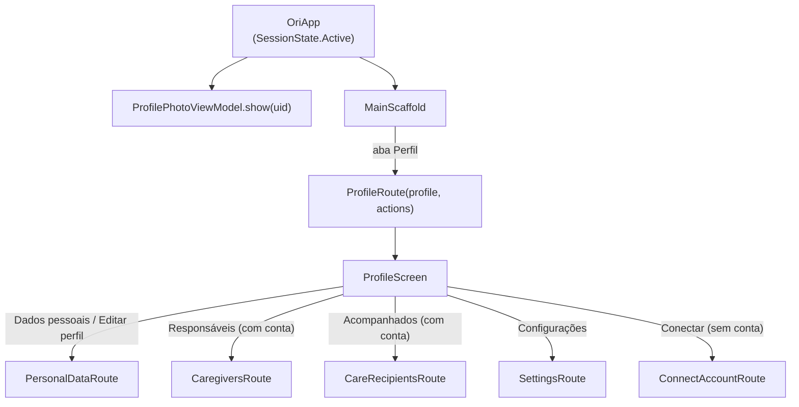
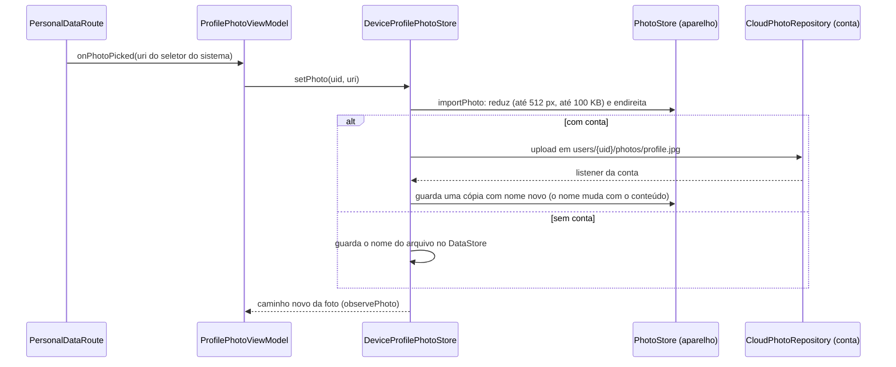

# Perfil e conta

## 1. O que faz e por que existe

"Perfil" é a quarta área do app. É o lugar de tudo que é **sobre a pessoa**, e não sobre a rotina ou a comunicação:

- foto e nome;
- quem ajuda a pessoa ("Responsáveis");
- quem ela acompanha ("Acompanhados");
- configurações;
- sair da conta, ou trazer para uma conta o que foi criado sem ela.

O app pergunta o mínimo sobre alguém: **nome e, se a pessoa quiser, uma foto**. Não há tipo de conta
nem papel: o que uma pessoa pode fazer com os dados de outra é decidido pelo vínculo entre elas (ver
[perfis-e-permissoes.md](perfis-e-permissoes.md)).

## 2. Como a execução começa



- O `OriApp` cria o `ProfilePhotoViewModel` uma vez para a sessão e passa tudo o que o Perfil faz num único objeto, `ProfileActions`. As telas do Perfil não conhecem o `SessionViewModel`.
- Cada subtela abre com `rememberOpenSubscreen<ProfilePane>()`: uma de cada vez, guardada se o app for fechado em segundo plano e fechada pelo "voltar" do sistema.

## 3. Quem participa

| Peça | Onde | Papel |
|---|---|---|
| `ProfileRoute`, `ProfileScreen`, `ProfileHeader` | `ui/app/screens/account/ProfileScreen.kt` | O cartão com foto, nome e "Editar perfil", e o menu |
| `PersonalDataRoute`, `CaregiversRoute`, `ConnectAccountRoute` | `ui/app/screens/account/ProfilePanes.kt` | Foto e nome; responsáveis e código de convite; entrar ou criar conta sem perder o que está no aparelho |
| `ProfileActions` | `ui/app/screens/account/ProfileActions.kt` | O que o Perfil pode pedir à sessão (renomear, sair, apagar, foto) |
| `ProfileAvatar` | `ui/app/screens/account/ProfileAvatar.kt` | A foto redonda, com um ícone de pessoa enquanto não há foto |
| `ProfilePhotoViewModel` | `ui/app/screens/account` | Mostra e troca a foto |
| `ProfilePhotoStore` / `DeviceProfilePhotoStore` | `domain/profile`, `data/profile` | Onde a foto mora |
| `SessionViewModel` | `ui/app/session` | Renomear, sair, apagar os dados do aparelho e passar os dados para a conta |
| `CareLinksSection`, `InvitationSection` e os ViewModels | `ui/app/screens/carelinks` | Lista de vínculos, permissões, revogação e convites |
| `CareRecipientsRoute`, `CareRecipientDetail` | `ui/app/screens/carerecipients` | As pessoas acompanhadas e, para cada uma, a rotina e a comunicação, com as permissões daquele vínculo |
| `SettingsRoute` | `ui/app/screens/preferences/SettingsScreen.kt` | Acessibilidade, Tema, Comunicação, Tela, Privacidade e Sobre (ver [preferencias.md](preferencias.md)) |

## 4. Fluxos

### Nome

- **Com conta:** "Dados pessoais" grava o nome em `users/{uid}.displayName` (`ProfileRepository.updateDisplayName`). As regras só deixam mudar esse campo, e com até 100 caracteres.
- **Sem conta:** o nome fica no DataStore do aparelho.
- **Nome vazio:** é recusado antes de qualquer gravação.

**Limitação:** o nome que aparece para quem acompanha foi copiado para o vínculo quando ele foi criado (`caregiverName`, `primaryUserName`). Trocar o nome depois não muda essa cópia.

### Foto do perfil



- **Permissões:** o seletor de fotos do sistema não pede nenhuma, e o app só recebe a foto escolhida.
- **Uma foto por conta:** com conta, a foto fica num documento só (`profile.jpg`), e cada aparelho guarda uma cópia para funcionar sem internet. Quem acompanha, mesmo com permissão de comunicação, nunca lê a foto do perfil (regra `photoId != 'profile.jpg'`).
- **Ao passar para uma conta:** a foto vai junto (`movePhoto`), a não ser que a conta já tenha uma.

### Sair da conta

- O botão pede confirmação, porque é fácil tocar sem querer. Ele não é vermelho, porque sair não apaga nada: os dados continuam na conta.
- Sair chama `AuthRepository.signOut()`. A sessão vira `SignedOut`, e o `OriApp` troca a área inteira, sem navegação manual.

### Sem conta

- O cartão "Neste aparelho" leva a "Conectar", que explica, antes de qualquer escolha, que os dados vão para a conta.
- Depois de entrar, `SessionViewModel.onAccountActive` chama `MoveLocalDataToAccount` (ver [uso-local.md](uso-local.md)).
- Se algo não coube, ou faltou conexão, o Perfil mostra um aviso com "Tentar de novo".
- "Apagar os dados deste aparelho" fica em Configurações → Privacidade, e só existe sem conta.

## 5. Regras e permissões

| O quê | Quem pode |
|---|---|
| Ler o perfil | A própria pessoa e quem tem vínculo ativo com ela (para mostrar o nome) |
| Mudar o nome | Só a própria pessoa, só o campo `displayName` |
| Ler ou trocar a foto do perfil | Só a própria pessoa |
| Ver "Responsáveis" e "Acompanhados" | Só com conta, porque um vínculo precisa de duas contas |

## 6. Erros

| Situação | O que acontece |
|---|---|
| Nome recusado ou sem conexão | Uma mensagem aparece abaixo do campo. Sem conexão, a mudança fica pendente e sai depois, como toda gravação |
| Foto que não abre | "Não foi possível abrir esta imagem. Tente outra." (`photo_error_unreadable`) |
| Foto que o aparelho não conseguiu gravar | `photo_error_storage` |
| Foto que a conta recusou | `photo_error_upload` |
| Perfil da conta ilegível ao abrir | Tela com "Tentar novamente" e "Sair" (`ProfileUnavailableScreen`); com uma cópia do perfil no aparelho, o app abre com ela |

## 7. Como testar

```bash
./gradlew testDevDebugUnitTest --tests "*ProfileScreenTest" --tests "*DeviceProfilePhotoStoreTest" --tests "*SessionViewModelTest"
```

- **`ProfileScreenTest`:** o botão "Aa" aparece no Perfil.
- **`DeviceProfilePhotoStoreTest`:**
  - sem conta, a foto fica no aparelho; com conta, ela vai para a conta e volta como cópia;
  - outro aparelho recebe a foto;
  - uma foto nova tem um caminho novo;
  - erros, remoção, e a passagem da foto para a conta.
- **`SessionViewModelTest`:** estados da sessão, perfil a criar, uso offline com a cópia do perfil, passagem dos dados e da foto para a conta, apagar e renomear.
- **Regras:** os testes "profiles" e "photos" em `functions/security-tests/test/rules.test.mjs`.

## 8. Como estender sem quebrar

- **Um dado novo sobre a pessoa:** antes, pergunte se o app precisa mesmo dele (dados mínimos). Se precisar, ele entra em `isValidNewProfile` e na regra de `update`, com teste no emulador, e em `FirestoreSchema`.
- **Uma linha nova no menu:** use `OriMenuRow` com a cor da área a que ela pertence (`OriAreaAccents`) e uma subtela em `ProfilePane`.
