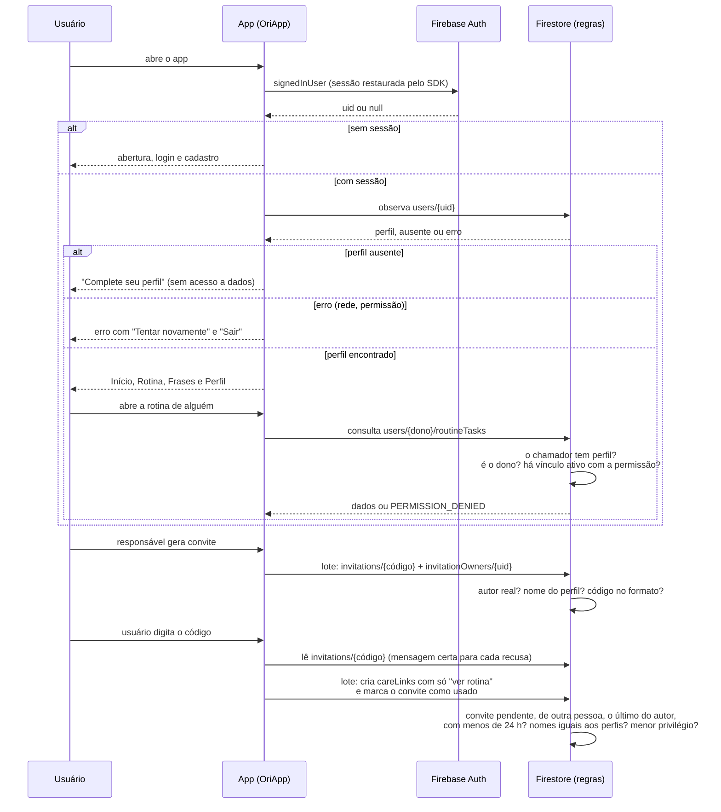

# Perfis, vínculos e permissões

**Situação:**
- **Regras do Firestore, inclusive os convites:** implementadas e testadas no emulador (`functions/security-tests`).
- **App Android:** implementado e parcialmente testado (testes de domínio e de ViewModels; telas sem teste de ponta a ponta com Firebase real).
- **Convites sem Cloud Functions (15/11/2026):** gerar e aceitar convite passaram a ser feitos pelo app, conferidos pelas regras do Firestore (veja a seção 5). As Cloud Functions de antes exigiam o plano Blaze, nunca foram publicadas e ficam em `functions/functions` só para quando houver Blaze.
- **Publicação:** as regras com os convites foram publicadas no projeto `oriteam-ori` em 15/11/2026.

## 1. Identidade não é autorização

O ORI separa duas perguntas:

| Pergunta | Quem responde | Onde fica |
|---|---|---|
| **Quem é você?** (identidade) | Firebase Authentication | Token da sessão (`request.auth.uid`) |
| **O que você pode fazer?** (autorização) | Regras do Firestore | Perfil (`users/{uid}`) e vínculo (`careLinks/...`) |

Estar logado **não dá acesso a nada** por si só. Uma conta sem perfil não lê
nem grava dados do app.

A interface esconde botões que a pessoa não pode usar, mas isso serve só para
deixar a tela clara. **Quem protege os dados são as regras**, que valem também
para quem tentar acessar o banco por fora do app.

## 2. Uma só conta, dois lados de um vínculo

Não há mais login nem cadastro de responsável. **Toda conta pode tudo o que é dela:** ter rotina, usar a comunicação, acompanhar alguém e ser acompanhada. O que uma pessoa pode fazer com os dados de outra depende só do **vínculo** entre as duas.

**Por que mudou:** a mesma pessoa pode precisar de apoio e também apoiar alguém, e a escolha definitiva no cadastro não trazia segurança a mais: quem protege os dados é o vínculo com permissões.

| Lado no vínculo | Pode | Não pode |
|---|---|---|
| Quem é acompanhado (`primaryUserUid`) | Tudo nos próprios dados; concluir as atividades do responsável com `ownerCanComplete = true`; dar ou tirar as permissões `manageRoutines` e `manageCommunication`; encerrar o vínculo; aceitar convites | Alterar atividades criadas pelo responsável |
| Quem acompanha (`caregiverUid`) | Com `viewRoutines`: ver as atividades ativas da pessoa. Com `manageRoutines`: criar, editar, apagar e concluir atividades. Com `manageCommunication`: organizar pranchas e símbolos. Gerar convites. Encerrar o vínculo | Ver atividades ocultas (`hidden_from_caregiver`); ler ou alterar frases salvas; adicionar fotos a símbolos; dar permissões a si mesmo |

No app: **Perfil → Responsáveis vinculados** (quem me acompanha, e aceitar um código) e **Perfil → Acompanhados** (quem eu acompanho, e gerar um código).

**Não há papel no perfil.** Um perfil novo tem só o nome, e as regras recusam um `role` nele. Perfis antigos ainda têm `role`, que não pode ser mudado e que nada lê. No app, quem escolhe o lado do vínculo é a tela, com `CareLinkSide` (`domain/carelink`): `PRIMARY_USER` no Perfil (quem me acompanha) e `CAREGIVER` em Acompanhados (quem eu acompanho). Quem usa o app sem conta não tem perfil no Firestore: veja [uso-local.md](uso-local.md).

> **Atividades reservadas ao responsável** são as que ele criou. Com isso, uma pessoa sem responsável monta a própria rotina, e o que o responsável definiu continua do jeito combinado.
>
> **Comunicação (CAA):** as pranchas são da pessoa; o responsável só as organiza se ela permitir.

## 3. Modelos de dados

```text
users/{uid}
  displayName: string (1–100)
  createdAt: horário do servidor

users/{uid}/routineTasks/{taskId}
  title: string (1–200)            date: "AAAA-MM-DD"
  scheduledTime: "HH:MM" | null    description: string (até 500) | null
  status: "active" | "hidden_from_caregiver" | "archived"
  ownerCanComplete: bool           isDone: bool
  completedBy: uid | null          completedAt: horário do servidor | null
  createdBy: uid de quem criou     createdAt / updatedAt (horário do servidor)

careLinks/{caregiverUid}_{primaryUserUid}
  caregiverUid, primaryUserUid, caregiverName, primaryUserName
  status: "active" | "revoked"
  permissions: { viewRoutines: bool, manageRoutines: bool, manageCommunication: bool }
  (vínculos antigos sem manageCommunication contam como "sem permissão")
  createdAt, revokedAt, invitationCode (o código aceito; vínculos antigos não têm)

users/{uid}/aacBoards/{boardId}            (e /symbols/{symbolId}; veja caa.md)
users/{uid}/settings/preferences           (só o dono; veja preferencias.md)
users/{uid}/aacSavedMessages/{messageId}   (só o dono)

invitations/{código}              (lido um por vez, pelo código; nunca em lista)
  caregiverUid, caregiverName, status: "pending" | "accepted"
  createdAt (do servidor; vale 24 h a partir dele), expiresAt (para a limpeza automática),
  acceptedBy, acceptedAt

invitationOwners/{uid}            (só o dono)
  code: o último código da pessoa (só ele pode ser aceito), createdAt
```

O id do vínculo é previsível (`cuidador_usuario`). Assim, a regra encontra o
vínculo com um único `get()`, sem consultas, que as regras não permitem.

No Android, os modelos de domínio equivalentes são `UserProfile`, `RoutineTask`,
`CareLink`/`CareLinkPermissions` e `CareInvitation`. A conversão entre documento e
modelo fica em `data/firestore/FirestoreSchema.kt`. Um documento com valor
desconhecido vira `null`, nunca um modelo pela metade. O `role` dos perfis antigos é ignorado.

## 4. Do login à decisão de autorização



### Estados da sessão (`SessionState`)

| Estado | Quando | O que o app mostra |
|---|---|---|
| `Initializing` | O SDK restaura a sessão ou o perfil está sendo lido | Carregando |
| `SignedOut` | Não há sessão nem perfil local | Abertura, login, cadastro e "Continuar sem conta" |
| `ProfileRequired` | Há sessão, mas não há perfil | "Complete seu perfil" |
| `ProfileUnavailable` | O perfil não pôde ser lido | Erro com "Tentar novamente" e "Sair" |
| `Active` | Há perfil válido, ou perfil local (sem conta) | Início, Rotina, Frases e Perfil |

- A sessão é guardada e renovada pelo próprio SDK do Firebase. O app **não guarda
  senhas nem tokens** e **não pede login de novo** ao reabrir.
- Falha de rede **não** desloga a pessoa: com a cópia do perfil no aparelho ela segue usando o app; sem cópia, vê `ProfileUnavailable`.
- Credenciais revogadas ou expiradas fazem o SDK encerrar a sessão, e o app volta para `SignedOut`.
- **Sair** chama `signOut()`, e a raiz do app volta sozinha para a abertura.

### Permissões dentro da tela

- `canToggleCompletion()` (domínio) decide se o cartão da atividade pode ser
  marcado. A regra é a mesma do Firestore, mas serve só para a clareza da
  interface.
- Erro de permissão aparece como **erro** ("Você não tem permissão..."), nunca
  como lista vazia. Isso vale, por exemplo, quando um vínculo é encerrado com a
  tela aberta.

## 5. Convites: o app grava, as regras conferem

Criar um vínculo dá acesso aos dados de outra pessoa. Antes, só as Cloud Functions criavam vínculos, mas elas
exigem o plano Blaze e nunca foram publicadas: sem elas, nenhum vínculo existia. Desde 15/11/2026, o app grava o
convite e o vínculo, e **as regras do Firestore conferem tudo o que a função conferia**. Um cliente alterado
continua sem conseguir criar um vínculo sem um código válido.

**Por que dá para confiar nas regras aqui:** cada gravação vai num lote (`WriteBatch`), e as regras olham o banco como
ficaria depois do lote (`getAfter`). O vínculo só é aceito se o convite for marcado como usado **no mesmo lote**, e o
convite só é marcado como usado se o vínculo for criado junto. Um sem o outro é recusado.

| Passo | Quem faz | O que as regras exigem |
|---|---|---|
| Gerar (`FirestoreInvitationRepository.createInvitation`) | Quem vai acompanhar | Perfil; o próprio uid e o nome do perfil; código de 8 caracteres sem 0/O e 1/I (gerado com `SecureRandom`), que ainda não existe; `createdAt` do servidor; o ponteiro `invitationOwners/{uid}` para o código no mesmo lote; 30 s desde o último código |
| Ler o código digitado | Quem será acompanhado | Perfil. Só um convite por vez, pelo código: listar é recusado |
| Aceitar (`acceptInvitation`) | Quem será acompanhado | Perfil dos dois; convite pendente, de outra pessoa, com menos de 24 h (pelo horário do servidor) e o último código do autor; vínculo `{responsável}_{eu}` com os nomes dos perfis, `status: active`, **só `viewRoutines`**, `createdAt` do servidor e o código aceito; um vínculo ativo não é sobrescrito, e um encerrado recomeça (novo consentimento) |
| Apagar | Quem gerou | Só o próprio código e o próprio ponteiro |

- **Um código por vez:** gerar de novo mostra o mesmo código enquanto ele tiver pelo menos uma hora de validade; senão
  cria outro e apaga o anterior no mesmo lote. Só o último código de cada pessoa pode ser aceito.
- **Idempotente:** aceitar de novo um código que eu mesmo já aceitei, com o vínculo ativo, devolve sucesso (a resposta
  da primeira vez pode ter se perdido).
- **Mensagens:** antes de gravar, o app lê o convite e diz o motivo certo (código não encontrado, vencido ou usado, já
  vinculados). O que só as regras pegam vira "sem permissão".
- **Só com internet:** as leituras vão ao servidor (`Source.SERVER`) e tudo para em 15 s com "Sem conexão". Nada fica
  na fila do aparelho, porque um vínculo pendente não daria acesso a nada e confundiria as duas pessoas.
- **Limite:** se quem convidou mudar o nome depois de gerar o código, o aceite é recusado (o nome guardado no convite
  não bate mais com o perfil). Basta gerar um código novo.
- **As Cloud Functions** (`functions/functions/src/careInvitations.ts`) ficam no repositório, com os testes delas
  (`invitationFunctions.test.mjs`), para quando houver o plano Blaze. O app não as chama.

## 6. Testes de segurança

### Regras e funções no emulador (`functions/security-tests`)

```bash
cd functions/security-tests
npm ci
npm test   # sobe o emulador do Firestore, roda os testes e desliga
```

Esse comando precisa de Java 11 ou superior e do Node 24.

| Grupo | O que é verificado |
|---|---|
| Visitante sem login | Não lê perfis, rotinas, vínculos nem convites |
| Perfis | Cria só o próprio perfil, só com o nome; **recusa qualquer `role`** (inclusive os antigos) e campos extras; exige o nome; o `role` dos perfis antigos não muda (nem por `update` nem por sobrescrita); perfil não pode ser apagado; perfis de pessoas não vinculadas são privados |
| Conta sem perfil | Não acessa nem o próprio caminho; vínculo ativo de nada vale sem perfil de responsável |
| Usuário principal | Lê a própria rotina; marca e desmarca atividade autorizada; **não** marca atividade reservada; **não** registra conclusão em nome de outra pessoa; **não** edita nem cria atividades; **não** acessa a rotina de terceiros |
| Responsável com vínculo | Lê só atividades ativas; consulta que poderia trazer ocultas é recusada; cria só como autor real; edita atividade já concluída sem reescrever a conclusão; não toca em atividades ocultas; não acessa pessoas não vinculadas |
| Permissões | "Só ver" lê, mas não gerencia; **responsável não se dá permissão**; usuário principal concede e retira; chaves de permissão desconhecidas são recusadas |
| Vínculos | Cliente **não cria** vínculo sem convite; só os dois participantes leem; **encerrar corta o acesso na hora** e não pode ser desfeito pelo cliente; responsável já revogado não tem acesso; terceiros não encerram vínculo alheio |
| Convites (`careInvitations.test.mjs`) | Gerar só com o próprio uid, o nome do perfil, o formato e o ponteiro; código já usado por outra pessoa; 30 s entre códigos, e só o último vale; ler um por vez, nunca em lista, só com perfil; aceitar cria vínculo só de ver, para os dois, e gasta o código; mais permissões, outros nomes, outro estado ou outro vínculo são recusados; vínculo e convite só juntos; o próprio código, vencido ou usado é recusado; sem perfil (de quem aceita ou de quem convidou) é recusado; vínculo ativo não é sobrescrito; encerrado recomeça só com um código novo; só quem gerou apaga |
| Comunicação (`aac.test.mjs`) | Dono organiza pranchas e símbolos com consultas limitadas; símbolo só em prancha existente; imagem só como referência curta (nada de `data:`, nada de `../`); responsável com `manageCommunication` organiza e apaga as fotos dos símbolos, mas **não** adiciona fotos nem toca na do perfil; responsável sem a permissão, com vínculo antigo ou revogado não lê nada; **frases salvas são só do dono**; só o usuário principal concede `manageCommunication` |
| Funções de convite, guardadas (`invitationFunctions.test.mjs`) | Formato do código; qualquer conta com perfil cria e aceita; retentativa em colisão; aceite cria vínculo com menor privilégio; uso único; código desconhecido ou expirado; conta sem perfil; sem vínculo duplicado; vínculo revogado recriado com permissões padrão; autor que não tem mais perfil. Os perfis desses testes não têm `role` |

Para conferir que os testes detectam falhas reais, as regras foram
enfraquecidas temporariamente (papel alterável e permissões ignoradas). Os
testes "o papel não pode ser alterado" e "só ver não gerencia" falharam, como
esperado. Depois disso as regras foram restauradas. Ao tirar o papel do perfil,
a regra antiga (que exigia `role`) foi testada de novo: os dois testes de perfil
novo falharam com ela.

Os convites passaram pelo mesmo teste em 15/11/2026: sem a exigência das permissões padrão, sem a espera de 30 s, sem
"só o último código do autor" ou sem "convite ainda pendente" no vínculo, um teste falhou em cada caso. A conferência
de validade de 24 h ficou só na regra do convite: repetida na do vínculo, nenhum teste a distinguia.

### App Android (`android/`)

```bash
./gradlew testDevDebugUnitTest
```

| Teste | O que garante |
|---|---|
| `AuthorizationDomainTest` | Estados da sessão; o cadastro cria o perfil; falha de conta não grava perfil; falha de perfil é separada; regra de quem marca a atividade |
| `SessionViewModelTest` | Sem sessão → `SignedOut`; sem perfil → `ProfileRequired`; perfil criado ativa a sessão sem novo login; nova tentativa e saída; trocar de conta não mostra o perfil anterior |
| `SignedInViewModelsTest` | Cada lado do vínculo vê os seus (`CareLinkSide`); erro de permissão na rotina não vira lista vazia; marcação proibida não chega ao repositório; encerrar vínculo exige confirmação; só o usuário principal muda permissões; validação e mensagens do convite; perfil exige nome |
| `AacDomainTest`, `AacOrganizeViewModelTest`, `AacScreenTest` | Quem organiza pranchas, quem usa frases salvas e fotos; responsável sem permissão não grava nada e não vê botões de mudança |
| `FirestoreSchemaTest` | Perfil sem nome é rejeitado, e o `role` antigo é ignorado; permissão ausente equivale a "não pode"; valores iguais aos das regras; mapeamento de erros |
| `InvitationCodesTest` | Códigos de 8 caracteres do alfabeto, diferentes entre si; limpeza do que foi digitado e recusa de 0/O e 1/I; o alfabeto das regras é o mesmo do app (lido de `firestore.rules`); quem pode aceitar (outra pessoa, uma vez, em 24 h) |
| `InvitationViewModelTest` | Gerar; sem conexão não vira "código errado"; código limpo e curto ou com letra parecida não vai ao servidor; a mensagem de cada recusa |
| `LoginViewModelTest`, `RegisterViewModelTest` | Preferência "Aa" persistida; cadastro grava o perfil; conta sem perfil segue para a sessão |

## 7. Limitações e riscos

- **Rascunho de perfil no cadastro:** criar a conta e o perfil são dois passos.
  Entre eles, a tela "Complete seu perfil" pode aparecer por um instante.
- **Cache offline:** o Firestore guarda dados no aparelho. Ao trocar de conta no
  mesmo aparelho, a nova conta só consulta os próprios caminhos, mas o cache não
  é apagado ao sair.
- **Convites:** um código usado ou vencido fica no banco até a política de TTL no campo `expiresAt` ser ligada no
  console do Firebase (S2). Cada pessoa gera no máximo um código a cada 30 s, e só o último vale.
- **App Check** não está configurado. Ele reduziria gravações feitas fora do app.

## Como publicar

**Perfil sem papel (03/11/2026):** as regras publicadas recusam `role` em perfis novos. Uma versão antiga do app, que ainda grava `role`, não consegue criar perfil: o cadastro para em "Complete seu perfil". Instale a versão nova nos aparelhos de teste.

**Convites sem Cloud Functions (15/11/2026):** publique as regras antes de testar os convites. Um app antigo, que ainda
chama as funções, mostra "Sem conexão" ou erro ao gerar um código; instale a versão nova.

Com a conta do projeto Firebase, dentro de `functions/`:

```bash
firebase deploy --only firestore:rules,firestore:indexes --project oriteam-ori
```

Antes de publicar, rode `npm test` em `functions/security-tests` e confira as regras atuais no console: este arquivo
**substitui** as regras existentes.

**Limpeza dos convites (opcional, recomendada):** no console do Firebase, em Firestore → Time-to-live, crie uma política
para o grupo de coleções `invitations` no campo `expiresAt`. O Firestore apaga os convites vencidos sozinho, em até um
dia depois da data, sem custo no plano gratuito.

## Erro do código de convite (09/11/2026)

Enquanto os convites dependiam das Cloud Functions não publicadas, "Gerar código de convite" mostrava "Código não
encontrado". Em 09/11/2026 o app passou a dizer "Este serviço ainda não está disponível". Desde 15/11/2026 os convites
não usam funções (seção 5), e essa mensagem saiu do app.

## Teste com duas contas no projeto real (15/11/2026)

Feito com o build `profiling` no celular (SM-S911B, em português) e no tablet (SM-X610, em inglês), cada um com uma
conta própria, no projeto `oriteam-ori`, com as regras publicadas no mesmo dia.

| Passo | Resultado |
|---|---|
| Celular gera o código em "Acompanhados" | Funcionou: "YYGN98UL", "Válido até 16/11/2026 22:56". Antes dos convites sem Cloud Functions, este passo falhava |
| Tablet digita o código em "Linked caregivers" | "Done! You are now linked with Matheus Mendonça", com "View only" |
| Celular, sem tocar em nada | A pessoa apareceu em "Acompanhados", "Somente visualização", na hora |
| Tablet liga "manage my routine" | O botão "Adicionar atividade" apareceu na rotina da pessoa, no celular |
| Celular cria uma atividade na rotina da pessoa | Apareceu no tablet com "Set by the caregiver" |
| Tablet marca a atividade como feita | O ✓ apareceu no celular |
| Celular exclui a atividade (com confirmação) | Sumiu também do tablet |
| Tablet encerra o vínculo (com confirmação), com a rotina da pessoa aberta no celular | O celular mostrou "Vínculo encerrado — Você não tem mais acesso à rotina desta pessoa" na hora; a lista do tablet ficou vazia |

**Não conferido ainda:** a permissão da comunicação (pranchas), uma atividade oculta e reaceitar depois de encerrar.
A atividade de teste foi apagada e o vínculo foi encerrado: as duas contas terminaram como começaram.

**Achados no teste:**

- Depois de aceito, o código continua na tela de quem convidou, como se ainda valesse. Esconder o código quando a
  pessoa aparece na lista.
- Depois de encerrar, o tablet ainda mostrava "Done! You are now linked with…" do aceite anterior. A mensagem de
  sucesso deveria sumir quando a lista muda.
- O texto de "Acompanhados" vazio diz "Gere um código de convite em Conta"; a área se chama "Perfil", e o botão está
  na mesma tela.
