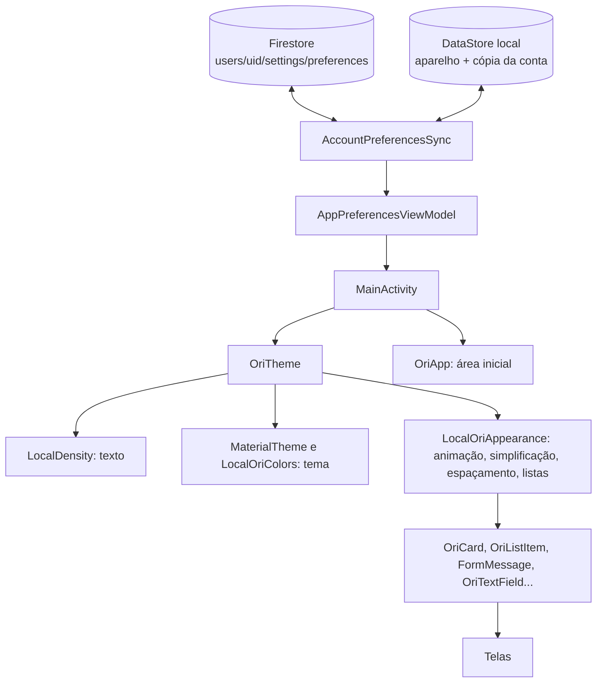
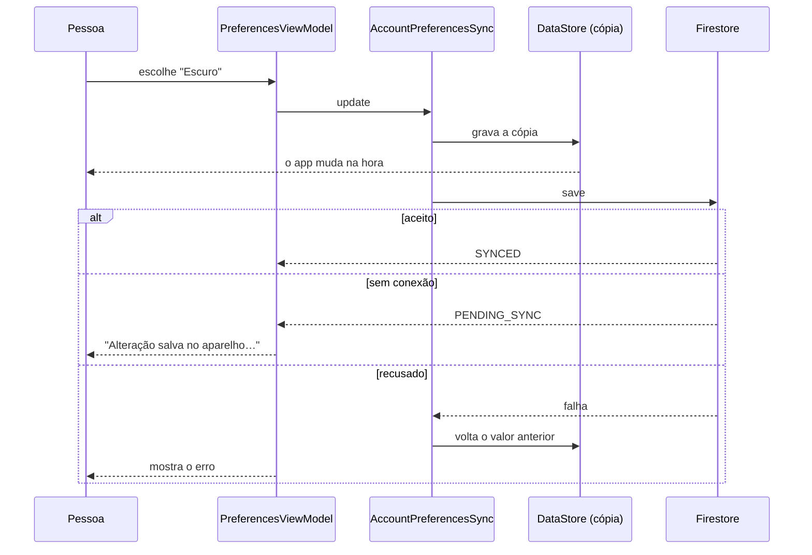

# Preferências

**Situação:**
- **Armazenamento, sincronização e tela:** implementados e testados na JVM.
- **Efeitos nos componentes:** implementados, testados (Robolectric) e conferidos em imagens geradas no computador.
- **Regras do Firestore:** implementadas, testadas no emulador e publicadas no `oriteam-ori`.
- **Não implementado:** preferências de launcher, porque o ORI ainda não tem launcher (veja a seção 7).
- **Não foi possível verificar:** o uso no celular real, a troca entre dois aparelhos reais e leitores de tela reais.

## 1. O que o módulo faz e por que existe

Cada pessoa precisa de algo diferente: texto maior, menos movimento, menos enfeites, mais conteúdo na tela. O módulo guarda essas escolhas e as aplica no app inteiro.

**Abertura:** em Perfil → Configurações, que separa as opções em Acessibilidade, Tema, Comunicação e Tela e início. Perfil também leva direto a Acessibilidade e Comunicação.

## 2. Conta ou aparelho?

A regra de decisão é: **é uma necessidade da pessoa, ou depende da tela e do uso deste aparelho?**

- **Necessidade da pessoa → acompanha a conta.** Quem precisa de texto grande precisa dele em qualquer aparelho.
- **Depende do aparelho → fica nele.** O espaçamento que funciona num tablet pode não funcionar num celular.

### Acompanham a conta

Ficam em `users/{uid}/settings/preferences`, com uma cópia local no DataStore.

| Preferência | Opções | Efeito real | Onde é aplicada |
|---|---|---|---|
| Tamanho do texto (`TextScale`) | Igual ao do sistema · Grande (1,15×) · Maior (1,3×) · Muito grande (1,5×) | Multiplica o tamanho escolhido no sistema, em todos os textos. A grade de símbolos e as ações da CAA se adaptam sozinhas, pois leem a mesma escala | `OriTheme` (`LocalDensity`) |
| Tema (`ThemeMode`) | Igual ao do sistema · Claro · Escuro | Troca a paleta inteira e os ícones das barras do sistema | `OriTheme`, `MainActivity` |
| Interface simplificada | Ligada · Desligada | Tira bordas de cartões, ícones ao lado do texto nas listas, o ícone dos estados vazios e os arcos decorativos | `OriCard`, `OriListItem`, `EmptyState`, `OriDecorativeArcs` |
| Animações (`MotionLevel`) | Igual às do sistema · Expressivas · Sutis · Reduzidas · Desligadas | Veja a tabela abaixo | `OriMotion`, usado pelos componentes |

| Nível de animação | Enfeites | Avisos de mudança | Balanço | Rolagem até um ponto |
|---|---|---|---|---|
| Expressivas | Duração completa | Duração completa | Sim | Animada |
| Sutis | 60% da duração | 60% da duração | Não | Animada |
| Reduzidas | Mudam na hora | 40% da duração | Não | Vai direto |
| Desligadas | Mudam na hora | Mudam na hora | Não | Vai direto |

"Igual às do sistema" vira Desligadas quando o Android está com as animações removidas, e Expressivas nos outros casos. Desligar animação nunca esconde informação: o valor final aparece na hora.

### Ficam só no aparelho

Ficam no DataStore local.

| Preferência | Opções | Efeito real | Onde é aplicada |
|---|---|---|---|
| Espaçamento (`ContentDensity`) | Compacto · Confortável · Amplo | Muda a margem interna dos cartões, a altura e o espaço entre itens de lista e o espaço entre símbolos. Linhas de lista nunca ficam abaixo de 48 dp | `OriCard`, `OriListItem`, itens de configuração, listas, `AacBoardGrid` |
| Listas (`ListPresentation`) | Detalhadas · Resumidas | Resumidas escondem a linha de apoio e os avisos dos cartões de atividade. O restante continua ao abrir o item | `OriListItem`, `OriMenuRow`, `RoutineTimeline` |
| Abrir o app em (`StartArea`) | Início · Minha rotina · Formar frase | Define a primeira área ao abrir. Mudar a opção não tira a pessoa da tela atual | `startDestinationFor`, `MainScaffold` |
| Letras maiúsculas | Ligada · Desligada | Todos os textos do app em maiúsculas, inclusive o que a pessoa escreveu. Muda também pelo botão "Aa" no topo das telas. Fica no aparelho, pois vale antes do login | `ui/components/text/Text.kt`, `OriTextField` |
| Símbolos: tamanho, rótulos, o que um toque faz | Veja [caa.md](caa.md#8-preferências-e-grade-adaptável) | Colunas da grade e modo de montar a mensagem. Também podem ser mudados dentro de Formar frase | `AacBoardGrid`, `AacCommunicateViewModel` |

**O que nunca é removido:** as preferências tiram enfeites e texto secundário, mas nenhum botão, nenhum rótulo de ação e nenhuma área de toque mínima. O ícone de erro também fica, porque um aviso não é enfeite.

## 3. Como é aplicada, sem repetir por tela



- **Telas não leem preferências de aparência.** Elas usam os componentes, e os componentes leem `LocalOriAppearance`. Por isso uma tela nova já nasce respeitando as escolhas.
- **Animações:** os componentes pedem um *tipo* de movimento (`motion.decorative`, `motion.feedback`, `motion.playful`) em vez de uma duração fixa.
- **Cores:** as que o Material 3 não nomeia (placeholder, trilho do switch, arcos, erro, sucesso) estão em `LocalOriColors`, com uma versão para cada tema.
- **Primeiro quadro:** a `MainActivity` não desenha nada até ler o DataStore (alguns milissegundos). Assim, quem usa texto grande ou tema escuro não vê um primeiro quadro com os padrões.

## 4. Fluxo de atualização

### Preferência do aparelho

A tela chama `DevicePreferencesRepository.update`. O DataStore grava, o fluxo `preferences` emite, e o `OriTheme` recompõe.

### Preferência da conta



### Em outro aparelho

Enquanto o app está na tela e há alguém conectado, `AccountPreferencesSync` acompanha o documento. Quando ele muda, a cópia local muda, e o app se atualiza.

| Situação | O que acontece | Por quê |
|---|---|---|
| Sem login | Vale a cópia local | A tela de login precisa continuar legível para quem usa texto grande |
| Conta nunca salvou preferências | Mantém a cópia atual; nada é gravado | Quem precisa de texto grande não o perde ao entrar pela primeira vez |
| Falha ao ler | Mantém a cópia; nenhum erro na tela | Aparência nunca é motivo para bloquear o app |
| Sair da conta | Mantém a cópia | Mesmo motivo do login |
| Duas alterações em aparelhos diferentes | Vale a última gravada | Conflito simples e previsível; o documento é sempre gravado inteiro |

**Consequência em aparelho compartilhado:** a próxima pessoa vê a cópia da anterior até entrar. Se a conta dela já tiver preferências, elas substituem a cópia. Se não tiver, a cópia continua até ela escolher.

**Custo:** um documento pequeno por pessoa e um listener só enquanto o app está na tela.

## 5. Permissões

O documento é pessoal: só a própria pessoa lê e grava. **Nenhum vínculo dá acesso a ele**, nem com todas as permissões. As regras aceitam só o documento `preferences`, só os campos e valores conhecidos, com `updatedAt` do servidor. Ele não pode ser listado nem apagado.

**Para acrescentar uma opção:** publique as regras antes da versão do app que a grava (veja [dados.md](../dados.md)). Valores desconhecidos no app voltam ao padrão, campo a campo, sem perder os outros.

## 6. Testes

```bash
cd android && ./gradlew testDevDebugUnitTest
cd functions/security-tests && npm test
```

| Cenário | Testes |
|---|---|
| Sincronização: login, conta sem documento, falha de leitura, troca de conta, offline, recusa, sem login | `AccountPreferencesSyncTest` |
| Separação conta/aparelho, erro e aviso de pendência | `PreferencesViewModelTest` |
| Efeito de cada opção: tamanho do texto, tema, espaçamento, resumo, simplificação, animação; controles continuam | `PreferenceEffectsTest` |
| Regras: níveis de animação, área de toque, área inicial, contraste AA do tema escuro | `OriThemeRulesTest` |
| Tela: cada opção chama a sua preferência, valor salvo selecionado | `PreferencesScreenTest` |
| Maiúsculas em menus, navegação, listas e títulos; botão "Aa" | `UppercaseEverywhereTest` |
| Valores desconhecidos e campos exigidos pelas regras | `AccountPreferencesMappingTest`, `DataStoreDevicePreferencesRepositoryTest` |
| Permissões no servidor (5 testes) | `functions/security-tests/test/preferences.test.mjs` |

**Conferência de que os testes pegam falhas reais:** desfiz temporariamente os efeitos e a sincronização, e 11 testes falharam. Um teste não pegou a animação da mensagem ignorando a preferência, porque a mensagem já nascia visível. Ele foi reescrito para comparar a altura logo depois de aparecer com a altura final, e passou a falhar nessa situação.

**Conferido em imagens geradas no computador, a 360 × 640 dp:** CAA, login, preferências e listas no tema escuro; listas simplificadas e resumidas; espaçamentos Amplo e Compacto; texto Muito grande.

## 7. Limitações

- **Launcher:** não existe launcher no repositório, então não há preferências dele. Quando existir, as escolhas dele devem ficar em `DevicePreferences`, porque dependem do aparelho. A mais próxima hoje é "Abrir o app em".
- **Animações internas do Material 3** (efeito de toque, indicador da barra de navegação, abertura de menus) não seguem o nível escolhido, só o ajuste do sistema. Elas são breves e essenciais à resposta ao toque.
- **Tamanho do texto "Muito grande" somado a um texto de sistema já ampliado** pode exigir mais rolagem. As telas rolam em vez de cortar.
- **Tema escuro:** só o contraste dos pares principais de cores é verificado automaticamente. O logo e a ilustração da mão têm cores fixas.
- **Espaçamento Amplo** não aumenta o espaço entre símbolos, pois isso tiraria uma coluna da grade nos celulares.
- **As preferências de conta não têm histórico** nem "restaurar padrão".

## 8. Como estender

1. **Decida onde fica** usando a regra da seção 2.
2. **Da conta:** acrescente em `AccountPreferences`, no mapeamento de `FirestoreAccountPreferencesRepository`, na cópia do `DataStoreDevicePreferencesRepository` e em `isValidPreferences` nas regras, com teste. **Publique as regras antes.**
3. **Do aparelho:** acrescente em `DevicePreferences` e no `DataStoreDevicePreferencesRepository`.
4. **Aplique no componente compartilhado**, por `OriAppearance`, e não em cada tela.
5. **Teste o efeito real** em `PreferenceEffectsTest`. Uma opção sem efeito visível não deve existir.
