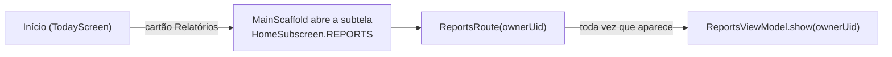
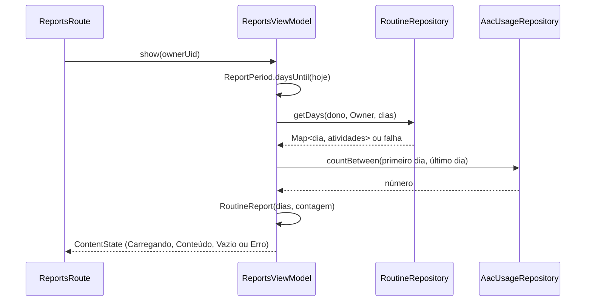

# Relatórios

## 1. O que faz e por que existe

"Relatórios" mostra, para a própria pessoa, como foi a rotina dela na semana ou no mês:

- quantas atividades foram concluídas;
- qual a porcentagem de conclusão;
- quantas vezes ela se comunicou pela CAA;
- uma linha por dia.

A tela existe para a pessoa (e quem ela escolher mostrar) perceber o próprio ritmo. Por isso não
compara com metas e não pune dias vazios: **um dia sem nada planejado não é um dia que falhou**, e
fica fora da porcentagem.

## 2. Como a execução começa



O relatório é sempre do dono da sessão (`RoutineViewer.Owner`). Quem acompanha não tem relatório da
outra pessoa, porque relatório não está entre as permissões de um vínculo.

## 3. Quem participa

| Peça | Onde | Papel |
|---|---|---|
| `ReportsRoute`, `ReportContent`, `SummaryTile`, `DailyChart`, `DayLine` | `ui/app/screens/reports/ReportsScreen.kt` | Desenham as abas (semana ou mês), o resumo, o gráfico e os detalhes |
| `ReportsViewModel` e `ReportsUiState` | `ui/app/screens/reports/ReportsViewModel.kt` | Escolhem o período, leem os dias e montam o relatório |
| `ReportPeriod`, `DayResult`, `RoutineReport`, `dayResultOf` | `domain/reports/RoutineReport.kt` | As contas, sem Android e sem Firebase |
| `RoutineRepository.getDays` | `domain/routine` e `data/routine` | Os dias do período, com as atividades que se repetem já incluídas |
| `AacUsageRepository` | `domain/aac`, `data/local/RoomLocalDataStore.kt` | Quantas vezes a pessoa se comunicou, contadas só neste aparelho |

## 4. Como os dados circulam



- **Período:**
  - A semana começa no primeiro dia da semana do app (`FIRST_DAY_OF_WEEK`, domingo); o mês começa no dia 1.
  - Os dois vão só até hoje: o futuro ainda não tem o que contar.
- **Atividades do dia:** passam por `forDay()`, que tira as arquivadas. Um dia de uma atividade repetida conta como uma atividade daquele dia.
- **Porcentagem:** `concluídas × 100 / total`, somando só os dias com atividades.

**Leitura da conta:** `FirestoreRoutineRepository.getDays` lê o período numa consulta por intervalo de datas, em páginas de 100, mais uma leitura das atividades que se repetem. Sem conta, os dias vêm do banco local (Room). `RoutedRepositoriesTest` garante que o pedido chega inteiro ao Firestore: até 03/11/2026 ele virava uma consulta por dia sem ninguém perceber (falha R1, corrigida).

## 5. Regras e permissões

- O relatório lê com `RoutineViewer.Owner`, então as regras do Firestore liberam só a própria rotina (`isPrimaryUserOwner`).
- A contagem de comunicação nunca sai do aparelho. Duas pessoas no mesmo aparelho, ou a mesma pessoa em dois aparelhos, contam separado, e a tela diz isso em `reports_aac_usage_note`.

## 6. Onde os dados são lidos e gravados

A tela **só lê**:

| Dado | Com conta | Sem conta |
|---|---|---|
| Atividades | `users/{uid}/routineTasks` e `users/{uid}/routineSeries` | tabelas `routine_tasks` e `routine_series` |
| Comunicação | tabela `aac_usage` (sempre local) | tabela `aac_usage` |

A contagem é gravada pela tela de Comunicar, em `recordCommunication`. O que conta como comunicação
está em [caa.md](caa.md).

## 7. Erros

- Se a leitura dos dias falhar, a tela mostra o erro com "Tentar novamente" (`ContentState.Error`), nunca um relatório vazio.
- Um erro de permissão aparece como erro, e não como "sem dados".
- **Limitação:** se a contagem de comunicação falhar, ela aparece como 0 (falha R12).

## 8. Como o estado da interface muda

| Situação | O que aparece |
|---|---|
| Primeira abertura | "Carregando" |
| Voltar à tela | O relatório anterior continua na tela enquanto o novo é lido; depois é trocado |
| Trocar semana ⇄ mês | "Carregando", porque os números antigos são de outro período |
| Nada planejado e nenhuma comunicação | Estado vazio, com uma explicação |
| Falha | Erro com "Tentar novamente" |

**Acessibilidade:**

- Cada bloco do resumo é lido como uma coisa só ("15, Atividades concluídas").
- O gráfico tem uma descrição, e os mesmos números estão nos detalhes, para quem não lê gráficos.

## 9. Como testar

```bash
./gradlew testDevDebugUnitTest --tests "*RoutineReportTest" --tests "*ReportTilesTest" --tests "*RoutedRepositoriesTest"
```

- **`RoutineReportTest`:**
  - limites da semana e do mês;
  - dias vazios fora da porcentagem;
  - relatório vazio.
- **`ReportTilesTest`:** blocos do resumo com a mesma altura, qualquer que seja o texto.
- **`RoutedRepositoriesTest`:** com conta, o período vai ao Firestore numa leitura só.
- **Falta:** um teste do `ReportsViewModel` (ver a seção 6 de [revisao-de-codigo.md](../revisao-de-codigo.md)).

## 10. Como estender sem quebrar

- **Um número novo no relatório:** calcule em `domain/reports` com um teste puro e só depois mostre na tela.
- **Um período novo** (por exemplo, "últimos 30 dias"): basta outro valor em `ReportPeriod`. A leitura por intervalo serve para qualquer período. Mantenha o período curto, porque cada dia lido custa leitura.
- **Mostrar o relatório para quem acompanha:** antes, decida a permissão com quem é acompanhado (novo campo em `CareLinkPermissions`), com regra e teste no emulador.
