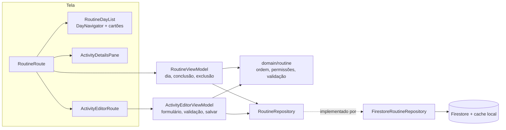
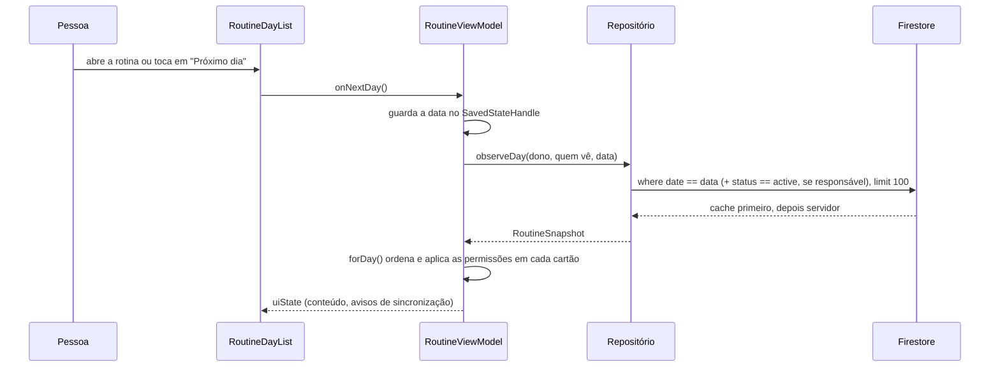
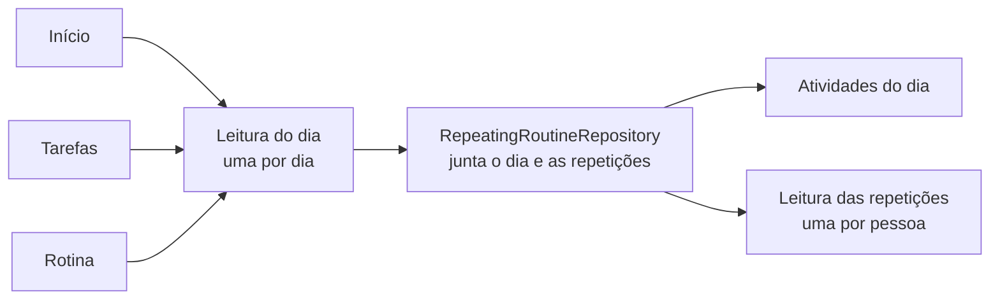
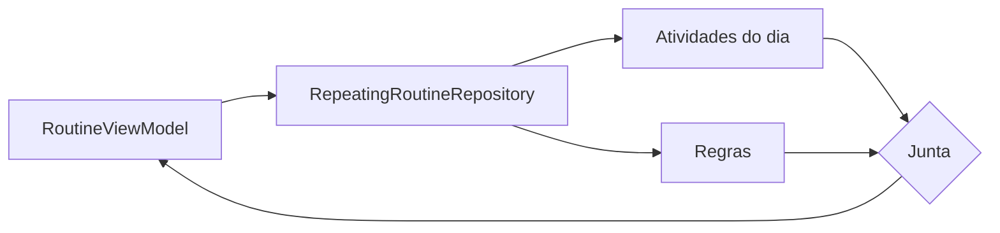

# Rotina

**Situação:**
- **Regras do Firestore:** implementadas e testadas no emulador.
- **Domínio e ViewModels:** implementados e testados na JVM.
- **Telas:** implementadas e testadas na JVM com Robolectric (layout de um e dois painéis, permissões visíveis).
- **Não foi possível verificar:** uso em aparelho real, modo avião de verdade e leitores de tela reais.
- **Bloqueado por configuração externa:** as regras novas precisam ser publicadas (`firebase deploy --only firestore:rules`) para o app novo gravar no projeto real.

## 1. O que o módulo faz e por que existe

A rotina organiza o dia do usuário principal em **atividades**. Cada atividade
tem nome, data, horário opcional e detalhes opcionais. A pessoa navega dia a
dia, abre os detalhes, marca como concluída e, quando pode, cria, edita e exclui.

Ela existe para dar previsibilidade ao dia, que é um dos pilares do ORI, sem
tirar a autonomia de quem usa.

## 2. Modelo da atividade

```text
users/{dono}/routineTasks/{id}
  title          texto, 1–200
  date           "AAAA-MM-DD" (calendário local da pessoa)
  scheduledTime  "HH:MM" ou null (sem horário)
  description    texto até 500 ou null
  status         "active" | "hidden_from_caregiver" | "archived"
  ownerCanComplete  o usuário principal pode marcar como concluída?
  isDone, completedBy, completedAt
  createdBy, createdAt, updatedAt
```

- **No domínio (Kotlin):** `RoutineTask`. O rascunho do formulário é `ActivityDraft`.
- **Data e hora são texto, não instantes.** A rotina segue o calendário de quem a
  usa. Se a pessoa viajar para outro fuso, "07:30 de 29/10" continua sendo
  07:30 de 29/10.
- **Ordem do dia:** primeiro as atividades com horário, em ordem crescente;
  depois as sem horário, em ordem alfabética. As concluídas não mudam de lugar,
  para o dia continuar previsível. Atividades arquivadas não aparecem.

## 3. Permissões

| Ação | Usuário principal | Responsável com `manageRoutines` | Responsável só com `viewRoutines` |
|---|---|---|---|
| Ver o dia | Todas as atividades | Só as `active` | Só as `active` |
| Criar | ✅ (atividades **dele**) | ✅ | ❌ |
| Editar / excluir | Só as que **ele** criou | As visíveis (não ocultas) | ❌ |
| Concluir | As dele e as do responsável com `ownerCanComplete` | As visíveis | ❌ |
| Ocultar do responsável | ✅ (só as dele) | ❌ nunca | ❌ |
| Definir "o usuário pode concluir" | Sempre "sim" nas dele | ✅ | ❌ |

**Atividades reservadas ao cuidador** são as que o cuidador criou. O usuário
principal pode consultá-las e concluí-las, quando isso foi permitido, mas não
pode editar nem excluir. Assim:
- uma pessoa **sem cuidador** monta a própria rotina sozinha (autonomia);
- o que o cuidador definiu não é alterado por engano.

**Onde as regras moram:**
- `domain/routine/RoutineAccess.kt` decide **o que a interface mostra**.
- `functions/firestore.rules` decide **o que o servidor aceita**.
- As duas precisam concordar, e os testes cobrem os dois lados.

Quando a pessoa não pode alterar uma atividade, os detalhes dizem isso
("Esta atividade só pode ser alterada por quem a gerencia") em vez de esconder
os botões sem explicação.

## 4. Componentes



**Layout adaptativo:**
- A tela decide entre **um ou dois painéis pela largura que ela própria recebe**
  (720 dp ou mais), e não pela janela. Por isso também funciona dentro do painel
  de detalhe do responsável.
- **Dois painéis:** o dia fica à esquerda; detalhes ou formulário, à direita.
- **Um painel:** os detalhes e o formulário ocupam a tela, e o "voltar" do
  sistema retorna ao dia.
- **Trocar de dia fecha os detalhes:** escolher outro dia (as setas, arrastar a semana, tocar num dia) fecha os
  detalhes abertos, porque a atividade é de outro dia. Antes, o painel dizia "Atividade não encontrada — pode ter sido
  excluída", sem nada ter sido apagado (G6). Salvar numa data diferente continua abrindo os detalhes no dia novo.

## 5. Fluxo de cada operação

### Consultar um dia



- **Falha de rede na leitura:** aparece um erro com "Tentar novamente".
- **Sem conexão, mas com cache:** aparece o dia salvo com o aviso "Mostrando a
  última versão salva".
- **Vínculo revogado:** aparece um erro de permissão, nunca uma lista vazia.

### Criar ou editar

```mermaid
sequenceDiagram
    participant U as Pessoa
    participant E as ActivityEditorScreen
    participant VM as ActivityEditorViewModel
    participant D as Domínio
    participant R as Repositório
    U->>E: toca em "Adicionar atividade"
    E->>VM: start() reserva um id (só uma vez)
    U->>E: preenche e toca em "Salvar"
    E->>VM: onSaveClick()
    VM->>D: parseScheduledTime(texto)
    alt horário inválido
        VM-->>E: "Use o horário no formato 08:30"
    else válido
        VM->>R: getDay(data) para conferir duplicatas
        VM->>D: validateActivity(rascunho, atividades do dia)
        alt duplicada ou inválida
            VM-->>E: mensagem do problema; o formulário continua preenchido
        else ok
            VM->>R: createActivity(id) ou updateActivity(id)
            R-->>VM: SYNCED, PENDING_SYNC ou falha
            VM-->>E: Saved (id e dia da atividade)
            E-->>E: volta para onde a pessoa estava
        end
    end
```

**Depois de salvar** (`RoutinePane.afterSave`), a Rotina e Tarefas seguem a mesma regra: a tela volta para onde a pessoa estava.
- **Criar** começa na lista, então volta para a lista.
- **Editar** começa nos detalhes, então volta para os detalhes. Se a atividade se repete, volta para a lista, porque ela pode não cair no dia mostrado.
- **Na Rotina**, a tela vai para o dia da atividade salva, porque o formulário pode ter mudado a data. Enquanto esse dia carrega, os detalhes mostram "Carregando…" em vez de "Atividade não encontrada".
- **Tarefas** só mostra hoje: uma atividade criada para outro dia não aparece ali.

**Duplicação, em três camadas:**
1. **Regra de domínio.** Mesmo nome (ignorando maiúsculas e espaços), mesma data
   e mesmo horário é "duplicada". Editar uma atividade não a compara com ela
   mesma.
2. **Toque duplo.** Enquanto salva, novos toques em "Salvar" são ignorados.
3. **Id reservado uma vez.** O id fica guardado no rascunho. Repetir, reenviar
   ou reabrir depois de o app ser encerrado grava **o mesmo documento**, nunca um
   segundo.

### Ver detalhes, concluir e excluir

- **Ver detalhes:** tocar no cartão abre `ActivityDetailsPane`. Ele mostra horário,
  situação, avisos ("Só você vê", "Definida pelo responsável"), os detalhes e só
  as ações permitidas.
- **Concluir:**
  - Pelo botão redondo do cartão (área de toque de 48 dp, anunciado como caixa de
    seleção) ou pelo botão "Marcar como concluída" nos detalhes.
  - O ViewModel confere `canToggleCompletion` e chama `setTaskDone`.
  - O servidor registra quem concluiu e quando.
- **Excluir:**
  - "Excluir" abre uma confirmação. Só depois de "Excluir" na confirmação o
    ViewModel confere a permissão e chama `deleteActivity`.
  - Uma falha aparece como mensagem na tela do dia.

## 6. Estados da interface

| Estado | Como aparece |
|---|---|
| Carregando | Indicador de progresso |
| Dia vazio | "Nada neste dia" e "Toque em \"Adicionar atividade\"…", com espaço para o botão flutuante |
| Erro (rede ou permissão) | Mensagem e "Tentar novamente" |
| Dados do aparelho (offline) | Aviso discreto acima da lista |
| Alteração aguardando conexão | "Alteração salva no aparelho…" |
| Limite atingido | "Mostrando as primeiras 100 atividades" |
| Falha ao concluir ou excluir | Mensagem de erro acima da lista; a lista continua visível |

Os estados visuais de cada atividade usam enums com o texto correspondente
(`ActivityProgress`, `ActivityBadge`), sem cadeias de `if`. As mensagens de
validação são mapeadas por um `when` exaustivo (`RoutineMessages.kt`).

## 7. Reinício do aplicativo

| O que | Como sobrevive |
|---|---|
| Dia escolhido | `SavedStateHandle` do `RoutineViewModel` |
| Painel aberto (detalhes ou edição) | `rememberSaveable` com chave em texto |
| Rascunho do formulário e id reservado | `SavedStateHandle` do `ActivityEditorViewModel` |
| Atividades já lidas | Cache do Firestore (offline) |
| Alterações feitas offline | Fila do Firestore, enviada quando a conexão voltar |

**O rascunho é de uma abertura só.** O ViewModel do formulário vive mais que o formulário, então o
rascunho continuava lá quando o formulário era fechado pelo voltar do sistema, que não passa por
"Cancelar". Na próxima "Adicionar atividade" ele voltava com o texto e **o dia** antigos. Ao editar a
mesma atividade de novo, mostrava as mudanças abandonadas em vez do que está salvo (falha B2,
corrigida em 07/11/2026). Agora cada abertura recebe um nome (`rememberFormOpening`, em
`ui/components/form`):

- o nome sobrevive à rotação, ao sistema fechar o app e à visita a outra área, e o rascunho continua;
- um formulário fechado e aberto de novo ganha outro nome, e o `start` descarta o rascunho anterior.

O formulário de símbolos da CAA (`SymbolEditorViewModel`) faz o mesmo e ainda apaga as fotos que o
rascunho abandonado tinha importado.

## 8. Testes

```bash
cd android && ./gradlew testDevDebugUnitTest
cd functions/security-tests && npm test
```

| Cenário pedido | Testes |
|---|---|
| **Regras de permissão** | `RoutineDomainTest` (matriz de permissões); `RoutineViewModelTest` (ações por cartão, responsável só com visualização, exclusão negada); `RoutineScreenLayoutTest` (atividade reservada sem Editar/Excluir); emulador: grupo "routine activities" (criar, editar e excluir as próprias; não editar as reservadas; responsável não oculta; validação de data, hora e tamanho; autoria preservada) |
| **Consulta por data** | `RoutineViewModelTest` (anterior, próximo e hoje consultam cada dia); emulador: "days are queried…" e "a query by date returns only that day" |
| **Duplicação** | `RoutineDomainTest` (nome, data e hora; edição não conta como duplicata); `ActivityEditorViewModelTest` (bloqueio antes de gravar; toque duplo com rede lenta grava uma vez) |
| **Falhas de rede** | `RoutineViewModelTest` (erro na leitura e nova tentativa; dados do cache; alteração pendente); `ActivityEditorViewModelTest` (falha mantém o formulário; gravação offline aceita como pendente) |
| **Recuperação após reiniciar** | `RoutineViewModelTest` (dia restaurado); `ActivityEditorViewModelTest` (rascunho e id restaurados, sem duplicar ao salvar; fechar descarta o rascunho; fechado com o voltar do sistema, abre de novo vazio e no dia escolhido; editar de novo mostra o que está salvo); `FormOpeningTest` (a abertura mantém o nome ao recriar a tela e muda ao abrir de novo) |
| **Layout adaptativo** | `RoutineScreenLayoutTest` (dois painéis em área larga; um painel com voltar em área estreita; mudar de semana fecha os detalhes em vez de dizer que a atividade sumiu) |
| **Leitura compartilhada** | `SharedRoutineReadingsTest` (duas telas no mesmo dia abrem uma leitura; trocar de dia mantém a das repetições; tudo para depois que a última tela sai; depois de um erro, tentar de novo abre outra leitura) |
| **Depois de salvar** | `RoutinePaneTest` (criar volta para a lista; editar volta para os detalhes); `RoutineScreenLayoutTest` (os detalhes esperam o dia carregar); `ActivityEditorViewModelTest` (uma repetição é salva sem dia) |

Para conferir que os testes pegam falhas reais, fiz duas mutações temporárias,
desfeitas logo depois:
- tirei a checagem de autoria da regra do usuário principal → o teste
  "cannot edit or delete activities reserved to the caregiver" falhou;
- tirei a trava de "salvando" do editor → o teste "tapping save twice while
  saving writes once" falhou;
- tirei o compartilhamento das leituras → os dois testes que contam leituras
  falharam;
- deixei a leitura continuar depois de um erro → o teste de tentar de novo falhou;
- voltei a abrir os detalhes depois de criar e tirei o "Carregando…" dos
  detalhes → os testes de `RoutinePaneTest` e `RoutineScreenLayoutTest` falharam.

## 9. Como estender

- **Novo campo na atividade:**
  1. Acrescente o campo nas listas `hasAll`/`hasOnly` de `isValidTask` nas regras,
     com teste.
  2. **Publique as regras.**
  3. Atualize `RoutineDocumentMapping.kt` e `ActivityDraft`.
  4. Atualize o formulário.
- **Nova tela que mostra um dia:** use `RoutineRepository.observeDay`. A leitura já
  é compartilhada com as outras telas (veja "Uma leitura por dia").
- **Nova permissão:** mude `RoutineAccess.kt` **e** `firestore.rules` juntos, com
  testes nos dois lados.

## 10. Limitações

- Não há lembretes nem notificações.
- O controle de duplicata do responsável não enxerga as atividades ocultas dele.
  Uma duplicata de uma atividade oculta é permitida, de propósito, para não
  revelar que ela existe.
- Atividades antigas sem `date` não aparecem. Até esta versão o app não tinha
  como criar atividades, então não deveria existir nenhuma, mas isso não foi
  conferido no banco real.

## Rotina, Tarefas, Início e Relatórios

Todas estas telas usam os **mesmos dados** de `RoutineRepository`, então marcar uma atividade em uma delas aparece nas outras.

| Tela | O que mostra |
|---|---|
| Minha rotina | A semana (`WeekStrip`), a linha do tempo do dia e "+ Adicionar atividade" |
| Tarefas | As atividades de hoje como lista, com os filtros Pendentes, Concluídas e Todas |
| Início | A saudação com o primeiro nome ("Olá, Ana!"), o progresso de hoje, a próxima atividade e os atalhos |
| Relatórios | Tarefas concluídas, percentual cumprido e uso de CAA, na semana ou no mês, com gráfico e lista por dia |

**Relatórios:** são calculados na hora a partir dos dias, sem uma segunda cópia dos dados. Um mês custa no máximo 31 consultas pequenas e, offline, usa o que está no aparelho. Dias sem atividades não entram no percentual. O gráfico tem os mesmos valores na lista "Ver relatórios detalhados", para quem não lê gráficos.

### Uma leitura por dia

Início, Tarefas e Rotina têm cada uma o seu `RoutineViewModel`, porque cada uma guarda o próprio dia: Início e Tarefas ficam em hoje, e a Rotina vai para qualquer dia. Os dados, porém, vêm de **uma leitura só** (`data/routine/SharedRoutineReadings.kt`):

- **Uma leitura por pessoa, quem vê e dia** (`SharedReadingRoutineRepository`). Ir do Início para Tarefas encontra o dia já lido e o mostra na hora, sem abrir outro listener.
- **Uma leitura das repetições por pessoa** (`SharedReadingSeriesRepository`). Elas não dependem do dia, então trocar de dia não abre de novo o listener delas.
- **Quando para:** 1 s depois de a última tela sair. As telas já mantêm a própria assinatura por 5 s ao sair de vista, então nada fica aberto com o app em segundo plano.
- **Depois de um erro** a leitura termina. Assim "Tentar novamente" abre uma nova, em vez de receber o mesmo erro guardado.



As leituras rodam em um escopo que dura o app inteiro, criado em `DataModule.provideRoutineRepository`. A chave inclui o dono e quem vê, então uma pessoa nunca recebe a leitura feita para outra.

## Atividades que se repetem

**O que a pessoa vê:** no formulário há atalhos (Não repete, Todos os dias, Dias úteis, Fim de semana, Último dia do mês e Último dia útil do mês), depois o rótulo "Ou escolha os dias da semana" e círculos com os dias, como no alarme do relógio Samsung, e uma frase dizendo o que foi escolhido. Com dias escolhidos, dá para repetir toda semana ou a cada 2, 3 ou 4 semanas. Até 09/11/2026 os círculos vinham antes dos atalhos e sem rótulo, e nada dizia que tocar num deles cria uma repetição.

**Salvar sem rolar (09/11/2026):** "Salvar" e "Cancelar" ficam numa barra fixa embaixo do formulário (`FormActionBar`), acima do teclado. Antes ficavam depois de Repetir e das opções, fora da tela do celular. Teste: `ActivityEditorScreenTest`.

**Como funciona:** só a regra é guardada, em `users/{dono}/routineSeries/{id}`, nunca uma cópia por dia. Por isso não tem data de fim e custa um documento. `RepeatingRoutineRepository` junta as atividades do dia com as regras que caem nele, e o resto do app recebe `RoutineTask` comuns.



| Situação | O que acontece |
|---|---|
| Marcar um dia como feito pela primeira vez | Cria um documento em `routineTasks` com o id `serie__2026-11-02`, depois marca. É o id que impede que o dia apareça duas vezes |
| Editar | Muda a atividade em todos os dias. Só o "feito" pertence ao dia. O formulário abre no primeiro dia da repetição |
| Excluir | Pergunta: **Só este dia** (entra em `skippedDates`) ou **Todos os dias** (apaga a regra; dias concluídos continuam nos relatórios, e um dia marcado e depois desmarcado não aparece mais) |
| Ligar ou desligar a repetição | Grava primeiro a forma nova, depois apaga a antiga. Se a segunda escrita falhar, nada se perde |
| As regras não puderam ser lidas | O dia aparece com o que tem e um aviso, em vez de sumir |

**Permissões:** as mesmas das atividades, em `firestore.rules`, com testes em `functions/security-tests`. O responsável só lê as ativas, e precisa de `manageRoutines` para mudar. Sem conta, a regra fica na tabela `routine_series` do Room (migração 1 → 2) e vai para a conta junto com o resto.

**Limitações:**
- No máximo 50 repetições por pessoa e 400 dias pulados por repetição.
- "Dia útil" é de segunda a sexta: o app não conhece feriados.
- Não há data de fim nem repetição mensal por dia do mês.
- Excluir "todos os dias" mantém os dias concluídos, inclusive futuros, se alguém marcou um dia futuro.
  - Um dia marcado e depois desmarcado continua guardado, mas não aparece: `RepeatingRoutineRepository.merged` só mostra, de uma série que não existe mais, os dias concluídos.
  - O mesmo vale para quem acompanha quando a série foi escondida dele depois.

**Arrastar a semana:** `WeekStrip` usa um `HorizontalPager`. Arrastar muda a semana e mantém o dia da semana; as setas continuam para quem não consegue arrastar.

**Semana e mês (`RoutineCalendar`):** arrastar para baixo, sobre o calendário ou sobre o dia, abre o mês inteiro; arrastar para cima volta à semana do dia escolhido. A barrinha abaixo do calendário mostra que dá para arrastar, e tocar nela faz o mesmo, para quem não consegue arrastar. Leitores de tela a anunciam como botão. Quem escuta o gesto é `rememberCalendarDragConnection`, que só usa o que a lista não usou: um arraste que rolou a lista ou um movimento curto (menos de 48 dp) não muda nada. Com o mês aberto, arrastar para o lado troca de mês. Dias de outro mês aparecem apagados, no mês e na semana.

**Primeiro dia da semana:** são dois, de propósito (`domain/routine/WeekStart.kt`):

- **Na tela** (`firstDayOfWeek`): o do idioma do app, domingo em português e na maioria do inglês, segunda em espanhol da Espanha. Vale para os calendários, os círculos de repetição e "esta semana" nos relatórios.
- **Nas repetições** (`REPEAT_WEEK_START`): sempre domingo, e não deve mudar. Ele decide em que semanas cai "a cada 2, 3 ou 4 semanas"; se mudasse com o idioma, uma série "a cada 2 semanas, domingo e segunda" cairia em dias diferentes para duas pessoas com idiomas diferentes. Teste: `WeekStartTest`.

No celular deitado, o mês rola dentro do próprio espaço. Os dias com atividades têm um ponto (veja o fim deste documento).

**Telas sobre hoje (Início e Tarefas):** acompanham a data com `RoutineViewModel.followToday()`. A data muda à meia-noite com a tela aberta e também quando a tela volta a aparecer, porque a espera pode atrasar enquanto o aparelho dorme.

**Quem grava uma repetição:** o formulário informa quem está gravando (`viewer`) a `createActivity` e `updateActivity`. Antes de gravar, as repetições são lidas como essa pessoa as vê, e um responsável só pode listar as ativas.

## Mudanças de 03/11/2026 (fim da lista de revisão)

**Marcas no mês.** Com o mês aberto, os dias com atividades têm um ponto, como no calendário da Samsung, e o leitor de tela diz "tem atividades". `RoutineDayList` avisa o mês mostrado (`RoutineViewModel.onMonthShown`), e o ViewModel lê os dias de uma vez (`getDays`). Ele lê de novo quando outro mês aparece ou quando uma atividade entra ou sai do dia escolhido, porque uma atividade repetida cai em outros dias também. Tocar noutro dia do mesmo mês não lê nada além daquele dia (teste "choosing another day of the open month does not read the month again"). Se a leitura falhar, o mês aparece sem pontos: eles só ajudam a achar um dia.

**Vários dias numa consulta.** `FirestoreRoutineRepository.getDays` lê o período numa consulta por intervalo de `date` (página de 100), em vez de uma por dia. Para o dono basta o índice automático de `date`. Para quem acompanha, a consulta também filtra `status == active`, e isso usa o índice composto de `functions/firestore.indexes.json`, publicado com `firebase deploy --only firestore:indexes`. Relatórios e marcas do mês usam essa leitura.

**Horário.** O campo continua aceitando digitação, e "Escolher" abre o relógio do sistema (`ActivityTimeField`). Sem horário, o relógio abre às 8h.

**Tarefas diz o dia.** Abaixo do título aparece "Hoje, quarta-feira, 4 de novembro". Trocar de dia continua sendo papel da Rotina.

**Ligar ou desligar a repetição.** É uma gravação só: `RoutineSeriesRepository.replaceActivityWithSeries` e `replaceSeriesWithActivity` gravam a forma nova e apagam a antiga num lote do Firestore (que também vale offline) ou numa transação do Room. Assim o dia nunca mostra a atividade duas vezes. Marcar um dia pela primeira vez continua em dois passos, porque as regras exigem que uma atividade nova comece não concluída.

**Lista e detalhe.** Rotina e Organizar pranchas usam `AreaListDetailLayout` (`ui/adaptive`), que decide pelo espaço que a área recebe (720 dp ou mais). Ele também cuida do "voltar" do sistema no celular.

**Dias da repetição.** Cada dia ocupa uma fatia igual da linha, com 48 dp de altura; o círculo continua com 40 dp.

**Testes:** `RoutedRepositoriesTest` (o `getDays` chega ao Firestore e não vira uma consulta por dia), `RoutineViewModelTest` (marcas do mês), `UsabilityTest` (relógio, área dos dias, mês dito pelo leitor de tela, data em Tarefas), `RepeatingRoutineRepositoryTest` e `LocalRepositoriesTest` (repetição ligada e desligada numa gravação), emulador: "an activity becomes a series, and back, in one batch" e "the owner reads a period with one bounded range query".

## Trocar de dia sem piscar (07/11/2026)

- **Ao escolher outro dia:**
  - A data muda na hora.
  - A lista do dia anterior fica na tela até a do novo dia chegar, o que costuma levar poucos milissegundos, vindo do cache do aparelho.
  - Quando a nova lista chega, ela aparece de uma vez, sem esmaecer cartão por cartão.
- **Quando a leitura passa de 300 ms** (`LOADING_GRACE_MILLIS`), aparece "Carregando".
- **Detalhe aberto:** espera o novo dia, em vez de dizer "atividade não encontrada".
- **Onde está no código:** `loadingAfter`, em `RoutineViewModel`. `RoutineUiState.contentDate` diz a que dia pertence a lista na tela.
- **Testes** (em `RoutineViewModelTest`):
  - "another day replaces the list without passing through Carregando";
  - "a day that takes long says Carregando after a moment, and the date changes at once".

## Mudanças de 07/11/2026 (segunda rodada)

- **Início, "A seguir".** É a primeira atividade não feita com horário ainda por vir, ou sem horário. As de horário
  já passado e não feitas são contadas à parte ("1 atividade de mais cedo ainda não foi feita"), em vez de aparecer
  como "a seguir" às três da tarde (`TodaySummary.kt`, `glanceAt`). A hora atual avança a cada minuto com a tela
  aberta. Teste: `TodayScreenTest`.
- **Tarefas, "Pendentes".** Uma tarefa marcada como feita fica alguns segundos na lista, marcada, antes de sair
  (`KEEP_JUST_DONE_MILLIS`): um toque por engano se desfaz ali mesmo. Teste: `TasksScreenTest`.
- **Voltar no tablet.** Com o detalhe ou o formulário aberto ao lado da lista, o voltar do sistema fecha o painel,
  em vez de sair da Rotina (`AreaListDetailLayout`). Teste: `RoutineScreenLayoutTest`.
- **Gravação atrasada.** Uma gravação que termina depois de o formulário ter sido fechado pelo voltar e aberto de
  novo não apaga nem fecha o formulário novo. Teste: `ActivityEditorViewModelTest`.
- **Botão flutuante.** O espaço dele é medido (`ActionPillLayout`) e vale também para o estado vazio. Com o
  formulário aberto ao lado da lista, o botão some: o formulário já é o jeito de adicionar.
- **Formulário.** A semana dele tem o título "Dia da atividade" (a outra, ao lado, só escolhe o dia mostrado); o
  horário vazio diz "Opcional, ex.: 08:30"; os dias da repetição têm três letras (Dom, Seg, Ter…), porque S e Q se
  repetiam.
- **Horário.** Aparece no formato do idioma e da escolha de 12/24 horas do aparelho (`rememberTimeFormat`); o
  campo aceita "8:30", "08:30", "7h30" e "8:30 PM". O que é gravado continua `HH:mm`. Testes: `RoutineDomainTest`,
  `AppDatesTest`.
- **Calendário.** Abaixo da barrinha aparece o texto "Ver o mês inteiro" (ou "Voltar para a semana"), então o mês
  se acha sem arrastar. Uma sexta semana toda do mês seguinte fica vazia, com a mesma altura. Teste:
  `WeekSwipeAndRepeatTest`.
- **Cartão da atividade.** O cartão inteiro abre a atividade, inclusive a faixa colorida; o círculo de concluir
  continua respondendo ao próprio toque.

## Cor das atividades (09/11/2026)

A cor do cartão de uma atividade diz a parte do dia: manhã (das 5h às 12h) em amarelo, tarde (das 12h às 18h) em
laranja, noite (das 18h às 5h) em lilás e sem horário em verde-menta (`dayPartOf`, em `RoutineTimeline.kt`). Antes,
a cor vinha do id da atividade: era estável, mas parecia sorteada. Continua igual na Rotina e em Tarefas e em todos os
dias de uma repetição. Testes: `DayPartTest` e `ConsistentLayoutTest`. Veja
[design-system.md](../design-system.md#o-que-cada-cor-quer-dizer-09112026).

## Todo mês no mesmo dia (09/11/2026)

- **O que a pessoa vê:** em Repetir, o atalho "Todo mês neste dia". A frase diz "Todo mês no dia 15"; a partir do dia
  29, "…, ou no último dia dos meses mais curtos".
- **Como funciona:** `RepeatRule.MonthlyOnStartDay`, guardada como `monthly_day` (as regras do Firestore conferem o
  texto). O dia vem da data de início; um dia que o mês não tem (31 em abril, 30 em fevereiro) cai no último dia
  daquele mês, para nenhum mês ficar sem a atividade. Uma versão antiga do app lê o texto como desconhecido e não
  repete, em vez de repetir errado.
- **Testes:** `RepeatRuleTest` ("monthly keeps the day of the first one…") e `routine.test.mjs` (série com
  `monthly_day`).
