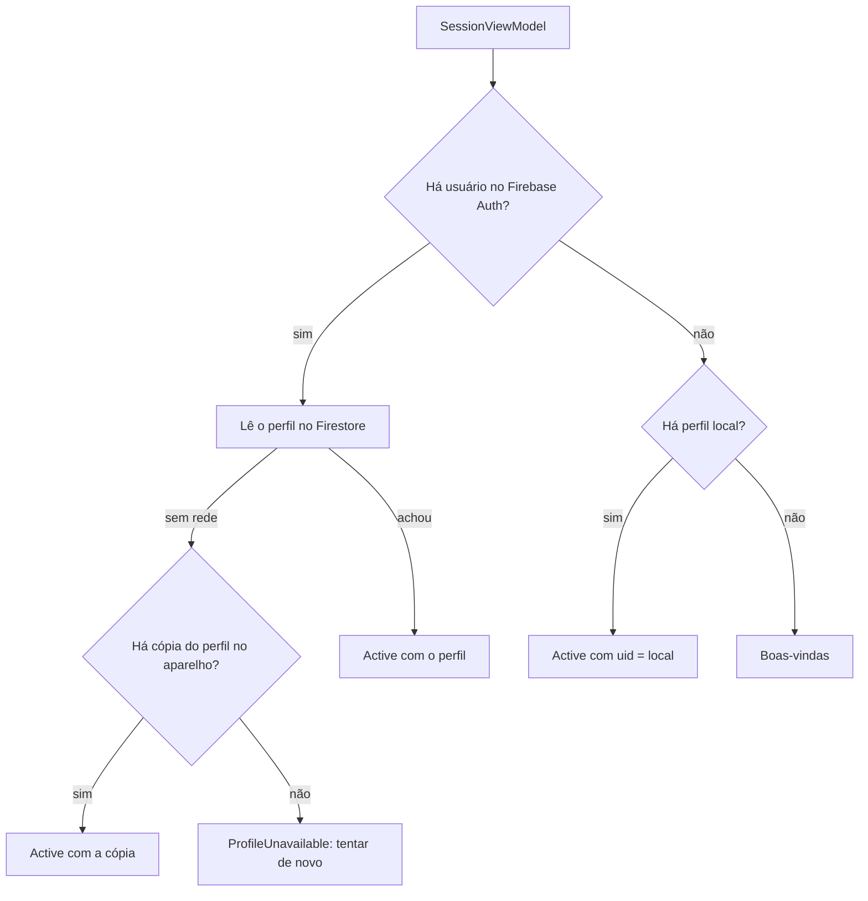
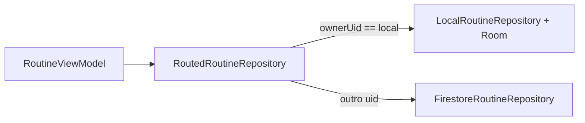
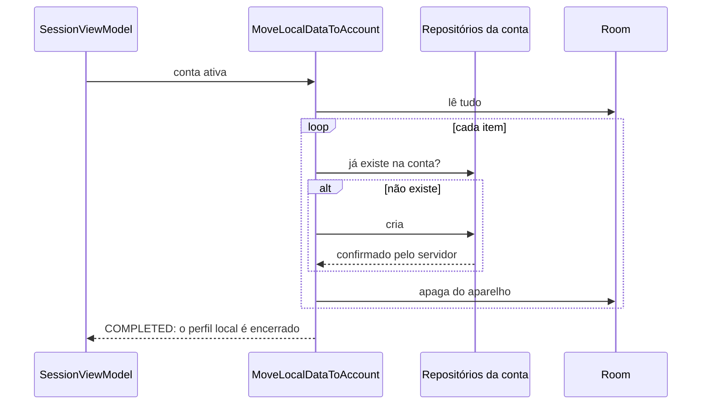

# Uso sem conta, offline e sincronização

**Situação:**
- **Uso sem conta, migração para a conta e cópia do perfil:** implementados e testados na JVM (banco real em memória).
- **Regras e funções para conta única:** implementadas e testadas no emulador. Veja em [perfis-e-permissoes.md](perfis-e-permissoes.md) o que precisa ser publicado.
- **Não foi possível verificar:** a troca real entre offline e online no celular e a migração contra o Firebase real.

## 1. O que o módulo faz e por que existe

O ORI precisa funcionar para quem não quer ou não pode criar uma conta, e para quem está sem internet. Por isso existem dois lugares para os dados:

| Quem usa | Onde os dados ficam | Offline |
|---|---|---|
| Sem conta | Banco Room no aparelho (`ori_local.db`). Nada sai dele | Sempre, é o único modo |
| Com conta | Firestore, com cache persistente de 50 MB no aparelho | Lê do cache; as escritas ficam numa fila do SDK e são enviadas quando a conexão volta |

## 2. Como a execução começa



"Continuar sem conta" só grava uma marca no DataStore. Não usa rede e não cria conta anônima no Firebase, porque isso exigiria internet na primeira abertura e colocaria dados da pessoa em um servidor sem ela ter pedido.

## 3. Como uma tela sabe onde gravar? Ela não sabe

As telas e os ViewModels recebem um `ownerUid` e continuam iguais. Quem decide é o repositório:



`LOCAL_OWNER_UID` é o texto `local`. Os ids do Firebase têm 28 caracteres, então nunca colidem. O mesmo vale para pranchas e mensagens salvas (`data/local/RoutedRepositories.kt`). Uma funcionalidade nova ganha o modo local implementando o contrato do domínio em Room e encaixando-o no roteamento.

## 4. Quando a pessoa cria uma conta

Em **Perfil → Entrar ou criar conta**. A tela avisa, antes do formulário, que os dados vão para a conta: esse aviso é o consentimento. Depois do login, `MoveLocalDataToAccount` junta os dados:



| Regra | Motivo |
|---|---|
| Cada item só sai do aparelho depois da confirmação do servidor | Se a conexão cair ou as regras recusarem, nada se perde |
| A operação pode parar a qualquer momento e recomeçar | Na próxima abertura ela continua de onde parou |
| Atividade igual (título, dia, horário) não é criada de novo; se a local estava feita, marca a da conta | A conta pode já ter dados |
| Prancha de mesmo nome é unida; só entram os símbolos que faltam | Evita "Básico" repetido |
| Pranchas lidas só do cache esperam | O cache poderia esconder pranchas da conta e criar duplicatas |
| Item além dos limites da conta (por exemplo, 30 pranchas) fica no aparelho, e o Perfil avisa | Melhor avisar do que perder |
| Uma atividade repetida que não cabe (a conta já tem 50) fica no aparelho junto com os dias marcados nela, e o resto continua indo | Os dias sozinhos apareceriam na conta como atividades soltas |
| Uma atividade repetida que a conta já recebeu numa tentativa anterior é atualizada, não criada de novo | As regras recusam uma segunda criação, porque ela mudaria quem criou e quando |

**Em caso de erro:** o Perfil mostra "vão para a conta quando a conexão voltar" com **Tentar de novo**. A tentativa também é refeita ao abrir o app.

## 5. O que nunca sai do aparelho

A contagem de uso de "Falar". A contagem guarda só um número por dia, nunca o que foi dito.

**Fotos:** sem conta ficam só no aparelho. Ao criar uma conta, as fotos de perfil e de símbolos vão para ela junto com o resto. Veja [dados.md](../dados.md#fotos).

## 6. Apagar

Sem conta, **Configurações → Privacidade → Apagar dados deste aparelho** apaga rotina, pranchas, mensagens e contagem, depois de confirmação, e volta às boas-vindas. Fotos de símbolos não são apagadas por essa ação (veja a seção 8).

## 7. Testes

```bash
cd android && ./gradlew testDevDebugUnitTest
```

| Cenário | Testes |
|---|---|
| Persistência local, ids repetidos, apagar prancha com símbolos, contagem | `LocalRepositoriesTest` |
| Migração: confirmação, pendência, recusa, duplicatas, união de pranchas, cache | `MoveLocalDataToAccountTest` |
| Sessão: sem conta, retorno, login vence, offline com e sem cópia, apagar | `SessionViewModelTest` |

## 8. Limitações

- **Conta offline:** um dia que nunca foi aberto com internet não está no cache, então aparece vazio com o aviso de dados salvos.
- **Login exige internet:** só o uso sem conta dispensa rede na primeira vez.
- **Banco local sem criptografia própria:** fica no armazenamento privado do app, protegido pelo Android.
- **Apagar dados** não remove os arquivos das fotos de símbolos.
- **Backup do Android** segue o padrão do sistema; o banco local não tem exportação própria.
