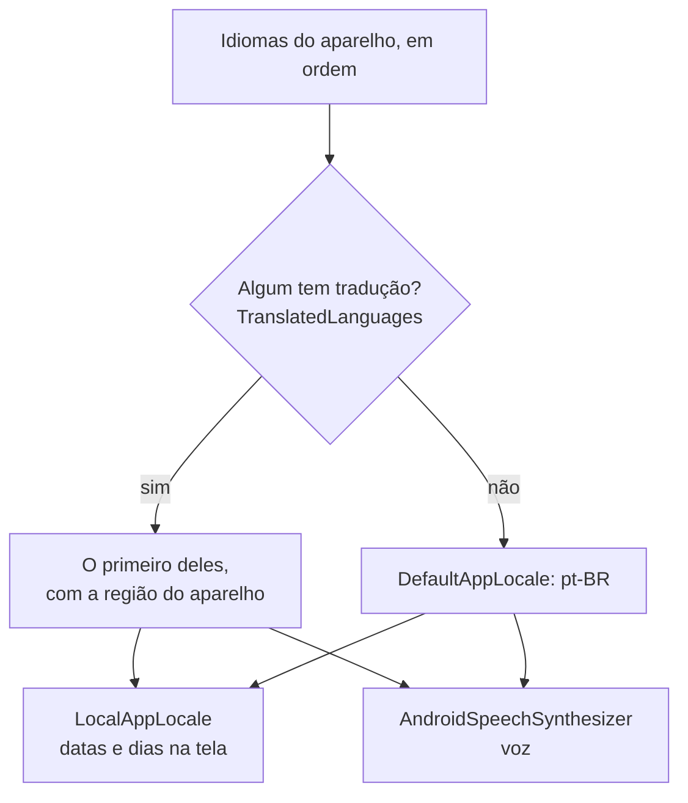

# Idiomas (07/11/2026)

## O que é e por que existe

O ori está em português do Brasil, inglês e espanhol (desde 08/11/2026). Este documento explica como o app
escolhe o idioma de cada coisa que mostra e o que fazer para traduzi-lo para outro idioma, sem deixar telas
"meio traduzidas", com os botões num idioma e as datas em outro.

## Como o idioma é escolhido

Os **textos** (`strings.xml`) são escolhidos pelo próprio Android: ele percorre os idiomas do aparelho,
em ordem, e usa a primeira pasta `values-xx` que encontrar. Se nenhuma servir, usa a pasta `values`, que
é a do português. O português também está em `values-pt`, para vencer um idioma que vem depois dele no
aparelho (veja "Português, inglês e espanhol").

As **datas, os nomes dos dias e a voz** não vêm do `strings.xml`, então o app escolhe o idioma deles
**da mesma forma** (`appLocaleFor`, em `domain/common/AppLocale.kt`). Por isso eles sempre aparecem no
idioma dos textos em volta.

- **A região do aparelho é mantida.** Num aparelho em `es-MX` com tradução para espanhol, as datas
  saem no jeito do México.
- **Idioma só do ori (Android 13 ou mais novo):** nas configurações do sistema, a pessoa pode escolher um
  idioma só para o app. A lista vem de `res/xml/locales_config.xml`. A escolha chega ao app como o primeiro
  idioma do aparelho, e tudo acima continua valendo.

## Quem participa

| Peça | Onde | Papel |
|---|---|---|
| `DefaultAppLocale`, `TranslatedLanguages`, `appLocaleFor` | `domain/common/AppLocale.kt` | O idioma padrão, os idiomas com tradução e a escolha |
| `LocalAppLocale`, `rememberDeviceAppLocale` | `ui/components/text/AppDates.kt` | O idioma das datas na tela. O `MainActivity` o fornece a partir dos idiomas do aparelho; testes e prévias recebem o padrão |
| `rememberDateFormat`, `DateSkeletons` | `ui/components/text/AppDates.kt` | Formatos de data escolhidos pelo idioma |
| `AndroidSpeechSynthesizer` | `data/aac` | Usa a voz do idioma do app, ou do idioma da prancha ou da frase, primeiro as da região do aparelho |
| `appLanguageTag`, `AacBoard.language`, `SavedMessage.language` | `domain/common`, `domain/aac` | O idioma gravado em cada prancha e frase salva |
| `grammarFor`, `PortugueseGrammar`, `EnglishGrammar`, `SpanishGrammar` | `domain/aac` | A gramática da CAA de cada idioma |
| `values`, `values-pt`, `values-en`, `values-es` | `res` | Os textos: a reserva, a cópia do português, o inglês e o espanhol |
| `locales_config.xml` | `res/xml` | Os idiomas oferecidos nas configurações do sistema |

## Datas: esqueletos, não padrões

Um padrão escrito à mão, como `"EEEE, d 'de' MMMM"`, só serve para um idioma: o "de" é português, e a ordem
dia/mês é a brasileira. Em inglês dos EUA, "07/11" é 11 de julho.

Por isso as telas pedem um **esqueleto**, que diz só os campos, e o idioma escolhe a ordem e as palavras
(`DateFormat.getBestDateTimePattern`):

| Esqueleto (`DateSkeletons`) | Português | Inglês (EUA) | Onde |
|---|---|---|---|
| `WEEKDAY_DAY_MONTH` | sábado, 7 de novembro | Saturday, November 7 | Tarefas ("Hoje, …") |
| `MONTH_YEAR` | novembro de 2026 | November 2026 | Título do calendário |
| `DAY_MONTH_NUMBERS` | 07/11 | 11/07 | Relatórios, resumo da repetição |

Os nomes dos dias (`getDisplayName`) usam `LocalAppLocale.current`.

**Mudança visível em português:** o título do calendário passou de "Novembro 2026" para "Novembro de 2026",
e o resumo da repetição, de "a partir de 4/11" para "a partir de 04/11". São as formas que o próprio
idioma usa.

## Como traduzir para um idioma novo

Por exemplo, o francês:

1. Criar `res/values-fr/` com os mesmos seis arquivos de `values-en`, traduzidos. O `AppLanguagesTest` e o
   Lint (`MissingTranslation`) falham se faltar um texto.
2. Acrescentar `fr` em `TranslatedLanguages` (`AppLocale.kt`) e em `res/xml/locales_config.xml`.
3. Criar a gramática da CAA, `FrenchGrammar.kt`, com as tabelas do idioma (`GrammarTables`), e registrá-la em
   `grammars` (`SentenceGrammar.kt`). O `SentenceGrammarTest` falha enquanto um idioma do app não tiver
   gramática. Use `EnglishGrammar.kt` e `SpanishGrammar.kt` como modelo, e escreva um `FrenchGrammarTest`.
4. Escolher as palavras da prancha sugerida (`aac_starter_*`) que a gramática conhece, e acrescentar a pasta
   e as frases esperadas em `StarterBoardLanguagesTest`.
5. Renderizar as telas a 360 dp no idioma novo (um teste com `@Config(qualifiers = "+fr-rFR")`), porque
   texto mais longo pode cortar.

Um texto novo em português vai para `values` **e** para `values-pt`, e a tradução para `values-en` e
`values-es`. A semana (L5), o idioma das pranchas (L4) e o horário (L6) já seguem o idioma.

## O que acontece em erro

- **O aparelho está num idioma sem tradução** (francês, por exemplo): os textos, as datas e a voz ficam em
  português. Com "francês, inglês", nessa ordem, o app fica em inglês.
- **Não há voz instalada no idioma do app:** a voz fica indisponível, e Falar mostra a mensagem em letras
  grandes, como antes.
- **Não há voz no idioma de uma prancha ou frase salva:** só aquela mensagem aparece em letras grandes.

## Testes

- **`AppLanguagesTest`:**
  - as pastas `values-xx`, `TranslatedLanguages` e `locales_config.xml` batem;
  - `values-pt` é igual a `values`, e cada tradução tem todos os textos e nada a mais;
  - sem tradução, tudo fica no padrão;
  - o primeiro idioma traduzido do aparelho vence e mantém a região.
- **`AppDatesTest`:**
  - a mesma data em português, inglês e espanhol;
  - uma tela usa o idioma que recebe, e o português quando não recebe nenhum.
  - Os testes falham com um padrão escrito à mão.
- **`SentenceGrammarTest`, `EnglishGrammarTest`, `SpanishGrammarTest`:** a gramática da CAA de cada idioma, e
  que todo idioma do app tem a sua.
- **`StarterBoardLanguagesTest`:** a prancha sugerida de cada idioma é pintada e monta frases certas.

## Limitações

- As traduções para inglês e espanhol não foram revisadas por quem fala esses idiomas como língua materna, nem
  o vocabulário da CAA por alguém de fonoaudiologia. O espanhol é um só para todas as regiões.
- A gramática não junta dois sujeitos ("I and he want") e não muda a ordem: "I not am" fica como foi
  tocado. No espanhol, não acerta o gênero de um adjetivo ("cansado" ou "cansada" é escolha de quem toca).
- O celular não foi conferido em inglês nem em espanhol; o tablet foi (veja "Conferido no tablet").
- A web (`web/`) continua só em português.
- A voz é escolhida quando o motor liga. Trocar o idioma com a tela de Frases aberta só muda a lista de vozes
  na próxima vez que ela abrir.

## Mudanças de 07/11/2026 (segunda rodada)

- **Gramática da CAA por idioma (L3):** `SentenceGrammar`, com `PortugueseGrammar` e `PlainGrammar`. Para um idioma
  novo, acrescente as tabelas dele em `grammarFor`; sem tabelas, as palavras saem como foram tocadas.
- **Semana (L5):** a da tela segue o idioma (`firstDayOfWeek`); a das repetições é fixa (`REPEAT_WEEK_START`).
  Veja [rotina.md](funcionalidades/rotina.md).
- **Horário (L6):** `rememberTimeFormat` escreve a hora no formato do idioma e da escolha de 12/24 horas do
  aparelho; o campo aceita AM/PM.
- **Arquivos de texto (L7):**
  - `values/strings.xml` foi separado por área: `strings_aac.xml`, `strings_routine.xml`, `strings_account.xml`,
    `strings_settings.xml`, `strings_reports.xml`, e o que é comum fica em `strings.xml`. Texto novo vai para o
    arquivo da área;
  - formatos sem palavras (`reports_percent`, `aac_voice_percent`) e o nome do app são `translatable="false"`;
  - um texto que cita um botão recebe o nome dele por parâmetro (`routine_empty_owner`, `aac_voice_unavailable`),
    então os dois mudam juntos;
  - o build de depuração liga os pseudo-idiomas: em Configurações do Android → Idiomas, escolha "English (XA)"
    (textos mais longos, entre colchetes) ou "العربية (XB)" (da direita para a esquerda) para ver texto cortado e
    texto escrito no código.
- **Web (L9):** `lang="pt-BR"` em `web/app/layout.tsx`.

## Idioma de cada prancha e frase (L4, 08/11/2026)

O conteúdo que a pessoa cria guarda o idioma em que foi criado, e não muda quando o idioma do aparelho muda:

- uma prancha nova recebe o idioma do app (`appLanguageTag`, por exemplo `pt-BR`) e fica nele;
- uma frase salva recebe o idioma da prancha em que foi montada;
- a voz, a gramática e as cores dos símbolos seguem a prancha aberta; uma frase salva é dita no idioma dela;
- o que foi criado antes não tem o campo e é tratado como português (`OLD_CONTENT_LANGUAGE`): antes de 08/11/2026
  o app só existia em português. Assim, com o app posto em inglês, uma prancha antiga continua falando português;
- **a exceção é a prancha sugerida**, que é vocabulário do app, como as frases prontas: as palavras que o app pôs
  nela, intocadas, e o nome "Básico" aparecem no idioma do app, e a prancha monta e fala nele. Veja
  [caa.md](funcionalidades/caa.md#a-prancha-sugerida-segue-o-idioma-do-app-08112026).

Assim, uma prancha em português continua em português num aparelho em inglês, e uma pessoa bilíngue pode ter
uma prancha em cada idioma: cada uma é criada com o app no idioma dela. Detalhes, regras e testes em
[caa.md](funcionalidades/caa.md#idioma-de-cada-prancha-e-frase-08112026).

## Português, inglês e espanhol (08/11/2026)

O app inteiro está nos três idiomas: as 482 entradas de texto, as datas, a voz e a CAA com a gramática de cada
um. A pessoa escolhe o idioma do aparelho ou, no Android 13+, só o do ori (Configurações do Android → Apps → ori →
Idioma).

### Onde estão os textos

| Pasta | Idioma | Observação |
|---|---|---|
| `values` | Português | A **reserva**: usada quando nenhum idioma do aparelho tem tradução (francês, alemão…). É onde se escreve um texto novo |
| `values-pt` | Português | **Cópia** de `values`, sem os textos `translatable="false"`. Existe só para o português vencer um idioma que vem depois dele no aparelho |
| `values-en` | Inglês | Inglês sem região: serve para `en-US`, `en-GB`… |
| `values-es` | Espanhol | Espanhol neutro, com "tú": serve para `es-ES`, `es-MX`, `es-419`… |

Cada pasta tem os mesmos seis arquivos (`strings.xml`, `strings_aac.xml`, `strings_routine.xml`,
`strings_account.xml`, `strings_settings.xml`, `strings_reports.xml`), com os mesmos nomes de texto e os mesmos
`%1$s`/`%1$d`. Os plurais têm `one` e `other` em inglês, e também `many` em português e espanhol (o Lint pede).

**Todos os idiomas ficam no app.** O app publicado como App Bundle não é dividido por idioma
(`bundle { language { enableSplit = false } }`, em `app/build.gradle.kts`): a prancha sugerida precisa das palavras
de todos os idiomas, não só dos do aparelho, e os três juntos são poucos kilobytes de texto.

**Por que a reserva continua em português?** O ori é brasileiro e já estava em uso assim; trocar a reserva para
inglês mudaria o app de quem tem o aparelho num idioma sem tradução. É uma decisão de produto: para trocar, basta
pôr o inglês em `values` e mudar `DefaultAppLocale`.

### Escolhas da tradução

- **Espanhol:** "tablero" para prancha (o termo da CAA em espanhol), "persona responsable" (sem gênero), "tú".
  Na prancha sugerida, o lugar de "estou" é "tengo", porque em espanhol se diz "tengo hambre / sueño / frío /
  dolor". As frases prontas também: "Tengo dolor", "Tengo frío".
- **Inglês:** "board", "caregiver", "Build"/"Ready". Na prancha sugerida: "I", "you", "am", "not", "want",
  "need", "like", "with", "water", "food", "bathroom", "help", "pain", "sleepy", "hungry", "cold", e depois
  "yes", "more", "he/she", "we", "go", "eat", "drink", "sleep", "play", "mom", "dad", "medicine", "hot",
  "scared", "happy", "sad".
- As frases prontas continuam sem gênero gramatical nos três idiomas.

### A CAA em cada idioma

A gramática é a mesma máquina (`GrammarTables` e `read`, em `SentencePiece.kt`) com as tabelas de cada idioma
(`PortugueseGrammar.kt`, `EnglishGrammar.kt`, `SpanishGrammar.kt`). Todas fazem o mesmo:

| O que faz | Português | Inglês | Espanhol |
|---|---|---|---|
| O verbo concorda com quem vem antes | "você quer" | "he wants" | "tú tienes" |
| O verbo traz a palavra que pede | "gosto **de** você", "estou **com** dor" | "want **to** go", "am **in** pain" | "tengo **que** ir", "estoy **con** dolor" |
| Não repete o que já foi tocado | "estou com dor" | "want to go" | "tengo que ir" |
| Completa o verbo que faltou | "eu **estou com** fome" | "I **am** hungry", "I **am in** pain" | "yo **tengo** hambre" |
| Junções na fala | "dele", "comigo" | — | "al", "del", "conmigo", "para ti" |
| Regras só do idioma | — | "not" com "do": "I **don't** want"; "me", "him" depois do verbo | "**a mí** me gusta **el** agua", "me gust**as** tú" |
| Cores: pessoas, ações, sentimentos | eu, quero, dor | I, want, go, pain, hungry | yo, quiero, comer, dolor, cansada |

Detalhes, tabelas e testes em [caa.md](funcionalidades/caa.md#a-frase-montada-em-cada-idioma-08112026).

### Testes do idioma

- Os testes de tela são escritos em português. O Robolectric usa `pt-rBR` (`src/test/resources/robolectric.properties`)
  e o Gradle roda os testes com `user.language=pt` e `user.country=BR` (`app/build.gradle.kts`). Sem isso, eles
  sairiam em inglês num computador ou num CI em inglês, agora que há `values-en`.
- Um teste de outro idioma escolhe o dele: `@Config(qualifiers = "+es-rES")` numa tela, ou a gramática direto.

### Conferido em imagem

Renderizadas em 360 dp com Robolectric, em inglês e em espanhol: Montar (prancha sugerida, cores e a frase "I am in
pain" / "yo tengo dolor"), Prontas, Montar sem pranchas, Início e Tarefas. Nada cortado. Apareceu um problema, já
corrigido: a coluna de horário da linha do tempo tinha 52 dp fixos e quebrava "8:00 AM" em duas linhas; agora ela
mede o horário mais largo do formato em uso (`rememberTimeColumnWidth`, em `RoutineTimeline.kt`) e continua com
52 dp em português e espanhol.

### Conferido no tablet

No SM-X610 (build `prodProfiling`, sem conta), em 08/11/2026, com o idioma só do ori posto em inglês e depois em
espanhol (`adb shell cmd locale set-app-locales com.oriteam.ori --locales en-US`) e, no fim, de volta ao do
aparelho:

- **Inglês:** Home, Routine (semana começando no domingo, "November 2026"), Phrases (frases prontas), Build e
  Communication preferences. "Hear a sample" tocou a voz `en-US` do aparelho.
- **Espanhol:** Inicio, Rutina (semana começando na segunda, "Noviembre de 2026"), Frases, Formar e Preferencias
  de comunicación, com "Ver las 9 voces del dispositivo". "Escuchar ejemplo" tocou a voz `es-ES`.
- **A prancha "Básico" do tablet, de antes:** nos dois idiomas, continuou com as cores do português e montou "eu
  estou com dor". Antes da correção do mesmo dia (`OLD_CONTENT_LANGUAGE`), ela seguiria o idioma do app: sem cores,
  "eu estou dor" e uma voz em inglês. A frase foi apagada depois; nada foi criado nem salvo.
- Nenhum erro no registro do sistema.
- **Depois disso**, no mesmo dia, entraram a prancha sugerida no idioma do app e o verbo que faltava ("I hungry" →
  "I am hungry"). Foram conferidos em imagem a 360 dp, com a prancha "Básico" criada em português e o vocabulário lido
  dos textos de verdade: "I am hungry", "I am not in pain", "yo tengo hambre" e "tú no necesitas el baño". E no
  tablet, com a prancha "Básico" do aparelho, criada em português:
  - **em inglês**, ela apareceu inteira em inglês, com as cores, e montou "I am hungry", "I am in pain", "I am not
    hungry", "you are cold" e "I need the bathroom"; "I water" ficou como foi tocado. "Speak" leu com a voz `en-US`;
  - **em espanhol**, inteira em espanhol, montou "yo tengo hambre", "yo tengo dolor", "yo no tengo frío", "tú tienes
    sueño", "yo necesito el baño", "a mí me gusta el agua", "a mí me gustas tú" e "tú quieres comida"; "yo agua"
    ficou como foi tocado. "Hablar" leu com a voz `es-ES`;
  - **de volta ao português**, a prancha voltou a "eu", "estou", "dor" e montou "eu estou com fome", "eu não estou
    com dor" e "você está com sono".
  - As frases foram apagadas depois e nada foi salvo. Os dois toques em "Speak"/"Hablar" somaram 2 na contagem de
    comunicação do dia no tablet.

## Tipo de palavra escolhido e tabelas maiores (09/11/2026)

As tabelas de inglês e espanhol cresceram (verbos, pessoas, sentimentos, ações, artigos). Para uma palavra que nenhuma
tabela conhece, a pessoa escolhe o tipo no formulário do símbolo, e as três gramáticas seguem a escolha
(`SentenceGrammar.compose(words, classes)`). Veja [caa.md](funcionalidades/caa.md#pedidos-de-09112026-emoji-das-frases-arrastar-cor-e-tipo-de-palavra).
